# Visión de producto

---

## 1. El problema

Una agencia de turismo con cinco a cincuenta empleados opera hoy así:

- **WhatsApp personal en varios celulares.** Cada asesor con su número. El historial del cliente
  vive en el teléfono de quien lo atendió.
- **Excel para cotizar.** Cada asesor con su plantilla, con sus fórmulas, con sus errores.
- **Correo para confirmar**, y a veces ni eso.
- **La memoria del asesor para hacer seguimiento.** El que se acuerda, vende.

Las consecuencias son siempre las mismas y el dueño las conoce de sobra:

| Síntoma | Qué está pasando debajo |
|---|---|
| "No sé cuántas consultas entraron este mes" | No hay registro: lo que no se mide no se gestiona |
| "Se me cayó una venta porque nadie respondió" | Sin bandeja compartida ni SLA, los mensajes se pierden en un celular apagado |
| "Cotizar me toma dos horas" | Trabajo artesanal que un sistema haría en cinco minutos |
| "Cuando se fue Juan, se llevó sus clientes" | El activo más valioso del negocio vive en un teléfono ajeno |
| "No sé cuánto gané en ese viaje" | Sin costo neto contra venta por archivo, el margen es una creencia |
| "Mis clientes compran una vez y no vuelven" | Sin base de datos de viajeros no hay recompra, y la recompra es la venta más barata que existe |

### Por qué las herramientas actuales no resuelven esto

**Los CRM genéricos** (HubSpot, Pipedrive, Zoho, Salesforce) no entienden el dominio. No saben qué
es un pasajero, una tarifa neta, un *time limit*, un itinerario multi-destino ni un archivo de
viaje. La agencia termina doblando el CRM para que parezca un negocio de turismo, o abandonándolo
al tercer mes. Y su integración con WhatsApp, cuando existe, es un añadido.

**Las herramientas de WhatsApp multi-agente** (Callbell, Chatwoot, Kommo) resuelven bien la bandeja
compartida, pero ahí se acaban. No cotizan, no reservan, no calculan margen, no saben que el viaje
empieza en tres semanas.

**Los sistemas de gestión turística** (back office de agencias) sí entienden el negocio, pero nacieron
antes de que WhatsApp fuera el canal de venta. Son pesados, caros, y la venta ocurre fuera de ellos.

**El hueco está en el medio:** donde ocurre la venta —WhatsApp— y donde ocurre el negocio —el
archivo de viaje— no hay nada que los una.

---

## 2. La solución

Un CRM que nace dentro de WhatsApp y habla el idioma del turismo.

```mermaid
flowchart LR
    V["Viajero<br/>escribe por WhatsApp"] --> I["Inbox compartido<br/>un número para todo el equipo"]
    I --> IA["IA extrae la intención:<br/>destino · fechas · pax · presupuesto"]
    IA --> O["Oportunidad en el pipeline<br/>sin teclear nada"]
    O --> C["Cotización multi-opción<br/>con tarifas netas y markup"]
    C --> P["Propuesta PDF<br/>enviada por WhatsApp"]
    P --> R["Archivo de viaje<br/>reserva · pasajeros · documentos"]
    R --> PA["Pagos<br/>anticipo y cuotas"]
    PA --> PV["Post-venta<br/>durante y después del viaje"]
    PV --> RC["Recompra"]
    RC --> I
```

El ciclo se cierra: el viajero que volvió de Cartagena es el lead más barato que la agencia tendrá
el año que viene, y el sistema lo sabe.

### Las cinco capacidades

**1. Inbox omnicanal.** Un número oficial de WhatsApp para toda la agencia. Asignación de
conversaciones, notas internas, SLA de primera respuesta, historial unificado por viajero sin
importar quién lo atendió.

**2. Pipeline comercial.** Embudo con las etapas reales del sector, no las de un CRM de software.
Cada oportunidad conectada a su conversación, su cotización y su archivo.

**3. Cotizador.** Propuestas multi-opción con vuelos, hoteles, traslados y tours. Tarifas netas del
proveedor, markup o comisión según el producto, impuestos, multi-moneda con TRM congelada.
PDF con la marca de la agencia, enviado por WhatsApp en un clic.

**4. Reservas, pagos y post-venta.** El archivo de viaje con sus pasajeros, documentos, proveedores
y *time limits*. Cobro de anticipo y cuotas. Seguimiento antes, durante y después del viaje.

**5. Automatización e IA.** Calificación de leads, extracción de intención desde el chat,
respuestas sugeridas, seguimientos que se disparan solos, reportes de conversión y margen.

---

## 3. Qué nos hace distintos

| | CRM genérico | Herramienta de WhatsApp | Back office turístico | **ViajaPro** |
|---|---|---|---|---|
| WhatsApp como canal nativo | Añadido | **Sí** | No | **Sí** |
| Entiende pasajeros, tarifas netas, itinerarios | No | No | **Sí** | **Sí** |
| Cotiza y emite propuesta | No | No | **Sí** | **Sí** |
| Margen real por archivo | No | No | **Sí** | **Sí** |
| Usable por un asesor desde el celular | Parcial | **Sí** | No | **Sí** |
| Precio accesible para una agencia de 5 personas | No | **Sí** | No | **Sí** |

La defensa no es ninguna de esas casillas por separado: es **la combinación**. Un competidor
generalista tendría que aprender turismo; uno de turismo tendría que reconstruirse alrededor de
WhatsApp. Ambos caminos son caros y lentos.

Y hay una defensa que crece sola: **los datos acumulados**. Cada cotización enviada, cada
conversación, cada archivo cerrado entrena mejores sugerencias para esa agencia. Al año, migrar a
otro sistema significa perder el historial que hace que el sistema sea útil.

---

## 4. Por qué ahora

1. **WhatsApp Cloud API maduró.** Desde que Meta la abrió, una empresa pequeña puede construir
   sobre el canal sin ser un operador de telecomunicaciones.
2. **El turismo en Latinoamérica se vende por WhatsApp.** No es un canal más: para la mayoría de
   las agencias de la región, es *el* canal.
3. **La IA hace viable lo que antes no lo era.** Convertir "somos 4 para Cartagena en diciembre,
   2 niños, algo económico" en una oportunidad estructurada era imposible hace tres años.
4. **La digitalización post-pandemia del sector sigue incompleta.** Las agencias que sobrevivieron
   entendieron que necesitan sistemas; la mayoría todavía no los tiene.

---

## 5. Para quién, y para quién no

**Sí:**
- Agencias minoristas de 3 a 50 empleados, con volumen de WhatsApp real.
- Agencias en crecimiento que ya sienten el dolor de operar con Excel.
- Operadores de turismo receptivo que venden directo al viajero.

**Todavía no:**
- Agencias de un solo asesor sin volumen: el dolor no justifica el cambio.
- Grandes cadenas con back office consolidado: el costo de migración es prohibitivo y la venta es
  larga. Más adelante, por integración, no por reemplazo.
- Turismo corporativo puro: tiene necesidades distintas (políticas de viaje, autorizaciones,
  conciliación con el ERP del cliente) que no están en el alcance de v1.

---

## 6. Principios de producto

1. **El asesor primero.** Si una acción toma más de tres clics, no se usará. El sistema se adapta a
   cómo trabaja la gente, no al revés.
2. **WhatsApp es el centro, no una integración.** Todo lo demás orbita la conversación.
3. **El margen es la métrica.** Un CRM que no le dice al dueño cuánto ganó por archivo no está
   terminado.
4. **La IA sugiere, la persona decide.** En v1, ninguna salida de IA llega al cliente final sin que
   un asesor la haya visto. La automatización completa se gana con datos, no con optimismo.
5. **Multi-tenant desde el primer día.** Construir para una agencia y "multi-tenantizar después" es
   reescribir el sistema.
6. **Honestidad sobre lo que no hacemos.** Es mejor no tener contabilidad que tener una mala.

---

## 7. Cómo se ve el éxito

**A 12 meses:** 50 agencias pagando, retención mensual por encima del 95%, y al menos una agencia
que diga sin que se lo preguntemos que no podría volver a operar sin el sistema.

**A 36 meses:** referencia en el mercado hispanohablante, con integraciones de proveedores que
hagan del cotizador algo que un competidor no pueda replicar en un trimestre.

La métrica que de verdad importa, desde el primer cliente: **cuánto aumentó la tasa de conversión
de la agencia** desde que usa ViajaPro. Si no sube, nada de lo demás importa.
