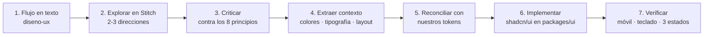

# Diseño y experiencia de usuario

> ViajaPro es una herramienta de trabajo que alguien usa ocho horas al día. El criterio de diseño
> no es que impresione en una captura: es que **un asesor venda más y se canse menos**.

---

## 1. El usuario y su día

| Hecho sobre el asesor | Consecuencia de diseño |
|---|---|
| 6 a 15 conversaciones abiertas a la vez | Cambiar de conversación debe costar menos de 100 ms y un clic |
| Trabaja desde el celular buena parte del tiempo | Diseño móvil real, no "responsive al final" |
| Pierde la venta si tarda 20 minutos en responder | La respuesta debe estar a tres clics desde cualquier punto |
| No va a leer documentación | Si no es evidente en la pantalla, no existe |
| Su jefe quiere números a fin de mes | Los reportes son para otro usuario, con otra pantalla y otro ritmo |

---

## 2. Los ocho principios

1. **La conversación es el centro.** Oportunidad, cotización y archivo orbitan el chat y se alcanzan
   sin salir de él. Si para cotizar hay que abandonar la conversación, el diseño falló.
2. **Tres clics como máximo** para toda acción frecuente. Se cuentan, no se estiman.
3. **El estado que cuesta dinero, siempre visible.** Ventana de 24 horas por cerrarse, *time limit*
   que vence, pago pendiente, SLA de respuesta vencido. Nada de eso vive en un submenú.
4. **Optimista en mensajería.** El mensaje aparece enviado antes de la confirmación, con su estado
   (reloj → ✓ → ✓✓ → leído) y un camino claro cuando falla.
5. **Densidad sobre aire.** Más filas visibles es más trabajo hecho. El aire agrupa, no decora.
6. **Teclado en la bandeja.** Un asesor experto debe poder trabajar sin tocar el mouse.
7. **Tres estados en toda vista:** vacío, cargando, error. Esqueleto, no spinner. Un error dice
   qué pasó y qué hacer.
8. **Accesibilidad como requisito, no como mejora.** Foco visible, navegación por teclado,
   contraste AA. Una herramienta de trabajo inaccesible es una que alguien no puede usar.

---

## 3. Las pantallas y su jerarquía

### Bandeja (la pantalla principal — aquí vive el asesor)

```
┌──────────────┬────────────────────────────────┬──────────────────┐
│ Conversación │  Hilo del chat                 │  Panel del       │
│ es           │                                │  viajero         │
│              │  ─────────────────────────     │                  │
│ ▸ Filtros    │  Mensajes, media, plantillas   │  Datos           │
│ ▸ Sin leer   │                                │  Oportunidad     │
│ ▸ Mías       │                                │  Cotizaciones    │
│ ▸ Vence SLA  │                                │  Archivos        │
│              │  ─────────────────────────     │  Notas internas  │
│ [lista]      │  [redactar · ventana 24h]      │  [acciones]      │
└──────────────┴────────────────────────────────┴──────────────────┘
```

**Qué debe lograrse sin salir de aquí:** responder, adjuntar, enviar una plantilla, crear la
oportunidad, abrir el cotizador, enviar la propuesta, registrar una nota, asignar a otro asesor.

En móvil, las tres columnas se vuelven tres vistas con navegación entre ellas; el hilo es la
vista por defecto al abrir una conversación.

### Pipeline

Tablero por etapas con arrastre, y vista de tabla para quien prefiera densidad. Cada tarjeta
muestra lo que decide una acción: viajero, destino, valor estimado, días sin contacto, próxima
tarea. **No más.** Una tarjeta con doce campos no se lee.

### Cotizador

La pantalla más compleja del producto y donde más se gana o se pierde. Objetivo declarado:
**de conversación a propuesta enviada en menos de cinco minutos.**

Estructura: encabezado con viajero y pasajeros (ADT/CHD/INF) → ítems por tipo de producto
→ costos netos, markup y venta visibles en la misma fila → totales por opción → vista previa del
PDF → enviar por WhatsApp. El margen debe estar visible en todo momento, no calculado al final.

### Archivo de viaje

Expediente completo: pasajeros, documentos, proveedores, *time limits*, pagos, itinerario, bitácora.
Es la pantalla de consulta, no de captura: se optimiza para encontrar rápido, no para teclear.

### Reportes

Otro usuario (el dueño), otro ritmo. Pocas métricas, bien elegidas, comparables contra el período
anterior. Ver `docs/01-producto/05-metricas.md`.

---

## 4. Sistema de diseño

**Base:** Tailwind + shadcn/ui, en `packages/ui`. Nada de librerías de componentes adicionales.

**Tokens** (definidos una vez, en `packages/ui/src/tokens.css`):

| Grupo | Criterio |
|---|---|
| Color | Paleta neutra dominante, un acento de marca, y colores semánticos con significado fijo: éxito, advertencia, error, información |
| Estado de conversación | Significado consistente en toda la aplicación: sin leer, asignada, ventana cerrada, SLA vencido |
| Tipografía | Una familia, escala de 6 pasos. Tabular para cifras: los montos deben alinearse |
| Espaciado | Escala de 4 px. Densidad alta en listas, media en formularios |
| Radio y sombra | Mínimos. Una herramienta de trabajo no necesita profundidad decorativa |

**Tema claro y oscuro desde el primer día.** El asesor que trabaja de noche existe, y reconvertir
una paleta después es más caro que definirla bien ahora.

**Marca blanca:** el color de acento y el logo son del tenant. El sistema de tokens debe permitir
que una agencia vea su propia marca en el PDF de la propuesta y, en planes superiores, en la
interfaz. Diseñar esto desde el inicio cuesta poco; agregarlo después toca todos los componentes.

---

## 5. El flujo de trabajo de diseño



**El paso 1 no se salta.** Un prompt a una herramienta de IA sin el flujo pensado produce pantallas
bonitas que no resuelven el trabajo del asesor. El valor de Stitch está en explorar rápido una
dirección ya definida, no en decidirla.

**El paso 5 es innegociable:** los tokens del sistema mandan sobre lo que devuelva cualquier
herramienta. Si Stitch propone un azul distinto, gana el nuestro.

**El código generado por Stitch no se copia al repositorio.** Se usa como referencia visual. Nuestro
código vive en `packages/ui` con la accesibilidad y la consistencia ya resueltas; pegar HTML
generado las rompe en silencio.

---

## 6. Verificación antes de dar por lista una pantalla

- [ ] La acción principal es la más prominente.
- [ ] Clics hasta responder un mensaje: contados y ≤ 3.
- [ ] Funciona a 375 px de ancho.
- [ ] Navegable por teclado, con foco visible.
- [ ] Contraste AA verificado, en tema claro y oscuro.
- [ ] Los tres estados implementados: vacío, cargando, error.
- [ ] Probada con volumen real: 500 conversaciones, nombres largos, cero resultados.
- [ ] El estado que cuesta dinero está visible sin abrir nada.
- [ ] Un asesor nuevo entiende qué hacer sin que nadie le explique.
