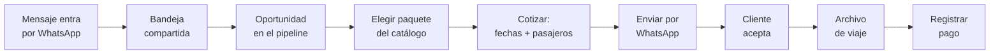

# Cabeza de playa: la agencia que vende paquetes

> **Decisión de alcance.** El primer producto no sirve a «agencias de turismo» en general:
> sirve a **la agencia minorista que revende paquetes armados**. Es el caso más común en Colombia
> y el que menos código exige.
>
> Esto **no recorta la visión** — el [norte](../00-vision/05-norte-del-producto.md) sigue intacto.
> Recorta por dónde se empieza.

---

## 1. Quién es exactamente

Una agencia de 3 a 15 personas que **revende producto de mayorista**: paquetes a San Andrés,
Cartagena, Cancún, Punta Cana, Europa. No arma viajes desde cero tramo a tramo; escoge de un
tarifario, aplica su margen y vende.

Su día: llegan consultas por WhatsApp, el asesor manda opciones de paquete, el cliente pregunta,
el asesor ajusta, el cliente decide, se reserva con el mayorista, se cobra, se viaja.

**Por qué esta y no otra.** Es el segmento más numeroso, el que más sufre el problema, y el que
exige menos producto para ser útil. Una agencia que arma itinerarios a medida necesita el cotizador
completo; una que revende paquetes necesita mucho menos para operar igual de bien.

## 2. Qué simplifica, y cuánto

El cotizador general —multi-opción, multi-ítem, itinerario por segmentos, markup por línea— es la
fase más cara del [roadmap](../08-roadmap/01-roadmap.md): de ocho a diez semanas.

Un paquete es otra cosa:

```
Paquete      =  destino · duración · qué incluye · precio por tipo de pasajero · temporada
Cotizar      =  elegir paquete + fechas + composición de pasajeros  →  precio
```

| Cotizador general | Cotizador de paquetes |
|---|---|
| Ítems sueltos: vuelo + hotel + traslado + tour | **Un paquete ya armado** |
| Markup por línea, por proveedor | Costo neto y venta del paquete |
| Itinerario construido segmento a segmento | Lo que incluye, como lista |
| Tarifas netas de N proveedores | Tarifario del mayorista |
| Multi-moneda con TRM por ítem | Una moneda en v1 |

No desaparece nada del modelo: `Quote`, `QuoteOption` y `QuoteItem` siguen existiendo. **Un paquete
es simplemente una cotización con un único ítem de tipo `PACKAGE`.** Cuando llegue el momento de
armar a medida, se añaden ítems — el esquema ya lo soporta y no hay que migrar nada.

## 3. La rebanada vertical

En vez de construir el inbox completo, luego el CRM completo, luego el cotizador completo, se
construye **el recorrido entero del negocio, estrecho**:



Estrecha, pero **completa**. Una agencia puede usarla de verdad en semanas, y lo que falte lo dirá
ella — que es información mucho mejor que nuestras suposiciones.

### Qué entra en la primera rebanada

| Área | Alcance mínimo viable |
|---|---|
| **WhatsApp** | Recibir y enviar texto y media. Plantillas básicas. Ventana de 24h visible |
| **Bandeja** | Lista de conversaciones, asignación, notas internas, búsqueda |
| **Contactos** | Ficha del contacto, historial unificado |
| **Pipeline** | Etapas configurables, oportunidad ligada a su conversación |
| **Catálogo** | Paquetes con destino, duración, inclusiones, temporadas, precio por tipo de pasajero |
| **Cotización** | Paquete + fechas + pasajeros → precio. PDF con la marca. Envío por WhatsApp |
| **Archivo de viaje** | Se crea al aceptar. Pasajeros, estado, *time limit* |
| **Pagos** | Registro manual de pago (anticipo y saldo). Sin pasarela todavía |

### Qué NO entra, y cuándo llega

| Fuera de la primera rebanada | Cuándo |
|---|---|
| Cotización armada pieza por pieza | Rebanada 2 |
| Itinerario multi-destino con segmentos | Rebanada 2 |
| Multi-moneda y TRM | Rebanada 2 |
| Pasarela de pagos y plan de cuotas | Rebanada 3 |
| Embedded Signup multi-tenant | Cuando Meta verifique el negocio |
| IA: extracción de intención, respuestas sugeridas | Rebanada 4 |
| Campañas, Instagram, portal del cliente | Después |

## 4. Entorno de desarrollo: número de prueba de Meta

**Para construir todo esto no hace falta empresa verificada.** Meta entrega un número de prueba
gratuito al crear una app de desarrollador.

| Con número de prueba | Necesita verificación del negocio |
|---|---|
| Enviar y recibir mensajes reales | **Embedded Signup** (que cada agencia conecte su número) |
| Webhooks, firma HMAC, idempotencia, estados | Enviar a destinatarios arbitrarios |
| Plantillas, ventana de 24h, media, interactivos | Volumen de producción |
| **Toda la rebanada vertical de arriba** | Cobrar a clientes reales |

El número de prueba envía a **hasta cinco destinatarios** que se registran a mano. Suficiente para
desarrollar y para que la agencia piloto pruebe con sus propios teléfonos.

**Consecuencia para el plan:** la verificación de Meta **no bloquea construir**. Bloquea *lanzar*.
Se arranca el trámite en paralelo, porque tarda semanas, y mientras tanto se construye.

El alta multi-tenant (Embedded Signup) se construye igual, detrás del puerto `MessagingProvider`,
con el intercambio de token simulado hasta que llegue la aprobación.

## 5. Qué hay que preguntarle a la agencia piloto

Lo que decide el modelo de datos del catálogo y no se puede adivinar:

1. ¿Con qué mayoristas trabaja y cómo recibe los tarifarios? ¿Excel, PDF, portal web?
2. ¿Cómo se define el precio de un paquete: por persona, por habitación, por acomodación?
3. ¿Qué cambia entre temporada alta, baja y puentes festivos?
4. ¿El precio incluye impuestos y tasas, o se suman aparte?
5. ¿Cobra markup sobre el neto, o recibe comisión del mayorista? ¿Ambos según el producto?
6. ¿Cuánto tiempo tiene para pagar al mayorista antes de perder el cupo? (*time limit* real)
7. ¿Qué pasa con niños e infantes: tarifa distinta, edad de corte, cuántos por habitación?

**Sin estas respuestas, el catálogo se modela a ciegas**, y el catálogo es el corazón de esta
rebanada.

## 6. Qué no cambia

- Toda la arquitectura: [ADR-0001](../03-adr/0001-stack-tecnologico.md) a
  [ADR-0006](../03-adr/0006-parametrizacion-y-extensibilidad.md) siguen vigentes.
- El aislamiento entre tenants, desde la primera migración.
- El versionado de cotizaciones, los *time limits*, los campos personalizados y las etapas por
  tenant. Siguen siendo **lo que no admite hacerse después**.
- El lenguaje ubicuo.
- El gobierno de la integración.

**Esto es una decisión de por dónde empezar, no de qué construir.**
