# Diagnóstico de pantallas — qué rediseñar y en qué orden

> **Qué es esto.** No es un rediseño ni una propuesta visual: es la lista de lo que está mal, mirado
> con la pantalla delante, y el orden en que conviene arreglarlo. Nace de una pregunta del
> propietario —«¿qué ha cambiado en el diseño? Veo todo igual»— y de su corrección posterior:
> **«importante mejorar mucho la navegabilidad»**. Por eso el documento empieza por ahí.
>
> **Fecha:** 2026-11-22. **Tarea:** T-618. **Autor:** agente `diseno-ux`.
> **Caduca:** cada captura es de un `main` concreto (`2aa3fdb3`). Si una pantalla cambia, su
> párrafo deja de valer.

---

## 0. Cómo se hizo, y qué NO se pudo verificar

Todo lo que sigue se midió sobre la **web compilada** (`next build` + `next start`, nunca `next dev`)
en **modo demostración**, con Playwright y Chromium:

- **Dos anchos:** 1440×900 (el portátil del dueño) y 390×844 (el teléfono del asesor), con
  `deviceScaleFactor: 1`.
- **Dos temas:** claro y oscuro.
- **52 capturas** de 13 rutas, más la pantalla de ingreso (que exige una compilación aparte, con
  `NEXT_PUBLIC_USE_REAL_AUTH=true`), la hoja «Más», la paleta de comandos y las fichas de detalle.
  Las citadas están en [`capturas-diagnostico/`](capturas-diagnostico/).
- **Recorridos reales**, no lectura de JSX: se hicieron clics, se volvió con el botón atrás del
  navegador, se recargó una conversación, se abrió la paleta y se buscaron siete términos. Donde el
  texto dice «medido», hay un número salido del DOM o del navegador.

**Lo que NO se pudo verificar, y hay que decirlo:**

| No verificado | Por qué |
|---|---|
| El comportamiento con **datos reales de una agencia** | La demostración carga unas tres decenas de conversaciones por página y 9 archivos de viaje. No se probó con 500 conversaciones ni con nombres reales largos más allá de los dos casos sintéticos que ya trae la demostración |
| La bandeja **contra la API real** y con WhatsApp vivo | No entró un mensaje real; los estados de envío (reloj → ✓ → ✓✓) **no son observables**: la demostración no tiene ni un solo mensaje saliente en el hilo |
| **Lectores de pantalla** | Se comprobó la semántica en el DOM (`aria-current`, `aria-label`, `<nav>`, `<table>`), no el resultado audible |
| El **arrastre del Kanban** y el teclado `j/k` de la bandeja | No se automatizó el gesto ni la sesión de teclado completa |
| Las pantallas de **impresión / PDF** y el portal del viajero | Fuera del alcance de esta pasada |
| Cualquier cosa **desplegada en staging** | Esto se midió en local, sobre `origin/main` |

---

## 1. Navegabilidad — el eje

> Resumen en una frase: **el producto ya sabe enlazar sus cosas entre sí, pero solo lo hace desde
> dos pantallas de cuatro, tiene dos enlaces rotos que parecen funcionar, y en el teléfono esconde
> siete de once módulos detrás de un toque extra y uno detrás de ninguno.**

Marco de referencia: [ADR-0032](../03-adr/0032-layout-compartido-y-tabla-unica-de-navegacion.md)
(marco común `(app)` + tabla única en `apps/web/src/lib/navegacion.ts`). **La crítica va dentro de
esa decisión**: la tabla única es buena y hay que apoyarse en ella, no superarla. Casi todo lo que
sigue son sitios donde el código **todavía no la obedece**.

### 1.1 Moverse entre pantallas

**Lo que hay (medido).** La tabla declara **11 módulos** y **1 acción** (`Cotizar`). El menú lateral
pinta 10 en escritorio; la barra inferior del móvil pinta 5 sitios: `Hoy · Conversaciones · Cotizar ·
Archivos · Más`.

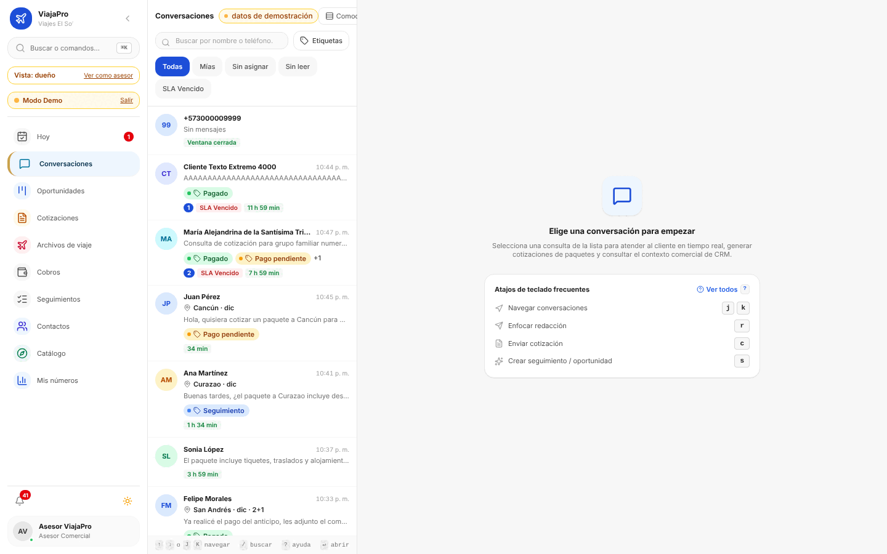

**N1. Configuración no se puede alcanzar desde la interfaz. (medido)**
En el modo demostración —el que ve una agencia en una demo— `/configuracion` **no está en el menú
lateral, no está en la hoja «Más», y la paleta devuelve 0 resultados** para «config» y para
«equipo». Solo se llega escribiendo la URL. El dueño de una agencia que pregunte «¿dónde conecto mi
WhatsApp, dónde doy de alta a mi asesora, dónde pongo mi NIT?» no tiene respuesta en la pantalla.
Es el agujero de navegación más grande del producto y, además, el que más duele en una demo.
*(El filtro por permiso oculta la entrada cuando no hay sesión; ocultar no es autorizar —y aquí
oculta de más.)*

**N2. En el teléfono, 7 de 11 módulos están a dos toques, siempre. (medido)**
La barra lleva `Hoy`, `Conversaciones`, `Archivos` y la acción `Cotizar`. Todo lo demás
—Oportunidades, Cotizaciones, **Cobros**, Seguimientos, Contactos, Catálogo, Reportes— vive en la
hoja «Más»: un toque para abrirla, otro para elegir. La hoja en sí está bien hecha (diálogo, dos
columnas, cierra con `Escape`), pero **Cobros —el dinero— está al mismo nivel que Catálogo**.

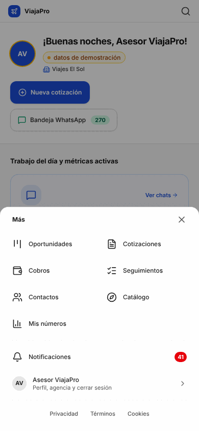

**N3. Los seis grupos no existen para el asesor; solo ensucian la paleta. (medido)**
`grupo: 'hoy' | 'atender' | 'vender' | 'operar' | 'clientes' | 'agencia'` está en la tabla, pero el
menú lateral es **una lista plana sin encabezados** y la hoja «Más» también. Donde sí asoman es en
la paleta, como subtítulo del módulo: «Cobros — Operar», «Seguimientos — Atender» y, en el peor
caso, **«Hoy — Hoy»**. O sea: hoy los grupos no ayudan a nadie a encontrar nada y producen una
tautología visible. Son **nuestra taxonomía**, no la del asesor; y además `clientes` no agrupa nada
(solo Contactos) y `hoy` tampoco.
*Decisión que hay que tomar: o se pintan como encabezados en el menú (y entonces hay que renombrarlos
en el idioma del asesor: «Atender hoy», «Vender», «Operar el viaje», «La agencia») o se quitan del
tipo. Lo que no tiene sentido es mantenerlos solo para que la paleta diga «Hoy — Hoy».*

**N4. Divergencia con el ADR que conviene resolver por escrito, no por código.**
ADR-0032 §4 dice que la barra móvil lleva «las 3 entradas con `movil: 'barra'` **más “Buscar” y
“Más”**». El código lleva las 3 entradas **más la acción `Cotizar`** y «Más»; «Buscar» quedó en la
lupa de la cabecera superior. La implementación es defendible (cotizar es el trabajo; buscar
siempre está arriba), pero **el ADR dice otra cosa** y los ADR no se editan: o se escribe el ADR que
lo supersede, o se cambia el código. Hoy el documento miente.

### 1.2 Moverse entre COSAS — el recuento de toques

Esta es la parte importante. La cadena real del asesor:

> mensaje → contacto → oportunidad → cotización → archivo de viaje → cobro

**Lo bueno, y hay que decirlo primero: el patrón correcto ya existe y está bien hecho.** El archivo
de viaje abre con una fila de tres enlaces —**«Abrir conversación» · «Contacto: Felipe Morales» ·
«Cotización v2»**— y la cotización hace lo mismo. Eso es exactamente la ventaja del producto hecha
visible. El problema es que solo lo hacen **dos pantallas de seis**.

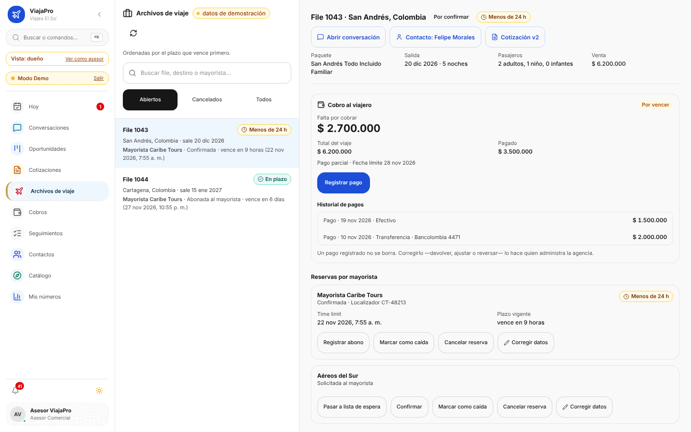

#### Recuento (escritorio 1440, modo demostración, medido con clics reales)

| Desde → hasta | Toques | Cómo | Veredicto |
|---|---|---|---|
| Bandeja → conversación | **1** | Fila de la lista, con URL propia | ✅ |
| Conversación → **su** cotización | **1** | «Ver cotización» en el panel del viajero | ✅ |
| Conversación → cotizador con el contexto | **1** | «Cotizar» (lleva contacto, oportunidad, destino, fecha, 2+2 en la URL) | ✅ |
| Cotización → su conversación | **1** | «Abrir conversación» | ✅ |
| Cotización → su contacto | **1** | «Contacto: Juan Pérez» | ✅ |
| Archivo de viaje → conversación / contacto / cotización | **1** cada uno | Fila de enlaces de la cabecera | ✅ |
| Cobros → el archivo de viaje | **1** | La fila entera es enlace a `/viajes?id=…` | ✅ |
| Contacto (ficha) → conversación / cotización | **1** cada uno | «Abrir conversación», «Ver detalle» | ✅ |
| **Oportunidad → su conversación** | **1 toque + buscar a ojo** | El enlace dice «Abrir conversación de WhatsApp con Juan Pérez» y apunta a `/bandeja`, **no** a `/bandeja/<id>`. Las **9** tarjetas apuntan a la lista | ❌ **roto** |
| **Contactos (lista) → su conversación** | **1 toque + buscar a ojo** | El icono de chat de cada fila también apunta a `/bandeja` | ❌ **roto** |
| **Conversación → su archivo de viaje** | **sin camino** | No hay enlace. Hay que ir al menú y buscar el file; y en la demostración el file de ese viajero ni siquiera está en la lista de Archivos (solo salen 1043 y 1044, mientras Cobros lista nueve: 1041–1049) | ❌ **falta** |
| **Conversación / cotización / contacto → su cobro** | **sin camino** | Ninguna de las tres enlaza a Cobros | ❌ **falta** |
| **Cobros → la conversación del que debe** | **2** | Cobros → archivo → «Abrir conversación» | ⚠️ aceptable, mejorable a 1 |
| Cualquier sitio → **Configuración** | **∞** | No hay camino (N1) | ❌ |

**Dos lecturas de esa tabla:**

1. **La cadena está enlazada en una sola dirección.** Todo apunta *hacia atrás* (del archivo y de la
   cotización hacia el chat), nada apunta *hacia delante* (del chat hacia el archivo y el cobro). El
   asesor trabaja hacia delante.
2. **Dos enlaces mienten.** «Abrir conversación de WhatsApp con Juan Pérez» que te deja en la lista
   de conversaciones es peor que no tener enlace: prometió un toque y cobró un toque más una
   búsqueda visual. Con 6–15 chats abiertos es molesto; con 500, es una pantalla inútil.

#### Recuento en móvil (390, medido)

| Desde → hasta | Toques |
|---|---|
| Bandeja → conversación | 1 |
| Conversación → su cotización | **2** (el panel del viajero está detrás del botón «Viaje») |
| Hoy → Cobros → un archivo → «Registrar pago» | **4** («Más» cuenta como un toque) |
| **Contactos → abrir una ficha** | **imposible** (ver N5) |

**N5. En el teléfono no se puede abrir ningún contacto. (medido, y es el peor hallazgo del informe)**
La lista de Contactos es una `<table>` de **877 px de ancho** dentro de un contenedor de **340 px**
con `overflow: hidden`. No es que se corte: **no se puede desplazar**. Los 8 enlaces que abren una
ficha están en `x ≈ 850–886`, es decir **460 px fuera de la pantalla**, dentro de una caja recortada.
Medido: `enlacesFichaDentroDePantalla: 0`. El asesor ve tres columnas y media, no puede llegar al
correo, al consentimiento, al último contacto ni a la ficha. **La pantalla de clientes es, en el
teléfono, un callejón sin salida.**

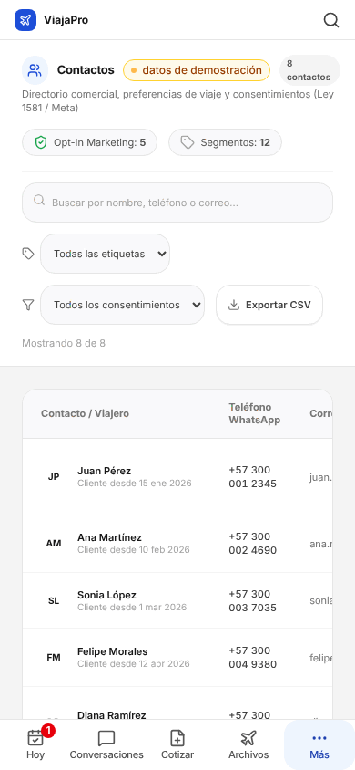

Nótese que Cobros, con la misma forma de datos, **sí** tiene su versión de tarjetas en móvil y
funciona. La solución ya está escrita en el repositorio; solo no se aplicó aquí.

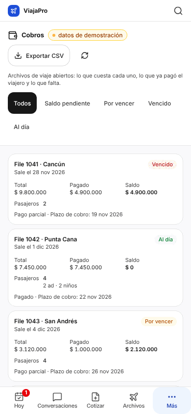

### 1.3 Saber dónde estás, y volver

**Lo que funciona (medido):**

- **La conversación tiene URL propia y sobrevive a la recarga.** `/bandeja/<id>` recargada devuelve
  el mismo hilo. Es compartible y se puede guardar.
- **El botón atrás del navegador hace lo esperado**: desde la cotización vuelve a la conversación.
- **La entrada activa del menú se marca** con `aria-current="page"` en todas las rutas que se
  probaron.
- **El componente de migas (`MigasDePan`) está bien hecho**: `<nav aria-label="Migas de pan">`,
  `<ol>`, `aria-current="page"` en la hoja, separador decorativo con `aria-hidden`, zona táctil de
  44 px en móvil.

**Lo que no (medido):**

**N6. Las migas dicen «Bandeja» donde el menú dice «Conversaciones».**
ADR-0032 §4 manda que la miga del padre use `moduloActivo().etiqueta`. El detalle de la bandeja pone
la cadena literal `'Bandeja'`. Resultado: la misma pantalla tiene dos nombres en la misma vista —el
menú a la izquierda dice «Conversaciones», la miga arriba dice «Bandeja»—. Es exactamente el defecto
de «una pantalla con cuatro nombres» que el ADR se escribió para matar.

**N7. `/seguimientos` tiene unas migas escritas a mano, con un nivel que no existe.**
Pinta `Hoy / CRM / Seguimientos`, donde **«CRM» no es ninguna pantalla** (enlaza a `/contactos`) y
es jerga técnica prohibida por la skill. Además es una pantalla de **primer nivel**, y el ADR dice
que las migas son solo de segundo nivel. Y no usa `MigasDePan`: es un `<nav>` sin `aria-label`, sin
`<ol>`, sin `aria-current`, con los separadores «/» como texto (que el lector de pantalla lee).

**N8. Ningún detalle pone su propio título de documento. (medido)**
ADR-0032 §4: «los detalles lo sobrescriben con `tituloDeDocumento(nombre)`». Medido:

| Ruta | `document.title` | Debería ser |
|---|---|---|
| `/bandeja/<id>` (Juan Pérez) | `Conversaciones · ViajaPro` | `Juan Pérez · ViajaPro` |
| `/cotizaciones/<id>` | `Cotizaciones · ViajaPro` | el título de la cotización |
| `/contactos/<id>` | `Contactos · ViajaPro` | `Juan Pérez · ViajaPro` |
| `/ingresar` | `Ingresar \| ViajaPro` | `Ingresar · ViajaPro` (separador distinto al del resto) |

Un asesor con 6–15 pestañas abiertas ve seis pestañas que dicen «Conversaciones». El dato existe (el
`h1` sí dice «Juan Pérez»); solo no llega al título.

**N9. Migas en 2 de 4 pantallas de detalle.** Las tienen `/bandeja/<id>` y `/cotizaciones/<id>`; no
las tienen la ficha de contacto (usa un enlace «← Directorio de Contactos») ni el archivo de viaje.
Y «Directorio de Contactos» es un **tercer** nombre para Contactos, junto con «Contactos» (menú) y
«Directorio comercial…» (subtítulo).

### 1.4 Llegar rápido a algo concreto

**La paleta de comandos es lo mejor que tiene el producto en navegación, y está infrautilizada.**
`Ctrl+K` abre un diálogo real con categorías y busca de verdad: «Cancún» devuelve conversaciones,
contactos, cotizaciones, **oportunidades** y paquetes; «1043» encuentra el archivo de viaje; «cobros»
y «seguim» saltan al módulo. En móvil está en la lupa de la cabecera.

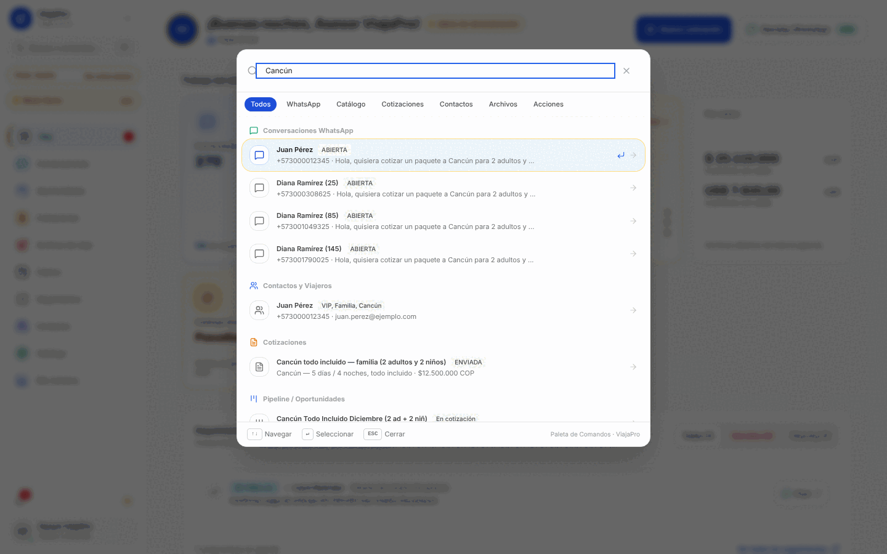

Fallos concretos (medidos):

| # | Qué | Evidencia |
|---|---|---|
| N10 | **«Laura» devuelve 0 resultados.** Laura Restrepo está escrita en la pantalla «Hoy» y en Seguimientos. La paleta **no busca seguimientos** | `0 resultados encontrados para Laura` |
| N11 | **La fila de categorías no coincide con lo que devuelve.** Pestañas: `Todos · WhatsApp · Catálogo · Cotizaciones · Contactos · Archivos · Acciones`. Pero los resultados traen un grupo **«Pipeline / Oportunidades»** que no tiene pestaña —y que además se llama «Pipeline», no «Oportunidades» | captura |
| N12 | **Configuración no se encuentra** (N1) | `0 resultados` para «config» y «equipo» |
| N13 | El atajo se anuncia como **`⌘K`** en todas las plataformas; en Linux/Windows el que funciona es `Ctrl+K` | botón «Buscar o comandos… ⌘K» en Chromium/Linux |
| N14 | Los resultados de conversación no traen la **línea de viaje** (`Cancún · dic · 2+2`), que es como el asesor reconoce a un cliente | captura |

### 1.5 Qué aporta aquí la plataforma web (R15)

Consultado con `modern-web-guidance`. **Verificado contra la pantalla**: se marcan también las guías
que buscamos y que **no** aportan nada a nuestro caso, para no arrastrar falsos positivos.

| Guía (`id`) | Para qué nos sirve aquí | Veredicto |
|---|---|---|
| `responsive-table` | **N5**. `<table>` semántica + `position: sticky` en cabeceras + `@container` (no `@media`) para apilar en tarjetas inyectando las cabeceras con `::before`. Es literalmente el arreglo de Contactos, y el que hay que usar para no volver a escribir a mano dos versiones como en Cobros | ✅ aplica, directo |
| `tabs` | Pestañas que no caben: estrategia 1 (scroll + desvanecido en los bordes con `scroll-driven animation`, y `scrollIntoView({inline:'nearest', container:'nearest'})` al cambiar) o 2 (menú de desbordamiento con `IntersectionObserver`). Arregla Configuración (8 pestañas, la última recortada **a 1440**) y Catálogo (la 3.ª pestaña reducida a un icono sin texto a 390) | ✅ aplica |
| `single-line-overflow` | Texto que debe caber en una línea: «Comod…» recortado en la cabecera de la bandeja, la tarea siguiente cortada a media palabra en las tarjetas del pipeline | ✅ aplica |
| `form-factor-adaptation` | «nada choca con la UI del sistema»: el aviso de cookies tapando el botón de ingreso en móvil (N17), la barra inferior tapando la última tarjeta del catálogo | ✅ aplica |
| `stack-drill-down` | Lista → detalle a pantalla completa en móvil, con el historial sincronizado y gesto de volver. Es el patrón que `/bandeja/<id>` y `/viajes` ya hacen a medias | ✅ aplica |
| `breadcrumbs` | Confirma que `MigasDePan` ya está bien. **Aporta poco**: solo dos matices (la hoja debería seguir siendo un enlace, y hay que medir el contraste AA del rastro). **No** obliga a cambiar el chevron: un icono decorativo renderizado como el resto del código está permitido | ⚠️ aporta poco, pero valida |
| `icons` + `accessibility` | Los 6+ botones de solo icono sin nombre accesible (recargar en Cobros, Viajes y Seguimientos; los dos iconos de persona en la cabecera móvil del chat; el chevron de Contactos; «⚡ /» en el redactor) | ✅ aplica |
| `dark-mode` + `color` | El fallo de tema oscuro de la pantalla «Hoy» (P2) y la auditoría de contraste AA | ✅ aplica |
| `calculate-event-differentials` | `Intl.DurationFormat`/`Temporal` para «34 min», «11 h 59 min», «vence en 9 horas», hoy construidos a mano en `bandeja-logica.ts` con `Math.floor` | ✅ aplica, de cola |
| `navigation-drawer` | La hoja «Más» ya es un diálogo que cierra con `Escape`; añadiría cerrar deslizando y al tocar fuera | ⚠️ marginal |
| `content-first-noise-reduction` | Las murallas de cabecera en móvil («Exportar CSV» ocupando una fila entera antes del contenido) | ⚠️ útil como criterio, no como técnica |
| `scrollspy` | **No aplica.** No tenemos documentos largos con menú de secciones | ❌ descartada |
| `spatial-navigation` | **No aplica.** Es para mandos y rejillas tipo TV; nuestro modelo de teclado es `j/k` en la bandeja y ya funciona | ❌ descartada |
| `app-menus` | **No aplica.** Barra de menús Archivo/Edición/Ver: patrón de aplicación de escritorio que no tenemos ni queremos | ❌ descartada |
| `carousel-snap-highlights` | **No aplica.** El Kanban en móvil se arregla con la vista «Tabla» que ya existe, no convirtiéndolo en carrusel; añadiría animación a una herramienta de trabajo | ❌ descartada |
| `same-document-transitions`, `cross-document-transitions`, `directional-navigation-transitions` | Tentadoras y correctas, pero **hacen que navegar se sienta mejor, no que funcione**. Con dos enlaces rotos y una pantalla sin salida, gastar aquí sería maquillaje | ⏸️ aparcadas |
| `toolbar` | Nuestras barras son cuatro botones; el patrón de `tabindex` rotatorio no paga su coste | ⏸️ aparcada |

---

## 2. Pantalla por pantalla

Cada apartado: **qué trabajo resuelve** · **qué está mal, con la captura delante** · **qué aporta la
plataforma** · **esfuerzo e impacto**.

### 2.1 Bandeja — `/bandeja` y `/bandeja/<id>`

**Trabajo:** responder a quien escribió, sin perder de vista lo que cuesta dinero. ¿Lo deja hacer?
**Sí, y es la mejor pantalla del producto.**

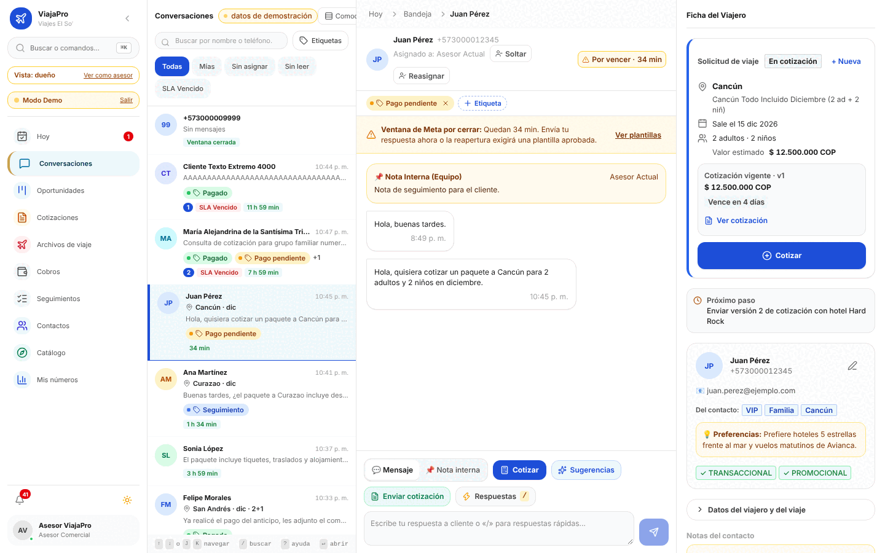

Lo que está bien y no hay que tocar: tres columnas, el aviso de **«Ventana de Meta por cerrar:
quedan 34 min»** en ámbar y a la vista, el panel del viajero con `Cancún · sale el 15 dic 2026 ·
2 adultos · 2 niños · $ 12.500.000`, «Cotización vigente v1 · Vence en 4 días», «Próximo paso», y
un único botón principal: **Cotizar**. La línea de viaje (`Cancún · dic`, `San Andrés · dic · 2+1`)
aparece en las filas de la lista. Eso es el producto.

**Lo que está mal:**

| # | Qué | Evidencia |
|---|---|---|
| B1 | **«Ventana cerrada» se pinta de verde**, el color del éxito. La ventana de 24 h cerrada es justo lo que cuesta dinero. Medido: texto `rgb(21,128,61)` sobre `rgb(240,253,244)` — `ok-700` sobre `ok-50` | [zoom](capturas-diagnostico/zoom-bandeja-cabecera.png) |
| B2 | **El contador de la ventana no tiene umbral.** `34 min` y `11 h 59 min` se pintan del mismo verde. A 34 minutos de cerrarse debería ser ámbar; a cero, rojo. Hoy `bg-ok-50 text-ok-700` sin condición | misma captura |
| B3 | **Una fila se contradice a sí misma**: la primera conversación muestra el texto «Ventana cerrada» **dentro de la rama verde de ventana abierta** (ocurre cuando `expiraEn` es `null`) | misma captura |
| B4 | **El selector de densidad se recorta a 1440 px**: la cabecera dice «Comod…», cortada por el borde de la columna | misma captura |
| B5 | **El marcador de posición del buscador se recorta solo**: a 390 dice «Buscar por nombre o teléfono… (/)», a 1440 «Buscar por nombre o teléfono.» | ambas capturas |
| B6 | **Densidad baja para una herramienta de 8 horas**: 6 conversaciones en 900 px de alto; 5,5 en el móvil, con 190 px de cabecera y filtros antes de la primera fila | capturas |
| B7 | **El time limit no aparece en ninguna fila.** El componente existe (`InsigniaDePlazo`), pero ninguna conversación de la demostración lo muestra. El plazo que cuesta dinero no se ve en la pantalla donde vive el asesor | captura |
| B8 | **Móvil: dos botones de solo icono, idénticos, en una fila propia** de la cabecera del chat (son «Soltar» y «Reasignar»), mientras «Ver cotización» queda escondido tras «Viaje». Prioridad invertida: reasignar es raro, la cotización es constante | [captura](capturas-diagnostico/bandeja-chat-movil-claro.png) |
| B9 | **El redactor móvil ocupa 130 px en 3 filas de botones** (`Mensaje · Nota interna · Cotizar` / `Sugerencias · Enviar cotización · ⚡/`) antes del campo de texto. Con el teclado abierto no queda hilo visible. Y «Cotizar» es un botón relleno dentro de una fila que parece de pestañas: no se sabe si cambia de modo o navega | misma captura |
| B10 | **Etiquetas en MAYÚSCULAS y en verde sin significado**: `TRANSACCIONAL` y `PROMOCIONAL` en el panel del viajero. La skill prohíbe las mayúsculas en etiquetas, y el verde está reservado | [captura](capturas-diagnostico/bandeja-chat-escritorio-claro.png) |
| B11 | **La demostración no tiene ni un mensaje saliente**: no se puede ver el estado optimista (reloj → ✓ → ✓✓ → leído), que es el principio 4 del diseño | captura |

**Plataforma:** `single-line-overflow` (B4, B5), `icons`+`accessibility` (B8), `color` (B1, B2),
`calculate-event-differentials` (B2).
**Esfuerzo:** S para B1–B5 y B10 (son clases y umbrales); M para B8–B9 (rehacer la cabecera y el
redactor móvil). **Impacto:** alto — es la pantalla donde el asesor vive.

### 2.2 Cotizador — `/cotizador`

**Trabajo declarado** (`06-diseno-y-ux.md` §3): *de conversación a propuesta enviada en menos de
cinco minutos*, con **costo neto, markup y venta en la misma fila** y el margen visible siempre.
¿Lo deja hacer? **No.**

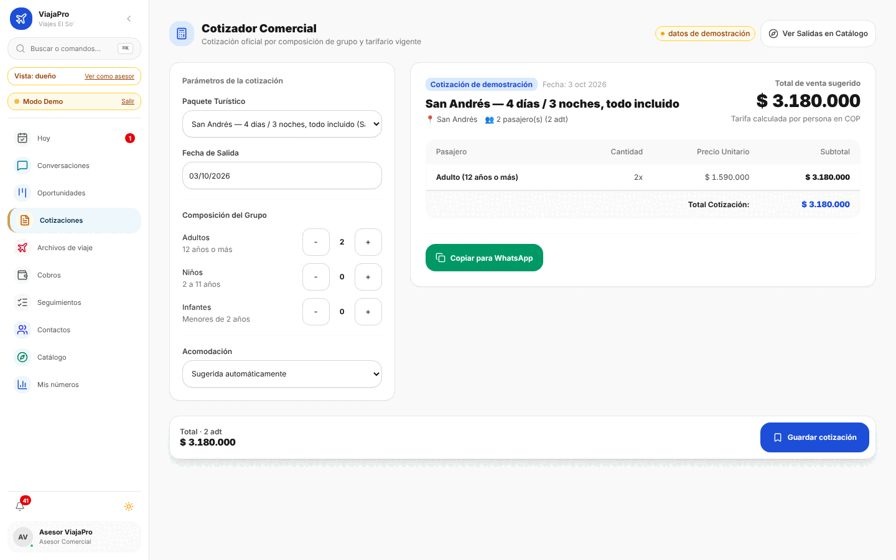

| # | Qué | Evidencia |
|---|---|---|
| C1 | **No hay neto, ni markup, ni margen. En ninguna parte.** Solo «Total de venta sugerido». La pantalla que más gana o pierde dinero no muestra cuánto se gana | captura |
| C2 | **No se puede enviar.** Hay «Copiar para WhatsApp» (verde) y «Guardar cotización» (azul): dos botones que parecen principales y ninguno envía. El objetivo declarado («propuesta enviada») no se cumple desde aquí | captura |
| C3 | **No hay ítems por tipo de producto** (vuelo, hotel, traslado) ni vista previa del PDF. Es una calculadora de un paquete, no un cotizador | captura |
| C4 | **La fecha de salida por defecto está en el pasado**: `03/10/2026`, siete semanas antes de hoy, y calcula tan ricamente. Datos de demostración que mienten y validación que falta | captura |
| C5 | **Plural de plantilla**: «2 pasajero(s) (2 adt)». La skill pide plurales correctos | captura |
| C6 | **Tres nombres para lo mismo**: «Cotizador Comercial» (título), «Cotizaciones» (menú), «Cotizar» (barra móvil) | capturas |
| C7 | **Móvil: la tarjeta de resultado queda tapada por la barra inferior** y «Acomodación» desaparece bajo el pliegue | [captura](capturas-diagnostico/cotizador-movil-claro.png) |
| C8 | **Escritorio: media pantalla vacía** bajo la barra de total, con 5 campos repartidos en 540 px de alto | captura |

**Plataforma:** `form-factor-adaptation` (C7), `forms` (C4, validación tras interacción).
**Esfuerzo:** L (C1–C3 son producto, no estilo). **Impacto:** muy alto, pero **no es un rediseño:
es funcionalidad que falta.** Hay que decírselo al `dueno-de-producto`, no al diseñador.

### 2.3 Catálogo — `/catalogo`

**Trabajo:** encontrar el paquete correcto mientras el cliente espera. ¿Lo deja hacer? **A medias.**

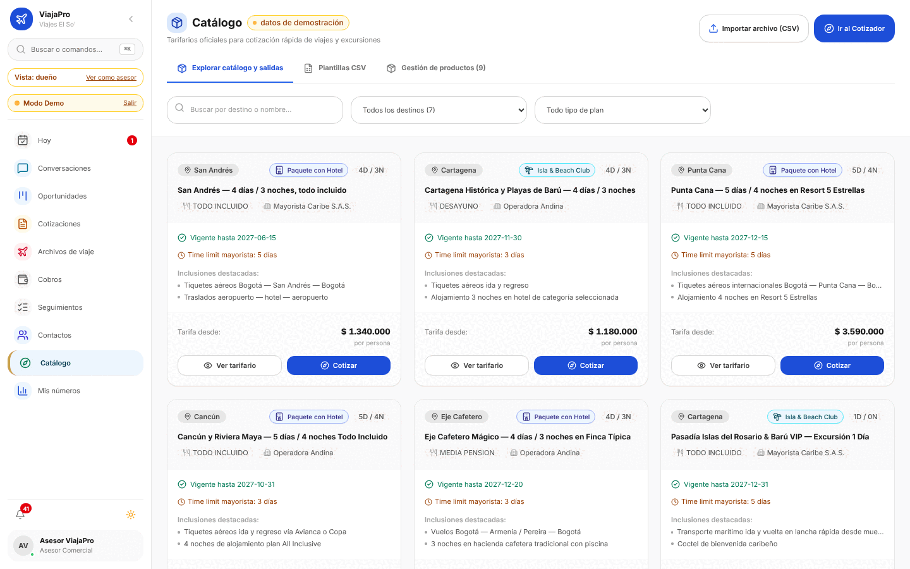

| # | Qué | Evidencia |
|---|---|---|
| K1 | **Fechas en formato ISO**: «Vigente hasta 2027-06-15», seis veces por pantalla. El sistema manda `15 jun 2027` | captura |
| K2 | **Etiquetas en MAYÚSCULAS**: `TODO INCLUIDO`, `DESAYUNO`, `MEDIA PENSION` —esta última, además, sin tilde | captura |
| K3 | **Densidad**: tarjetas de 355 px para un paquete; 4,5 visibles en escritorio. Una tabla densa mostraría 15–20. El asesor compara, no contempla | captura |
| K4 | **Móvil: lo primero que se ve es «Importar archivo (CSV)»**, a ancho completo, antes del buscador y antes de un solo paquete. Una tarea de administración mensual por delante del trabajo diario —y «CSV» es jerga | [captura](capturas-diagnostico/catalogo-movil-claro.png) |
| K5 | **Móvil: la 3.ª pestaña queda reducida a un icono sin texto** («Gestión de productos (9)»), sin ninguna señal de que se puede desplazar | misma captura |
| K6 | **Móvil: la barra inferior tapa el precio** de la primera tarjeta («por persona» cortado) | misma captura |
| K7 | **Todos los time limit en ámbar por igual**, sean 3 o 5 días: el color de «por vencer» usado para un dato de política que no vence | captura |

**Plataforma:** `tabs` (K5), `form-factor-adaptation` (K6), `responsive-table` (K3, si se va a tabla).
**Esfuerzo:** S para K1, K2, K4, K7; M para K3 y K5. **Impacto:** medio-alto, muy visible en una demo.

### 2.4 CRM — Contactos (`/contactos`) y Oportunidades (`/pipeline`)

**Trabajo:** saber quién es el cliente y en qué va la venta. ¿Lo deja hacer? **Oportunidades sí;
Contactos, en el teléfono, no.**

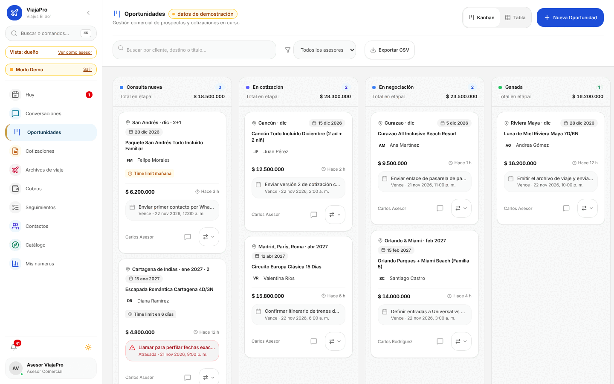

**Oportunidades está bien diseñada**: la tarjeta abre con la línea de viaje (`San Andrés · dic ·
2+1`), fecha de salida, título, dueño, **«Time limit mañana»** en ámbar, valor, tiempo sin contacto y
la tarea siguiente con su vencimiento. Es justo lo que pide `06-diseno-y-ux.md` §3.

| # | Qué | Evidencia |
|---|---|---|
| R1 | **El enlace a la conversación está roto** (ver 1.2): las 9 tarjetas apuntan a `/bandeja` | medido |
| R2 | **Dos botones de solo icono al pie de cada tarjeta**, sin texto (son comentar y mover de etapa) | captura |
| R3 | **El texto de la tarea siguiente se corta a media palabra** («Enviar enlace de pasarela de pa…»): lo más accionable de la tarjeta es lo que se recorta | captura |
| R4 | **Datos de demostración no creíbles**: tareas que vencen a las 2:00 a. m., 3:00 a. m., 12:00 a. m. | captura |
| R5 | **Móvil: 380 px de cabecera** (título, subtítulo, conmutador Kanban/Tabla, «Nueva Oportunidad», buscador, filtro y **«Exportar CSV» con una fila entera**) antes de la primera tarjeta; se ve 1,2 tarjetas y hay que deslizar 3 veces para llegar a «Ganada» | [captura](capturas-diagnostico/pipeline-movil-claro.png) |
| R6 | **Contactos: N5** — en el teléfono no se puede abrir ninguna ficha | medido |
| R7 | **Contactos: enlaces sin nombre accesible.** Los 8 enlaces de ficha no tienen texto ni `aria-label` (son chevrones) | medido |
| R8 | **Contactos no habla el idioma del viaje**: ninguna fila muestra `destino · mes · pax`, aunque el dato existe (hay etiquetas «Cancún», «Curazao») | captura |
| R9 | **Jerga en pantalla**: «Opt-In Marketing: 5», «Transaccional + Mkt», «Ley 1581 / Meta» en el subtítulo | [captura](capturas-diagnostico/contactos-escritorio-claro.png) |

**Plataforma:** `responsive-table` (R6), `accessibility`+`icons` (R2, R7), `single-line-overflow` (R3),
`content-first-noise-reduction` (R5).
**Esfuerzo:** M para Contactos en móvil; S para el resto. **Impacto:** alto (R6 es una pantalla
inservible en el dispositivo principal del asesor).

### 2.5 Cobros — `/cobros`

**Trabajo:** saber quién debe y cobrarle. ¿Lo deja hacer? **La primera mitad, muy bien. La segunda,
no.**

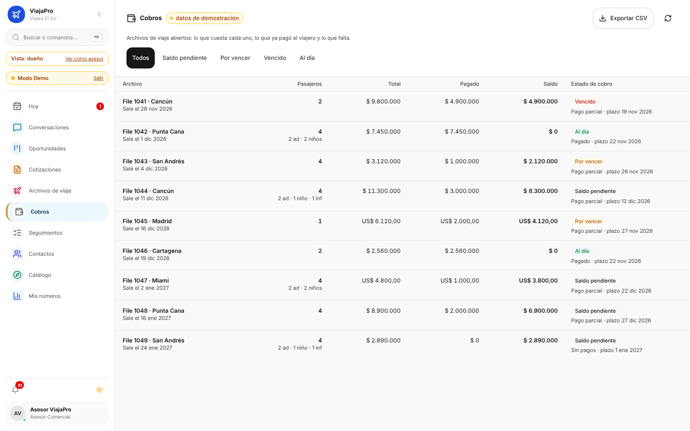

**Es la pantalla mejor construida del producto**: tabla densa, 9 archivos en una vista, `File 1041 ·
Cancún / Sale el 28 nov 2026`, pasajeros, total, pagado, saldo alineados a la derecha con cifras
tabulares, dos monedas, estados con **texto + color coherente** (`Vencido` rojo, `Por vencer` ámbar,
`Al día` verde) y el plazo en cada fila. En móvil tiene su versión de tarjetas.

| # | Qué | Evidencia |
|---|---|---|
| O1 | **Ninguna acción en la fila.** Ni «Registrar pago», ni «Escribir por WhatsApp». Dice quién debe y no deja hacer nada: es un informe, no una herramienta de cobro. La única acción prominente es «Exportar CSV» | captura |
| O2 | **Ordenado por número de archivo, no por riesgo.** Lo vencido está primero por casualidad | captura |
| O3 | **Botón de recargar de solo icono, sin texto**, junto a «Exportar CSV» | captura |
| O4 | **La columna de pasajeros es inconsistente**: unas filas dicen «4», otras «4 / 2 ad · 2 niños» | captura |
| O5 | **Contradice a Archivos de viaje**: aquí hay 9 archivos abiertos; `/viajes` lista 2. Dos pantallas que el dueño verá seguidas | ambas capturas |

**Plataforma:** `responsive-table` (para que la tabla y las tarjetas sean una sola cosa),
`sortable-table` (O2), `icons` (O3).
**Esfuerzo:** S (O2–O4), M (O1). **Impacto:** alto — es el punto 4 del criterio de salida del piloto.

### 2.6 Reportes — `/reportes`

**Trabajo:** que el dueño vea cómo va el mes en treinta segundos. ¿Lo deja hacer? **No.**

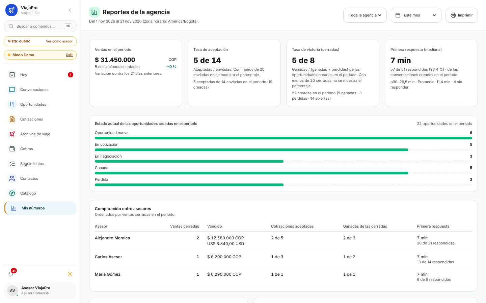

| # | Qué | Evidencia |
|---|---|---|
| T1 | **Todas las barras son verdes, incluida «Perdida: 3».** La skill lo prohíbe literalmente: «nunca un color de “todo bien” para algo cerrado o perdido» | captura |
| T2 | **No hay ni un porcentaje.** Las cifras principales son fracciones: «5 de 14», «5 de 8». Y cada tarjeta explica por qué no hay porcentaje: «Con menos de 20 enviadas no se muestra el porcentaje» | captura |
| T3 | **La nota al pie se comió la tarjeta.** De los ~160 px de alto de cada tarjeta, el número ocupa 30 y la metodología el resto. El dueño pidió números, no advertencias estadísticas | captura |
| T4 | **El menú dice «Mis números» y el título «Reportes de la agencia»**, con datos de los tres asesores en la misma pantalla | captura |
| T5 | **«↗ 0 %»**: flecha de subida para una variación nula; y «Variación contra los 21 días anteriores» mientras el filtro dice «Este mes» y la cabecera «Del 1 nov al 21 nov» | captura |
| T6 | **Los tres asesores tienen exactamente «7 min» de primera respuesta.** Datos de demostración que se delatan | captura |
| T7 | **Móvil: una sola cifra por encima del pliegue**, tras 280 px de cabecera y filtros; dos de las tres tarjetas visibles son casi todo texto de metodología | [captura](capturas-diagnostico/reportes-movil-claro.png) |

**Plataforma:** `color` (T1). El resto no es técnica, es decisión de contenido.
**Esfuerzo:** S para T1, T4, T5; M para T2–T3 y T7 (hay que decidir qué métricas van).
**Impacto:** **el más alto en «lo que el cliente nota»**, porque es la pantalla que el dueño de la
agencia mira para decidir si paga.

### 2.7 Ingreso — `/ingresar`

**Trabajo:** entrar. ¿Lo deja hacer? **Sí en escritorio; en el teléfono, con un obstáculo.**

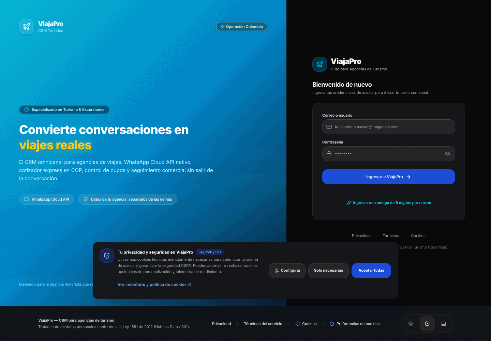

| # | Qué | Evidencia |
|---|---|---|
| N17 | **En móvil, el aviso de cookies tapa el botón de ingresar.** Medido: el botón ocupa `y 470–514`; el aviso empieza en `y 501`. El botón sigue siendo pulsable en su centro, pero **el enlace «Ingresar con código de 6 dígitos por correo» queda inalcanzable** (medido: `enlaceCodigoVisible: false`). Es decir: el camino alternativo para quien no puede entrar está escondido detrás del aviso, justo en el dispositivo del asesor. Recuérdese que **un cliente del propietario estuvo días sin poder entrar** (T-594, T-600) | [captura](capturas-diagnostico/ingreso-movil-claro.png) |
| I2 | **La mitad izquierda es una landing de marketing dentro de la herramienta**: degradado, «eyebrow» («Especializado en Turismo & Excursiones»), badge («Operación Colombia») y un titular con **una palabra resaltada en dorado** («viajes **reales**»). Los cuatro rasgos están en la lista de «nada de plantilla de IA» de la skill | captura |
| I3 | **Jerga en la primera pantalla que ve una agencia**: «WhatsApp Cloud API», «Ley 1581 / SIC», «seguridad CSRF» en el aviso de cookies | capturas |
| I4 | `document.title` usa `\|` en vez de `·` (N8) | medido |

Lo que **sí** está bien: etiquetas visibles en los dos campos, `autocomplete="username"` y
`"current-password"` correctos, mostrar/ocultar contraseña, conmutador de tema, y cero desborde
horizontal en ambos anchos.

**Plataforma:** `form-factor-adaptation` (N17), `autofill-sign-up-form`/`forms` (ya cumplido).
**Esfuerzo:** S. **Impacto:** alto y desproporcionado: es la primera y a veces la única pantalla que
ve alguien que no consigue entrar.

### 2.8 Configuración — `/configuracion`

**Trabajo:** que el dueño conecte su WhatsApp, dé de alta a su equipo y ponga sus datos fiscales.
¿Lo deja hacer? **Si llega. Ver N1: desde la interfaz, no llega.**

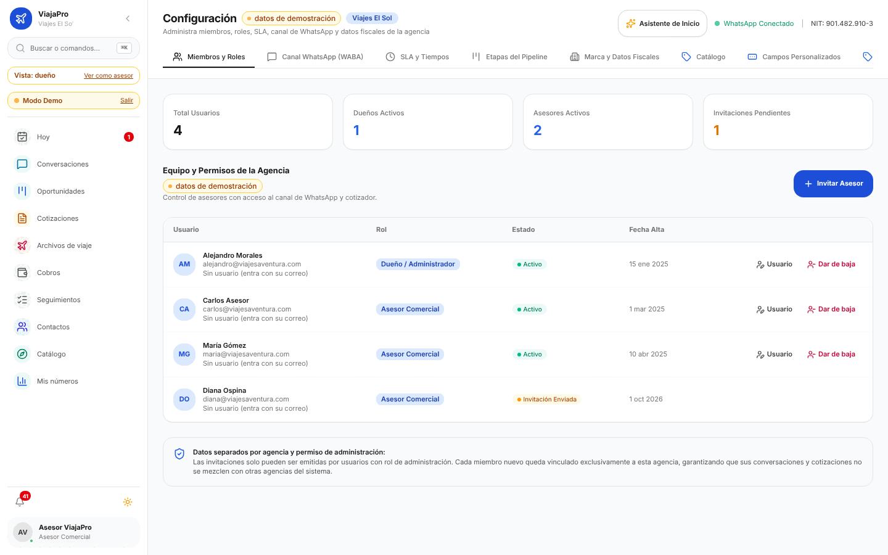

| # | Qué | Evidencia |
|---|---|---|
| G1 | **N1**: no está en el menú, ni en «Más», ni en la paleta | medido |
| G2 | **La 8.ª pestaña se recorta a 1440 px**, reducida a un icono huérfano en el borde derecho | captura |
| G3 | **Móvil: solo 2 de 8 pestañas visibles**, sin señal de desplazamiento | [captura](capturas-diagnostico/configuracion-movil-claro.png) |
| G4 | **Jerga**: «Canal WhatsApp (WABA)», «SLA y Tiempos». `WABA` y `SLA` son siglas técnicas prohibidas por la skill —y `SLA` aparece también en la bandeja («SLA Vencido») y en Reportes | capturas |
| G5 | **Cuatro tarjetas de KPI que no llevan a ninguna acción**: «Total Usuarios 4», «Dueños Activos 1», «Asesores Activos 2», «Invitaciones Pendientes 1» — los cuatro números están en la tabla de debajo. En móvil ocupan 390 px, toda la pantalla, y el equipo queda bajo el pliegue | capturas |
| G6 | **Title Case en inglés en todo**: «Miembros y Roles», «Marca y Datos Fiscales», «Campos Personalizados», «Fecha Alta», «Invitar Asesor», «Dueño / Administrador». En español va mayúscula inicial y ya | captura |
| G7 | **Barra vertical huérfana** tras «WhatsApp Conectado» en móvil | captura |

**Plataforma:** `tabs` (G2, G3).
**Esfuerzo:** S. **Impacto:** alto por G1 (hoy es inalcanzable), medio por el resto.

### 2.9 Extras que aparecieron por el camino

**P2 — Fallo de tema oscuro en «Hoy» (medido, con causa exacta).**
En modo oscuro, las tarjetas de «Seguimientos pendientes del día» se quedan **blancas**, con texto
casi blanco encima. Medido: texto `rgb(245,245,245)` y `rgb(229,229,229)` sobre fondo
`rgb(255,255,255)` → contraste **≈ 1,1 : 1** (AA exige 4,5). La línea ilegible contiene un importe:
«Confirmar pago de anticipo $2.500.000 San Andrés Decameron».

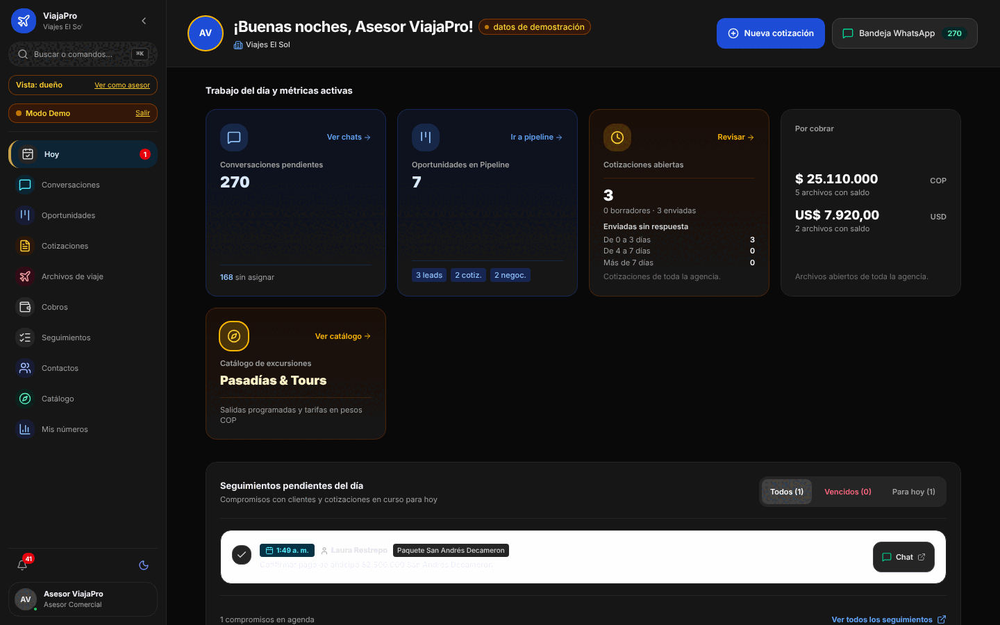

**Causa:** la clase `dark:bg-neutral-850` no existe. `neutral-850` **no está definido en
`@theme` de `globals.css`**, así que esa clase no emite ni una línea de CSS y la tarjeta conserva su
`bg-white`. Hay 3 usos en el repositorio, 2 de ellos en esa tarjeta. Es exactamente el modo de fallo
que el propio `globals.css` documenta en un comentario y que ya había ocurrido antes.
**Esfuerzo: S. Impacto: alto** — rompe la promesa de «tema claro y oscuro desde el primer día».

**Otros, en «Hoy»:** el título más prominente es un saludo («¡Buenas noches, Asesor ViajaPro!»);
«Conversaciones pendientes **270**» contradice la bandeja, que carga unas tres decenas por página; «3 leads · 2 cotiz. ·
2 negoc.» usa un anglicismo y dos abreviaturas para las etapas que el pipeline llama «Consulta
nueva», «En cotización» y «En negociación»; «**1 compromisos** en agenda» (plural); «Vencidos (0)»
pintado en rojo con cero elementos; y una tarjeta decorativa de catálogo («Pasadías & Tours») con
degradado dorado entre tarjetas de trabajo.

**Cotizaciones (`/cotizaciones`):** estados en MAYÚSCULAS (`ENVIADA`, `ACEPTADA`); tres botones de
igual peso por fila (`Ver · WhatsApp · Duplicar`) sin acción principal; «WhatsApp» como etiqueta de
botón en vez del verbo («Enviar por WhatsApp»); columna «Total Venta (COP)» con la moneda fija en la
cabecera, cuando hay archivos en USD; sin margen; «versiones inmutables» en el subtítulo.

**Seguimientos (`/seguimientos`):** buena densidad y «Chat WhatsApp» en cada fila, pero **las cuatro
tarjetas de KPI y las cinco pestañas dicen exactamente lo mismo** (Vencidos/Hoy/Próximos/
Completados, dos veces); migas inventadas (N7); botón de recargar sin texto; y tareas a la
1:49 a. m., 1:19 a. m. y 2:49 a. m.

---

## 3. Tabla priorizada

Orden = **lo que el cliente nota dividido por lo que cuesta**. «Carril» separa lo que es diseño de
lo que en realidad es producto.

| # | Qué | Por qué primero | Esfuerzo | Impacto | Carril |
|---|---|---|---|---|---|
| **1** | **Arreglar los dos enlaces rotos y cerrar la cadena hacia delante** (N1.2): que la tarjeta del pipeline y la fila de contactos apunten a `/bandeja/<id>`; añadir la fila de enlaces que ya existe en Archivo de viaje a la **conversación**, la **cotización** y la **ficha de contacto**, con el archivo y el cobro incluidos | Es *la* navegabilidad. El patrón ya está escrito y probado en dos pantallas: se copia, no se inventa. Convierte «1 toque + buscar a ojo» en 1 toque | **S** | **Muy alto** | diseño |
| **2** | **Devolver Configuración al menú y a la paleta** (N1, N12) | Hoy es inalcanzable. En una demo, «¿dónde conecto mi WhatsApp?» no tiene respuesta | **S** | **Muy alto** | diseño |
| **3** | **Contactos en el teléfono** (N5/R6): tabla `<table>` + `@container` que apila en tarjetas, como ya hace Cobros | Una de las once pantallas no se puede usar en el dispositivo principal del asesor | **M** | **Alto** | diseño |
| **4** | **Color con significado**: «Ventana cerrada» y «Perdida» dejan de ser verdes; umbral ámbar/rojo en el contador de 24 h (B1, B2, B3, T1) | Son tres o cuatro clases. Es la diferencia entre un color que informa y uno que decora; y es lo que la skill llama no negociable | **S** | **Alto** | diseño |
| **5** | **El fallo de tema oscuro de «Hoy»** (P2): definir `neutral-850` en `@theme` o usar un token existente | Texto a 1,1 : 1 de contraste sobre un importe. Una línea de CSS | **S** | **Alto** | diseño |
| **6** | **El aviso de cookies deja de tapar el ingreso en móvil** (N17) | Primera pantalla, y ya hubo un cliente que no pudo entrar | **S** | **Alto** | diseño |
| **7** | **Una pasada de lenguaje**: fechas ISO del catálogo → `15 jun 2027`; fuera `WABA`, `SLA`, `CSV`, `Opt-In`, `CRM`, `leads`; fuera MAYÚSCULAS en etiquetas y Title Case; plurales; un solo nombre por pantalla (N6, N7, N9, C6, G4, G6, K1, K2) | Es lo que el propietario ve como «el diseño cambió»: todo el producto empieza a hablar igual. Cuesta poco y se nota en cada pantalla | **S–M** | **Alto** | diseño |
| **8** | **Las murallas de cabecera en móvil**: bajar «Exportar CSV» / «Importar archivo» a un menú y dejar el contenido arriba (R5, K4) | 380 px de controles antes del primer dato, en cuatro pantallas | **M** | Medio-alto | diseño |
| **9** | **Pestañas que no caben**: scroll con desvanecido y `scrollIntoView` en Configuración y Catálogo (G2, G3, K5) | Hoy hay pestañas que un usuario no sabe que existen | **M** | Medio | diseño |
| **10** | **Nombres accesibles en los botones de solo icono** (B8, R2, R7, O3) | 6+ controles sin nombre; también afecta a quien ve, porque dos iconos iguales no se distinguen | **S** | Medio | diseño |
| **11** | **Títulos de documento y migas según ADR-0032** (N6, N8, N9) | Seis pestañas que dicen «Conversaciones». El mecanismo ya está en la tabla única | **S** | Medio | diseño |
| **12** | **Reportes: menos texto, más número** (T2, T3, T7) + acciones en la fila de Cobros (O1) | Es la pantalla que decide si el dueño paga; y Cobros sin acción es un informe | **M** | Alto | **producto** |
| **13** | **Cotizador: neto, markup, margen y enviar** (C1, C2, C3) | Es la promesa central del producto y no está. **No lo arregla un rediseño** | **L** | Muy alto | **producto** |
| **14** | **Datos de demostración creíbles**: tareas a las 2 a. m., salida por defecto en el pasado, 270 conversaciones que no existen, 2 archivos frente a 9, tres asesores con «7 min» idénticos (C4, R4, O5, T6) | Una demo con datos que mienten resta más que un diseño sobrio | **S** | Medio-alto | producto |
| — | Transiciones de vista, carrusel del Kanban, navegación espacial, barra de menús | Aparcados a propósito: mejoran la sensación, no el funcionamiento | — | — | — |

---

## 4. Recomendación

**Si solo se hace una cosa, que sea la fila 1 + la fila 2 + la fila 4**, en un solo lote de tamaño S.

Las tres juntas valen más que cualquier rediseño visual, y por este orden de razones:

1. **Son la respuesta literal a «mejorar mucho la navegabilidad».** Cierran la cadena del trabajo
   —chat → cotización → archivo → cobro— en los dos sentidos, devuelven la pantalla que hoy no
   existe para el usuario, y hacen que los colores dejen de mentir sobre lo que cuesta dinero.
2. **Casi no hay que diseñar nada.** El patrón de la fila de enlaces ya está construido y probado en
   el Archivo de viaje y en la Cotización; se trata de llevarlo a tres pantallas más y de corregir
   dos `href`. El menú ya lee la tabla única; solo hay que dejar de ocultar una entrada.
3. **Se notan en el primer minuto de una demo.** El propietario dijo «veo todo igual» porque lo
   último que se hizo fue deuda interna. Esto no: el día que una tarjeta de oportunidad abra la
   conversación correcta, y desde esa conversación se llegue al archivo y al cobro sin tocar el
   menú, la agencia lo va a ver sin que nadie se lo explique.

**La segunda cosa que haría**, inmediatamente después y también de tamaño S: la **fila 7**, la pasada
de lenguaje. Es lo que convierte once pantallas en un producto. Hoy la misma pantalla se llama
«Conversaciones» en el menú y «Bandeja» en las migas; la misma lista se llama «Contactos»,
«Directorio comercial» y «Directorio de Contactos»; y el catálogo escribe las fechas de una forma
que no se usa en ninguna otra pantalla. Nada de eso cuesta más que un día, y es exactamente lo que
alguien percibe como «cambió el diseño».

**Lo que recomiendo NO hacer todavía:** tocar el Cotizador (fila 13). Lo que le falta no es diseño,
es producto —neto, markup, margen, ítems y envío—, y decidir su alcance es del `dueno-de-producto`.
Rediseñar la pantalla antes de esa decisión sería dibujar dos veces.

---

## 5. Procedencia

- Capturas: [`capturas-diagnostico/`](capturas-diagnostico/), tomadas el 2026-11-22 sobre
  `origin/main` `2aa3fdb3`, con `next build` + `next start`, modo demostración, 1440×900 y 390×844,
  temas claro y oscuro, `deviceScaleFactor: 1`.
- Criterios, por orden de autoridad: [`CLAUDE.md`](../../CLAUDE.md) →
  `.claude/skills/diseno-web/SKILL.md` → `modern-web-guidance` (R15,
  [`docs/09-ia/10-guia-web-moderna.md`](../09-ia/10-guia-web-moderna.md)).
- Marco de navegación: [ADR-0032](../03-adr/0032-layout-compartido-y-tabla-unica-de-navegacion.md).
- Principios y jerarquía de pantallas: [`06-diseno-y-ux.md`](06-diseno-y-ux.md).
- Auditoría UX anterior: `docs/_auditorias/2026-11-20-auditoria-ux.md`.
