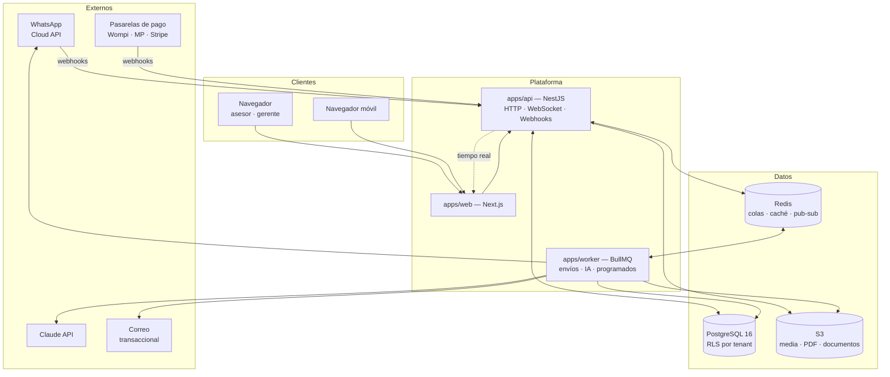
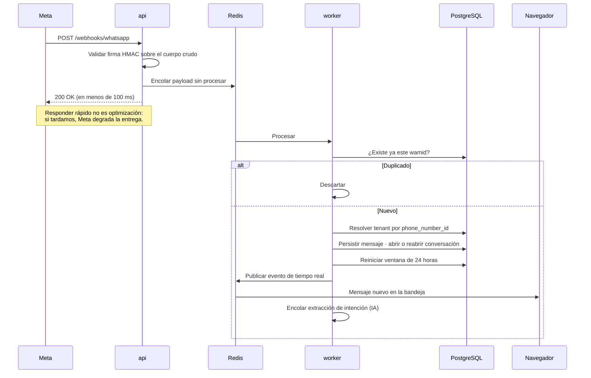
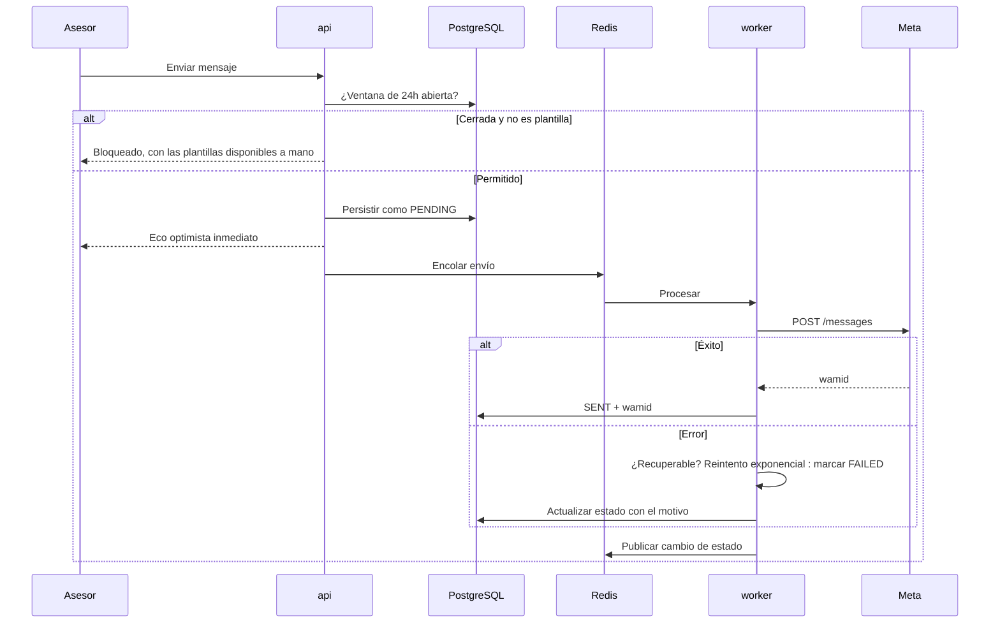

# Arquitectura — visión general

---

## 1. Forma del sistema

**Monolito modular** en TypeScript, desplegado como tres procesos, con fronteras internas lo
bastante limpias para extraer servicios cuando haga falta — y no antes. El porqué completo está en
[ADR-0004](../03-adr/0004-monolito-modular.md).

### Por qué tres procesos y no uno

| Proceso | Responsabilidad | Por qué separado |
|---|---|---|
| `api` | HTTP, WebSocket, recepción de webhooks | Debe responder rápido **siempre**. Si tarda, Meta degrada la entrega de mensajes. |
| `worker` | Envíos, IA, PDFs, trabajos programados | El trabajo pesado no puede competir por CPU con el webhook. Escala por separado. |
| `web` | Interfaz | Despliegue y escalado independientes. |

Comparten código y base de datos: **no son microservicios.** Son tres caras del mismo monolito,
separadas por su perfil de carga.

---

## 2. Los dos flujos que definen el sistema

### Mensaje entrante — la ruta crítica

Tres decisiones están condensadas aquí y las tres son deliberadas:

1. **Responder antes de procesar.** El webhook valida la firma, encola y devuelve 200. Nada más.
2. **Idempotencia por `wamid`.** Meta reintenta; el mismo mensaje puede llegar varias veces.
3. **Enrutamiento por `phone_number_id`.** Es lo que identifica al tenant. Si no se reconoce, se
   descarta y se alerta: un payload para un número que no conocemos es un síntoma, no un dato.

### Mensaje saliente

La interfaz **nunca espera a Meta**. Persistimos, respondemos, y la cola se encarga.
El asesor ve el estado real del mensaje (reloj → ✓ → ✓✓ → leído) sin que la pantalla se congele.

---

## 3. Multi-tenancy en todas las capas

Aislar no es una sola cosa: es la misma propiedad sostenida en cinco lugares.
Detalle en [ADR-0003](../03-adr/0003-multitenancy.md) y [04-multitenancy.md](04-multitenancy.md).

| Capa | Mecanismo |
|---|---|
| Petición HTTP | El `tenant_id` se deriva del token de sesión. **Nunca de un parámetro del cliente.** |
| Aplicación | Un interceptor fija `app.current_tenant` en la transacción de PostgreSQL |
| Base de datos | Row Level Security con `USING` y `WITH CHECK`, con rol `viajapro_app` que **no puede saltarla** |
| Caché | Claves con prefijo de tenant. Una clave compartida es una fuga |
| Objetos | Prefijo por tenant en S3 + URLs firmadas de vida corta |

La defensa en profundidad es intencional: un error en una capa no se convierte en brecha.

---

## 4. Comunicación entre módulos

Los módulos **no se importan entre sí**. Se comunican de dos formas:

**Eventos de dominio (patrón outbox)** — para lo que ocurre *después*:
el evento se escribe en `outbox` dentro de la misma transacción que el cambio de estado; un relay
lo publica a BullMQ; los suscriptores reaccionan de forma idempotente.
Nunca se publica directamente dentro de una transacción: si la transacción revierte, el evento ya salió.

**Puertos explícitos** — para lo que se necesita *ahora*:
el módulo consumidor declara la interfaz que necesita; el proveedor la implementa. La dependencia
es del consumidor hacia su propia abstracción, no hacia el otro módulo.

Esto es lo que permite extraer un servicio después sin reescribir. Y es lo primero que se erosiona:
el hook `PostToolUse` avisa de toda importación cruzada.

---

## 5. Decisiones estructurales y su porqué

| Decisión | Alternativa descartada | Por qué |
|---|---|---|
| Monolito modular | Microservicios | Un equipo pequeño no tiene el problema que resuelven los microservicios, y sí paga su costo completo |
| RLS en PostgreSQL | Filtrar en la aplicación | Filtrar en la aplicación depende de que nadie se olvide nunca. RLS no se olvida |
| Esquema compartido | Un esquema o base por tenant | Migrar 500 esquemas es una operación; migrar uno es un `deploy` |
| Outbox | Publicar directo | Sin outbox, un evento puede salir de una transacción que luego revierte |
| Cloud API directo | BSP intermediario | Margen y control del canal, que es el corazón del producto |
| Contratos Zod compartidos | Tipos duplicados | Una sola fuente de verdad entre API y web |

---

## 6. Qué NO está resuelto todavía

Honestidad sobre los límites de este diseño. Cada punto es trabajo real pendiente:

- **Escalamiento horizontal del WebSocket.** Con un solo proceso de `api` funciona; con varios hace
  falta un adaptador de Redis para Socket.IO. Se resolverá cuando el volumen lo exija.
- **Particionado de `messages`.** Esa tabla crecerá más rápido que todas las demás juntas. El plan
  de particionado por rango de fecha debe estar diseñado **antes** de los primeros 10 millones de filas.
- **Réplica de lectura para analítica.** Hoy los reportes irían contra la primaria. No es sostenible.
- **Integración con GDS y consolidadores.** El cotizador v1 es manual. Es lo correcto para empezar
  y un techo evidente después.
- **Residencia de datos por país.** Si un cliente grande exige datos en su jurisdicción, el esquema
  compartido se vuelve un problema. Hay respuesta (despliegue por región), pero cuesta.
