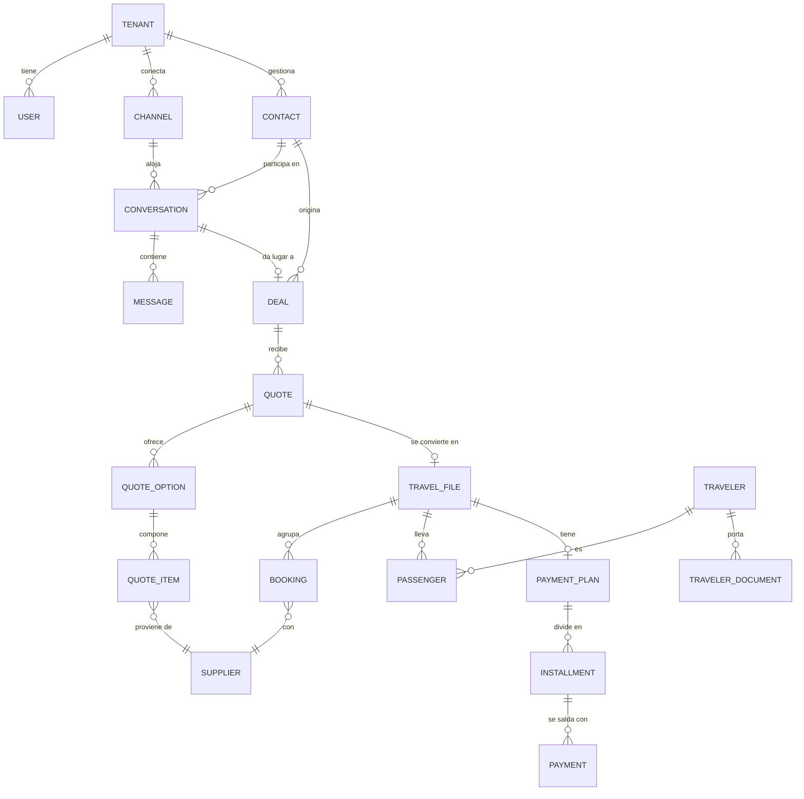
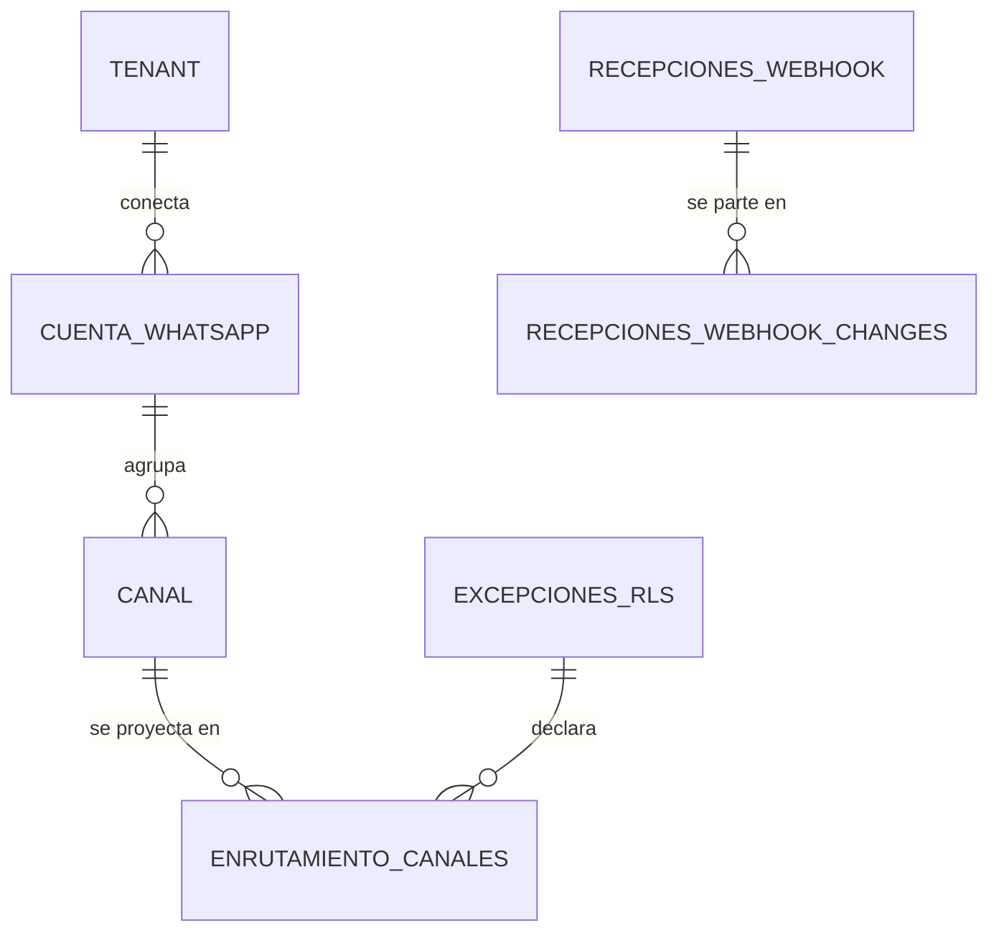

# Modelo de datos

> El esquema es el activo más caro de cambiar del sistema. Este documento explica **por qué** está
> modelado así; el esquema ejecutable vive en `packages/database/schema.prisma`.

---

## 1. Reglas transversales

Aplican a **toda** tabla de negocio, sin excepción:

| Regla | Forma |
|---|---|
| Aislamiento | `tenant_id uuid NOT NULL` + política RLS con `USING` y `WITH CHECK`. Ver [ADR-0003](../03-adr/0003-multitenancy.md) |
| Clave primaria | `uuid` v7 — ordenable en el tiempo, buen comportamiento en índices, no filtra volumen de negocio como haría un entero autoincremental |
| Dinero | `amount_cents bigint` + `currency char(3)`. **Nunca** coma flotante |
| Fechas y horas | `timestamptz` en UTC |
| Fechas de viaje | `date` — un vuelo del 24 es del 24 sin importar el huso horario |
| Borrado | Lógico: `deleted_at timestamptz`. Toda consulta lo excluye por defecto |
| Auditoría | `created_at`, `updated_at`, `created_by`, `updated_by` |
| Índices | Compuestos con `tenant_id` **siempre en primera posición** |

### Por qué dinero en enteros

`0.1 + 0.2 !== 0.3` en coma flotante. En un cotizador que suma veinte ítems en tres monedas con
markup porcentual, ese error se acumula y aparece como una diferencia de centavos entre lo cotizado
y lo cobrado. Es pequeño y es imperdonable: destruye la confianza en el sistema.

Las conversiones guardan **además** la tasa aplicada y su fecha. La TRM de una cotización queda
congelada: si el dólar sube mañana, lo que el cliente vio no cambia.

---

## 2. El mapa



### El mapa del enrutamiento entrante (ADR-0008)

Va aparte porque cruza la frontera del aislamiento, y conviene verlo de un vistazo: a la
izquierda, lo que está **bajo RLS**; a la derecha, lo que **no puede estarlo** y por qué.



| Tabla | ¿RLS? | Qué guarda |
|---|---|---|
| `cuentas_whatsapp` | **Sí** | El WABA de la agencia y su token cifrado. Es la **verdad**: el directorio es derivado de aquí |
| `canales` | **Sí** | El número conectado, con `phone_number_id` **en claro** bajo aislamiento |
| `enrutamiento_canales` | **No** | Solo claves de ruteo en HMAC → `tenant_resuelto_id`. Es lo que rompe el ciclo huevo-gallina |
| `enrutamiento_historial` | **No** | Bitácora del directorio, particionada por año. Global porque `registros_auditoria` archivaría el ataque bajo el atacante |
| `recepciones_webhook` (+ hija) | **No** | El cuerpo cifrado del webhook, durante segundos, antes de saber de quién es |
| `excepciones_rls` | **No** | La declaración que gobierna los privilegios. Se declara a sí misma |

El ciclo que esto rompe, en una frase: **para saber de qué agencia es el webhook hay que
leer una tabla, y si esa tabla está protegida por tenant, hay que saber la agencia para
leerla.** Meta manda todos los webhooks de todas las agencias al mismo endpoint.

**La zona sin RLS queda acotada a una franja exacta y descriptible: entre la validación de
la firma y la resolución del tenant. En esa franja no se lee ni se escribe ninguna tabla de
negocio.** Esa frase es la que hace compatible el diseño con ADR-0003.

### Referencias cruzadas entre tablas con tenant: clave foránea COMPUESTA

Una regla general que merece quedar escrita, y que ADR-0008 obliga a aplicar:

> Cuando una tabla referencia a otra que también tiene `tenant_id`, **la clave foránea
> incluye el tenant**: `UNIQUE (id, tenant_id)` en la referenciada y
> `FOREIGN KEY (otra_id, tenant_id) REFERENCES otra (id, tenant_id)`.

Escrita simple, la referencia puede apuntar a la fila de otro tenant y **nadie lo nota
hasta que una fila cruza agencias**: RLS no interviene, porque la comprobación de
integridad referencial se ejecuta por encima de las políticas. Lo verifica la aserción 25
de la prueba de aislamiento. Ya está aplicada en `canales → cuentas_whatsapp` y en
`enrutamiento_canales → canales`.

---

## 3. Decisiones de modelado y su porqué

### `Contact` ≠ `Traveler` ≠ `Passenger`

La distinción que más confunde al llegar y la que más problemas evita después.

| Entidad | Qué es | Ejemplo |
|---|---|---|
| `Contact` | Con quien la agencia conversa | La mamá que escribe por WhatsApp |
| `Traveler` | Persona que viaja, con sus datos y documentos | Ella, su esposo y sus dos hijos |
| `Passenger` | Un `Traveler` **dentro de un archivo concreto**, con su tipo (ADT/CHD/INF) y su asiento | Cada uno, en ese viaje específico |

Fusionarlas parece una simplificación razonable hasta el primer viaje familiar, y entonces hay que
rehacer el modelo con datos en producción. El mismo `Traveler` es `Passenger` en varios archivos a
lo largo de los años: eso es lo que hace posible la recompra.

### `Quote` con versiones inmutables

Una cotización enviada **no se modifica**. Editarla crea una versión nueva; la anterior queda
congelada con su contenido y su fecha de envío.

Sin esto no hay forma de resolver un reclamo del tipo "ustedes me ofrecieron otro precio". Con
esto, se abre la versión que el cliente recibió y la conversación se acaba.

### `QuoteItem` — netos y venta en la misma fila

```
net_amount_cents      Lo que cobra el proveedor. NUNCA se muestra al cliente.
sell_amount_cents     Lo que paga el cliente.
markup_type           PERCENTAGE | FIXED
markup_value
commission_rate       Lo que el proveedor devuelve. NO lo paga el cliente.
tax_amount_cents
currency              Moneda del proveedor
exchange_rate         TRM congelada
exchange_rate_date
```

**Markup y comisión no son lo mismo.** El markup lo paga el cliente (va sobre la tarifa neta); la
comisión la paga el proveedor (sale de su tarifa). Se contabilizan distinto y se declaran distinto.
Un modelo con un solo campo "ganancia" no puede responder cuánto se facturó ni cuánto se ganó.

### `TravelFile` como agregado central

Todo converge aquí: pasajeros, reservas, documentos, pagos, itinerario, bitácora. Es lo que el
sector llama "el file", y es la unidad sobre la que se mide el margen.

### `Booking.time_limit` — el campo que salva dinero

Fecha y hora límite para emitir o pagar antes de que el proveedor libere el cupo. Vencido, se
pierde la reserva y probablemente la venta.

Por eso no es un campo más: tiene índice propio, un trabajo programado que lo vigila, y el evento
`TimeLimitApproaching`. Es, en términos de dinero salvado, probablemente la funcionalidad de mayor
retorno de todo el sistema.

### `Message` — la tabla que más crecerá

Crecerá más rápido que todas las demás juntas: decenas de miles de filas por tenant al mes.

- Restricción única `(tenant_id, provider_message_id)` → idempotencia garantizada por el motor.
- Índice `(tenant_id, conversation_id, created_at DESC)` → cargar el hilo es la consulta más
  frecuente del producto.
- El contenido se guarda como `jsonb` porque los tipos de mensaje de WhatsApp varían mucho y Meta
  agrega formatos nuevos. Los campos que se consultan (tipo, dirección, estado) son columnas.
- **Particionado por rango de fecha diseñado antes de los primeros 10 millones de filas.**
  Después es una migración con ventana de caída.

### `outbox` — eventos que no se pierden

```
id · tenant_id · aggregate_type · aggregate_id
event_type · event_version · payload jsonb
occurred_at · published_at
```

El evento se escribe en la **misma transacción** que el cambio de estado. Un relay lee los no
publicados y los envía a BullMQ.

Sin esto: publicas el evento, la transacción revierte, y acabas de notificar un hecho que nunca
ocurrió. Con esto: o pasan las dos cosas, o no pasa ninguna.

`event_version` existe desde el principio porque los eventos son contrato público, y cambiar la
forma de uno publicado rompe a sus consumidores igual que cambiar una API.

### Datos personales sensibles

`TravelerDocument` guarda pasaportes, cédulas, visas y fechas de nacimiento, a veces de menores.

- Los números de documento se cifran a nivel de aplicación (AES-256-GCM) antes de persistirse.
- Todo acceso queda en la bitácora de auditoría: quién, cuándo, a qué.
- Política de retención definida: no se guardan para siempre "por si acaso".

Ver [protección de datos](../05-seguridad/02-proteccion-de-datos.md).

---

### Configuración y campos personalizados por tenant

Consecuencia directa de [ADR-0006](../03-adr/0006-parametrizacion-y-extensibilidad.md): el producto
se parametriza por agencia, y **eso hay que preverlo en el esquema desde la primera migración**.

**Nada de `enum` en el código para lo que cada agencia define distinto.** Las etapas del pipeline,
los motivos de pérdida, las reglas de markup y los tipos de proveedor son **tablas por tenant**,
no constantes de TypeScript. Convertir un `enum` en tabla cuando ya hay datos en producción es una
migración con reasignación de filas; nacer como tabla no cuesta nada.

**Campos personalizados.** Cada agencia tendrá siempre un dato que no previmos. El diseño:

```
custom_field_definitions          tenant_id · entidad · clave · etiqueta · tipo · obligatorio · orden
<entidad>.custom_fields jsonb     los valores, en la fila de la entidad
```

Las definiciones son relacionales (se consultan, se validan, se ordenan en la interfaz); los
valores van en una columna `jsonb` de la propia entidad, con índice GIN para poder filtrar por
ellos. Separarlo así evita la tabla genérica clave-valor, que degrada el rendimiento en cuanto hay
volumen.

Entidades que los llevan desde v1: `contacts`, `travelers`, `deals`, `travel_files`.

**Por qué ahora y no después.** Los campos personalizados están en la misma categoría que
`tenant_id`, el versionado de cotizaciones y los *time limits*: **añadirlos más tarde significa
migrar datos de producción.** La interfaz para gestionarlos puede llegar en la Fase 2; la columna
y la tabla de definiciones, no.

**Resolución de valores por defecto.** El alta de una agencia siembra configuración opinada que ya
sirve para operar —etapas, plantillas, roles, reglas de markup—. La agencia cambia solo lo que le
estorba. Un sistema que exige configurar cuarenta cosas antes del primer mensaje se abandona en la
semana dos.

### Preparar la agregación anónima entre tenants

El [norte del producto](../00-vision/05-norte-del-producto.md#27-el-horizonte-lejano-la-red-entre-agencias)
contempla, a largo plazo, benchmarking anónimo entre agencias y calificación compartida de
proveedores. Eso **no se construye ahora**, pero condiciona el esquema hoy:

- Los proveedores necesitan un **identificador canónico global** además del registro por tenant.
  Sin él, el «Hotel Las Américas» de una agencia y el de otra son entidades distintas para siempre,
  y la agregación se vuelve imposible sin un trabajo de reconciliación manual.
- Las métricas agregables (conversión, ticket promedio, margen) deben poder calcularse por tenant
  **sin depender de campos de configuración libre**, o no serán comparables entre agencias.
- El esquema debe permitir distinguir lo que es dato del tenant de lo que podría agregarse de
  forma anónima, para que la decisión de consentimiento sea posible después.

Costo hoy: una columna y una tabla de catálogo. Costo si se agrega más tarde: migrar datos de
producción y reconciliar proveedores a mano.

## 4. Tablas globales (las excepciones a RLS)

Solo estas. Cada una documentada aquí por obligación: una tabla sin `tenant_id` que no esté en esta
lista es un defecto bloqueante.

**Esta lista es la canónica, y desde ADR-0008 no es la fuente.** La fuente es la tabla
`excepciones_rls`, que vive **en la base** y que `001-aislamiento-tenant.sql` aplica
literalmente: la vista `tablas_sin_aislamiento` la consulta, y la aserción 11 de la prueba
de aislamiento compara su contenido contra un literal escrito en el archivo de prueba.
Antes había dos listas —una en el SQL y otra aquí— y **ya habían divergido**; el ADR se
apoyaba en la decorativa como mecanismo de control. Si este documento y `excepciones_rls`
discrepan, el defecto está en este documento.

Importa mantenerla corta porque **una tabla que entra en esta lista deja de estar vigilada
para siempre.**

| Tabla | ¿Existe hoy? | Por qué es global |
|---|---|---|
| `tenants` | Sí | Define los tenants: es la unidad de aislamiento y no puede estar aislada. La aplicación solo la lee |
| `monedas` | Sí | Dato de referencia universal, igual para todas las agencias |
| `_prisma_migrations` | Sí | Historial de migraciones de Prisma. Lo gestiona el rol propietario; ningún rol de aplicación tiene privilegios sobre ella |
| `excepciones_rls` | Sí — **ADR-0008** | La declaración que gobierna los privilegios de todas las demás. Se declara **a sí misma** con privilegios vacíos: si no lo hiciera, el `GRANT ... ON ALL TABLES` le daría `INSERT/UPDATE` a los roles de aplicación y el remedio del fallo crítico se convertiría en su vehículo — una fila manipulada se concedería sola en el siguiente despliegue, y una comprobación que contrastara lo real contra lo declarado la validaría como correcta |
| `enrutamiento_canales` | Sí — **ADR-0008** | El mapa `identificador de Meta → tenant`. Es lo que rompe el ciclo: leerlo es el paso previo a saber de qué agencia es el webhook. Claves en HMAC con pimienta fuera de la base; **ningún rol de login tiene un solo privilegio sobre ella** |
| `enrutamiento_historial` | Sí — **ADR-0008** | Bitácora del directorio, particionada por año. Es global porque `registros_auditoria` tiene `tenant_id` y RLS forzada: el registro de un secuestro quedaría archivado bajo el **atacante**, invisible para la víctima. Solo inserción, ni su propietario puede modificarla |
| `recepciones_webhook` y `recepciones_webhook_changes` | Sí — **ADR-0008** | El staging del webhook: contenido de varios tenants durante segundos, **antes** de saber de quién es. Cifrado con AAD, borrado al clasificar y purgado. Se cuentan como una: la hija existe porque el grano real del procesamiento es el `change` |
| `plans` | Todavía no | Catálogo de planes del SaaS, igual para todos |
| `countries`, `timezones` | Todavía no | Datos de referencia universales |
| `system_message_templates` | Todavía no | Plantillas base sugeridas, que cada tenant copia y adapta |

**Regla de parada, y se enuncia sobre lo que de verdad importa:** tablas globales **con
datos de negocio o de ruteo**, tres (`enrutamiento_canales`, `enrutamiento_historial`,
`recepciones_webhook` con su hija). Si aparece una cuarta, **el patrón está mal** y hay que
revisar la decisión, no añadirla a la lista. Las tablas de control del propio mecanismo
—`excepciones_rls`— y los catálogos de referencia son otra categoría.

**Ninguna de ellas tiene ni tendrá una columna llamada `tenant_id`**, y eso no es
cosmético: el aplicador de políticas es dirigido por datos y se la pondría RLS
automáticamente, devolviendo el ciclo huevo-gallina sin producir ningún error y en
producción. Por eso la columna del directorio se llama `tenant_resuelto_id`. Lo vigila la
aserción 17.

---

## 5. Rendimiento

**Consultas calientes** — se miden con `EXPLAIN ANALYZE` sobre datos sembrados a volumen realista
(100k conversaciones, 1M mensajes) antes de darlas por buenas:

| Consulta | Frecuencia | Índice que la sostiene |
|---|---|---|
| Bandeja: conversaciones con su último mensaje | Altísima | `(tenant_id, status, last_message_at DESC)` + denormalización del último mensaje |
| Hilo de una conversación, paginado hacia atrás | Altísima | `(tenant_id, conversation_id, created_at DESC)` |
| Búsqueda de contacto por nombre o teléfono | Alta | `pg_trgm` + `unaccent` |
| Pipeline por etapa | Alta | `(tenant_id, stage_id, updated_at DESC)` |
| *Time limits* próximos a vencer | Programada | `(tenant_id, time_limit) WHERE status = 'CONFIRMED'` — índice parcial |

**Denormalización deliberada:** `conversation.last_message_at`, `last_message_preview` y
`unread_count` se mantienen al día con cada mensaje. Calcularlos al vuelo haría de la bandeja —la
pantalla más usada del producto— la consulta más cara. Es una optimización consciente, con su costo
de consistencia asumido y documentado.

---

## 6. Evolución del esquema

- **Una migración por cambio lógico**, con nombre descriptivo.
- **Nunca se edita una migración ya aplicada.** Se corrige con una nueva.
- **Toda migración debe ser segura en caliente.** Cambios bloqueantes sobre tablas grandes, en dos
  pasos: agregar nullable → rellenar → imponer la restricción.
- Las migraciones corren **antes** del despliegue de la aplicación y deben ser compatibles con la
  versión anterior en ejecución. Sin eso, cada despliegue es una ventana de caída.
- Una migración irreversible se declara como tal, con su plan de reversión escrito.
