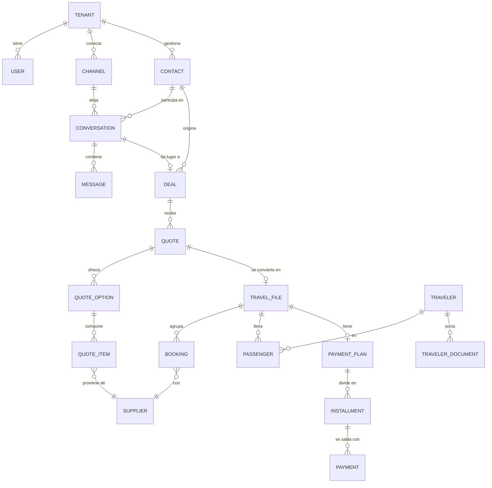
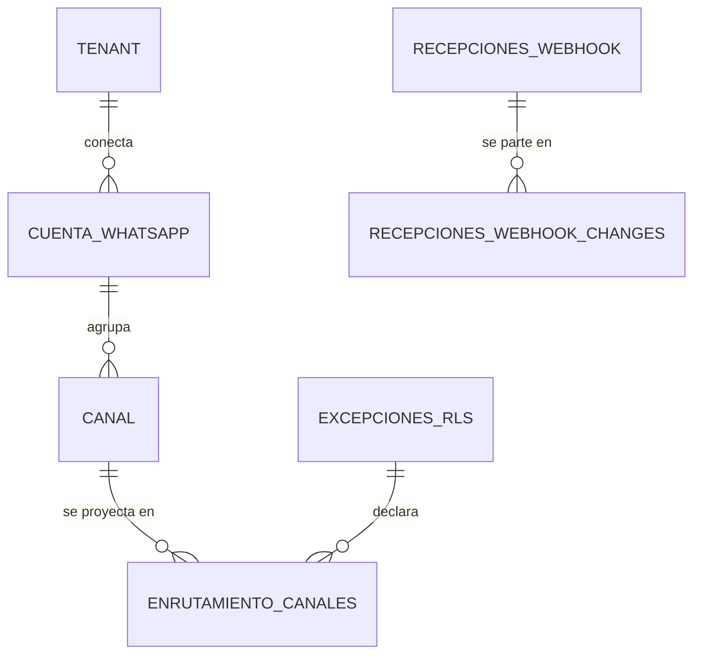
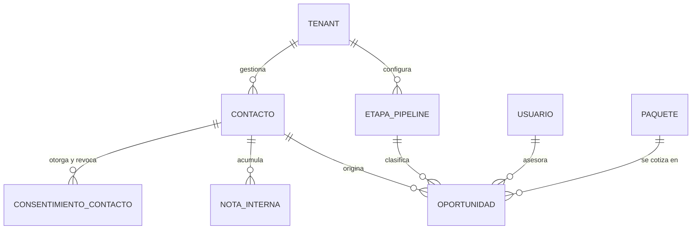
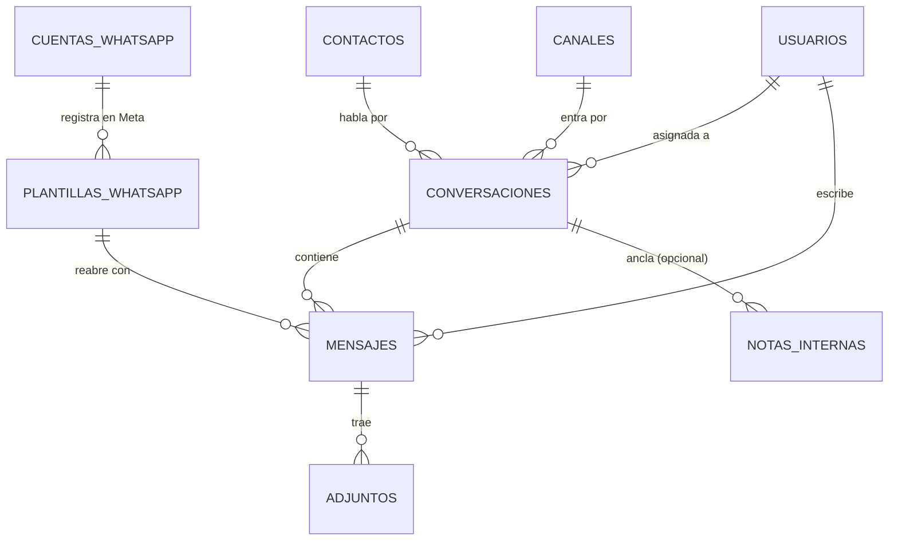
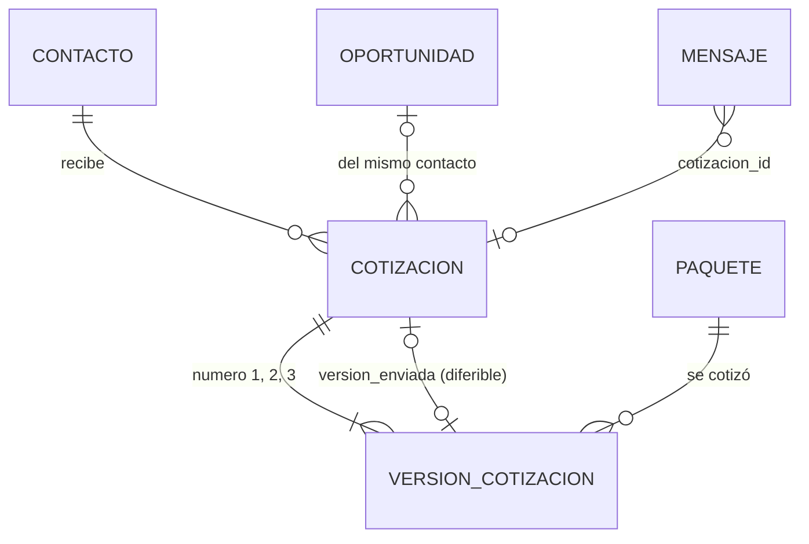

# Modelo de datos

> El esquema es el activo más caro de cambiar del sistema. Este documento explica **por qué** está
> modelado así; el esquema ejecutable vive en `packages/database/schema.prisma`.

---

## 1. Reglas transversales

Aplican a **toda** tabla de negocio, sin excepción:

| Regla | Forma |
|---|---|
| Aislamiento | `tenant_id uuid NOT NULL` + política RLS con `USING` y `WITH CHECK`. Ver [ADR-0003](../03-adr/0003-multitenancy.md) |
| Clave primaria | `uuid` v7 — ordenable en el tiempo, buen comportamiento en índices, no filtra volumen de negocio como haría un entero autoincremental |
| Dinero | `amount_cents bigint` + `currency char(3)`. **Nunca** coma flotante |
| Fechas y horas | `timestamptz` en UTC |
| Fechas de viaje | `date` — un vuelo del 24 es del 24 sin importar el huso horario |
| Borrado | Lógico: `deleted_at timestamptz`. Toda consulta lo excluye por defecto |
| Auditoría | `created_at`, `updated_at`, `created_by`, `updated_by` |
| Índices | Compuestos con `tenant_id` **siempre en primera posición** |

### Por qué dinero en enteros

`0.1 + 0.2 !== 0.3` en coma flotante. En un cotizador que suma veinte ítems en tres monedas con
markup porcentual, ese error se acumula y aparece como una diferencia de centavos entre lo cotizado
y lo cobrado. Es pequeño y es imperdonable: destruye la confianza en el sistema.

Las conversiones guardan **además** la tasa aplicada y su fecha. La TRM de una cotización queda
congelada: si el dólar sube mañana, lo que el cliente vio no cambia.

---

## 2. El mapa



### El mapa del enrutamiento entrante (ADR-0008)

Va aparte porque cruza la frontera del aislamiento, y conviene verlo de un vistazo: a la
izquierda, lo que está **bajo RLS**; a la derecha, lo que **no puede estarlo** y por qué.



| Tabla | ¿RLS? | Qué guarda |
|---|---|---|
| `cuentas_whatsapp` | **Sí** | El WABA de la agencia y su token cifrado. Es la **verdad**: el directorio es derivado de aquí |
| `canales` | **Sí** | El número conectado, con `phone_number_id` **en claro** bajo aislamiento |
| `enrutamiento_canales` | **No** | Solo claves de ruteo en HMAC → `tenant_resuelto_id`, más `canal_id` **o** `cuenta_id`. Es lo que rompe el ciclo huevo-gallina |
| `enrutamiento_historial` | **No** | Bitácora del directorio, particionada por año. Global porque `registros_auditoria` archivaría el ataque bajo el atacante |
| `recepciones_webhook` (+ hija) | **No** | El cuerpo cifrado del webhook, durante segundos, antes de saber de quién es |
| `excepciones_rls` | **No** | La declaración que gobierna los privilegios. Se declara a sí misma |

El ciclo que esto rompe, en una frase: **para saber de qué agencia es el webhook hay que
leer una tabla, y si esa tabla está protegida por tenant, hay que saber la agencia para
leerla.** Meta manda todos los webhooks de todas las agencias al mismo endpoint.

**La zona sin RLS queda acotada a una franja exacta y descriptible: entre la validación de
la firma y la resolución del tenant. En esa franja no se lee ni se escribe ninguna tabla de
negocio.** Esa frase es la que hace compatible el diseño con ADR-0003.

### Referencias cruzadas entre tablas con tenant: clave foránea COMPUESTA

Una regla general que merece quedar escrita, y que ADR-0008 obliga a aplicar:

> Cuando una tabla referencia a otra que también tiene `tenant_id`, **la clave foránea
> incluye el tenant**: `UNIQUE (id, tenant_id)` en la referenciada y
> `FOREIGN KEY (otra_id, tenant_id) REFERENCES otra (id, tenant_id)`.

Escrita simple, la referencia puede apuntar a la fila de otro tenant y **nadie lo nota
hasta que una fila cruza agencias**: RLS no interviene, porque la comprobación de
integridad referencial se ejecuta por encima de las políticas. Lo verifican las aserciones
25 y 25bis. Está aplicada en `canales → cuentas_whatsapp`, en
`enrutamiento_canales → canales` y en `enrutamiento_canales → cuentas_whatsapp`.

**Y se aplica a TODAS las variantes de la referencia, no a la más visible.** La primera
versión solo la puso en `canal_id`, de modo que las filas de tipo WABA —`canal_id` nulo,
`cuenta_id` relleno, las que gobiernan todos los eventos de plantillas y de cuenta— se
quedaron sin respaldo del motor: entraban sin que nada comprobara de quién era la cuenta.
Un `CHECK (num_nonnulls(canal_id, cuenta_id) = 1)` cierra la figura: **toda fila es de una
de las dos clases, y las dos tienen clave foránea compuesta.**

**Desde el 2026-10-19 no queda ninguna simple, y lo vigila un barrido, no una lista.** Las tres
últimas venían de la migración inicial y las cerró `20261019220000_foraneas_con_tenant_en_el_modelo_antiguo`:

```
mayoristas (id, tenant_id) <── paquetes (mayorista_id, tenant_id)   SET NULL ("mayorista_id")
paquetes   (id, tenant_id) <── temporadas (paquete_id, tenant_id)   CASCADE
temporadas (id, tenant_id) <── precios (temporada_id, tenant_id)    CASCADE   [UNIQUE nuevo en temporadas]
```

La aserción 54 recorre `pg_constraint` entero: toda foránea entre dos tablas con `tenant_id` tiene
que emparejar el `tenant_id` de la hija con el del padre en la misma posición. La migración repite
la consulta y tumba el despliegue si encuentra alguna. `temporadas` y `precios` son del modelo
anterior a ADR-0009 pero siguen vivas: las leen `cotizar-paquete` y `listar-paquetes`.

**La aserción 17 juzga por el dato, no por el nombre.** Toda tabla fuera de `excepciones_rls` con
una columna que sea foránea hacia `tenants` o que se llame `tenant%` tiene que tener RLS habilitada
y forzada, y toda excepción tiene que tener `motivo` no vacío. A diferencia de la aserción 1, no
depende de la vista `tablas_sin_aislamiento`, que vive en la base y una migración puede reescribir.

---

## 3. Decisiones de modelado y su porqué

### `Contact` ≠ `Traveler` ≠ `Passenger`

La distinción que más confunde al llegar y la que más problemas evita después.

| Entidad | Qué es | Ejemplo |
|---|---|---|
| `Contact` | Con quien la agencia conversa | La mamá que escribe por WhatsApp |
| `Traveler` | Persona que viaja, con sus datos y documentos | Ella, su esposo y sus dos hijos |
| `Passenger` | Un `Traveler` **dentro de un archivo concreto**, con su tipo (ADT/CHD/INF) y su asiento | Cada uno, en ese viaje específico |

Fusionarlas parece una simplificación razonable hasta el primer viaje familiar, y entonces hay que
rehacer el modelo con datos en producción. El mismo `Traveler` es `Passenger` en varios archivos a
lo largo de los años: eso es lo que hace posible la recompra.

### `Quote` con versiones inmutables

Una cotización enviada **no se modifica**. Editarla crea una versión nueva; la anterior queda
congelada con su contenido y su fecha de envío.

Sin esto no hay forma de resolver un reclamo del tipo "ustedes me ofrecieron otro precio". Con
esto, se abre la versión que el cliente recibió y la conversación se acaba.

### `QuoteItem` — netos y venta en la misma fila

```
net_amount_cents      Lo que cobra el proveedor. NUNCA se muestra al cliente.
sell_amount_cents     Lo que paga el cliente.
markup_type           PERCENTAGE | FIXED
markup_value
commission_rate       Lo que el proveedor devuelve. NO lo paga el cliente.
tax_amount_cents
currency              Moneda del proveedor
exchange_rate         TRM congelada
exchange_rate_date
```

**Markup y comisión no son lo mismo.** El markup lo paga el cliente (va sobre la tarifa neta); la
comisión la paga el proveedor (sale de su tarifa). Se contabilizan distinto y se declaran distinto.
Un modelo con un solo campo "ganancia" no puede responder cuánto se facturó ni cuánto se ganó.

### `TravelFile` como agregado central

Todo converge aquí: pasajeros, reservas, documentos, pagos, itinerario, bitácora. Es lo que el
sector llama "el file", y es la unidad sobre la que se mide el margen.

### `Booking.time_limit` — el campo que salva dinero

Fecha y hora límite para emitir o pagar antes de que el proveedor libere el cupo. Vencido, se
pierde la reserva y probablemente la venta.

Por eso no es un campo más: tiene índice propio, un trabajo programado que lo vigila, y el evento
`TimeLimitApproaching`. Es, en términos de dinero salvado, probablemente la funcionalidad de mayor
retorno de todo el sistema.

### `Message` — la tabla que más crecerá

Crecerá más rápido que todas las demás juntas: decenas de miles de filas por tenant al mes.

- Restricción única `(tenant_id, provider_message_id)` → idempotencia garantizada por el motor.
- Índice `(tenant_id, conversation_id, created_at DESC)` → cargar el hilo es la consulta más
  frecuente del producto.
- El contenido se guarda como `jsonb` porque los tipos de mensaje de WhatsApp varían mucho y Meta
  agrega formatos nuevos. Los campos que se consultan (tipo, dirección, estado) son columnas.
- **Particionado por rango de fecha diseñado antes de los primeros 10 millones de filas.**
  Después es una migración con ventana de caída.

### `outbox` — eventos que no se pierden

```
id · tenant_id · aggregate_type · aggregate_id
event_type · event_version · payload jsonb
occurred_at · published_at
```

El evento se escribe en la **misma transacción** que el cambio de estado. Un relay lee los no
publicados y los envía a BullMQ.

Sin esto: publicas el evento, la transacción revierte, y acabas de notificar un hecho que nunca
ocurrió. Con esto: o pasan las dos cosas, o no pasa ninguna.

`event_version` existe desde el principio porque los eventos son contrato público, y cambiar la
forma de uno publicado rompe a sus consumidores igual que cambiar una API.

### Datos personales sensibles

`TravelerDocument` guarda pasaportes, cédulas, visas y fechas de nacimiento, a veces de menores.

- Los números de documento se cifran a nivel de aplicación (AES-256-GCM) antes de persistirse.
- Todo acceso queda en la bitácora de auditoría: quién, cuándo, a qué.
- Política de retención definida: no se guardan para siempre "por si acaso".

Ver [protección de datos](../05-seguridad/02-proteccion-de-datos.md).

---

### Configuración y campos personalizados por tenant

Consecuencia directa de [ADR-0006](../03-adr/0006-parametrizacion-y-extensibilidad.md): el producto
se parametriza por agencia, y **eso hay que preverlo en el esquema desde la primera migración**.

**Nada de `enum` en el código para lo que cada agencia define distinto.** Las etapas del pipeline,
los motivos de pérdida, las reglas de markup y los tipos de proveedor son **tablas por tenant**,
no constantes de TypeScript. Convertir un `enum` en tabla cuando ya hay datos en producción es una
migración con reasignación de filas; nacer como tabla no cuesta nada.

**Campos personalizados.** Cada agencia tendrá siempre un dato que no previmos. El diseño:

```
custom_field_definitions          tenant_id · entidad · clave · etiqueta · tipo · obligatorio · orden
<entidad>.custom_fields jsonb     los valores, en la fila de la entidad
```

Las definiciones son relacionales (se consultan, se validan, se ordenan en la interfaz); los
valores van en una columna `jsonb` de la propia entidad, con índice GIN para poder filtrar por
ellos. Separarlo así evita la tabla genérica clave-valor, que degrada el rendimiento en cuanto hay
volumen.

Entidades que los llevan desde v1: `contacts`, `travelers`, `deals`, `travel_files`.

**Por qué ahora y no después.** Los campos personalizados están en la misma categoría que
`tenant_id`, el versionado de cotizaciones y los *time limits*: **añadirlos más tarde significa
migrar datos de producción.** La interfaz para gestionarlos puede llegar en la Fase 2; la columna
y la tabla de definiciones, no.

**Resolución de valores por defecto.** El alta de una agencia siembra configuración opinada que ya
sirve para operar —etapas, plantillas, roles, reglas de markup—. La agencia cambia solo lo que le
estorba. Un sistema que exige configurar cuarenta cosas antes del primer mensaje se abandona en la
semana dos.

### Preparar la agregación anónima entre tenants

El [norte del producto](../00-vision/05-norte-del-producto.md#27-el-horizonte-lejano-la-red-entre-agencias)
contempla, a largo plazo, benchmarking anónimo entre agencias y calificación compartida de
proveedores. Eso **no se construye ahora**, pero condiciona el esquema hoy:

- Los proveedores necesitan un **identificador canónico global** además del registro por tenant.
  Sin él, el «Hotel Las Américas» de una agencia y el de otra son entidades distintas para siempre,
  y la agregación se vuelve imposible sin un trabajo de reconciliación manual.
- Las métricas agregables (conversión, ticket promedio, margen) deben poder calcularse por tenant
  **sin depender de campos de configuración libre**, o no serán comparables entre agencias.
- El esquema debe permitir distinguir lo que es dato del tenant de lo que podría agregarse de
  forma anónima, para que la decisión de consentimiento sea posible después.

Costo hoy: una columna y una tabla de catálogo. Costo si se agrega más tarde: migrar datos de
producción y reconciliar proveedores a mano.

## 4. Tablas globales (las excepciones a RLS)

Solo estas. Cada una documentada aquí por obligación: una tabla sin `tenant_id` que no esté en esta
lista es un defecto bloqueante.

**Esta lista es la canónica, y desde ADR-0008 no es la fuente.** La fuente es la tabla
`excepciones_rls`, que vive **en la base** y que `001-aislamiento-tenant.sql` aplica
literalmente: la vista `tablas_sin_aislamiento` la consulta, y la aserción 11 de la prueba
de aislamiento compara su contenido contra un literal escrito en el archivo de prueba.
Antes había dos listas —una en el SQL y otra aquí— y **ya habían divergido**; el ADR se
apoyaba en la decorativa como mecanismo de control. Si este documento y `excepciones_rls`
discrepan, el defecto está en este documento.

Importa mantenerla corta porque **una tabla que entra en esta lista deja de estar vigilada
para siempre.**

| Tabla | ¿Existe hoy? | Por qué es global |
|---|---|---|
| `tenants` | Sí | Define los tenants: es la unidad de aislamiento y no puede estar aislada. La aplicación solo la lee |
| `monedas` | Sí | Dato de referencia universal, igual para todas las agencias |
| `_prisma_migrations` | Sí | Historial de migraciones de Prisma. Lo gestiona el rol propietario; ningún rol de aplicación tiene privilegios sobre ella |
| `excepciones_rls` | Sí — **ADR-0008** | La declaración que gobierna los privilegios de todas las demás. Se declara **a sí misma** con privilegios vacíos: si no lo hiciera, el `GRANT ... ON ALL TABLES` le daría `INSERT/UPDATE` a los roles de aplicación y el remedio del fallo crítico se convertiría en su vehículo — una fila manipulada se concedería sola en el siguiente despliegue, y una comprobación que contrastara lo real contra lo declarado la validaría como correcta |
| `enrutamiento_canales` | Sí — **ADR-0008** | El mapa `identificador de Meta → tenant`. Es lo que rompe el ciclo: leerlo es el paso previo a saber de qué agencia es el webhook. Claves en HMAC con pimienta fuera de la base; **ningún rol de login tiene un solo privilegio sobre ella** |
| `enrutamiento_historial` | Sí — **ADR-0008** | Bitácora del directorio, particionada por año. Es global porque `registros_auditoria` tiene `tenant_id` y RLS forzada: el registro de un secuestro quedaría archivado bajo el **atacante**, invisible para la víctima. Solo inserción, ni su propietario puede modificarla |
| `recepciones_webhook` y `recepciones_webhook_changes` | Sí — **ADR-0008** | El staging del webhook: contenido de varios tenants durante segundos, **antes** de saber de quién es. Cifrado con AAD, borrado al clasificar y purgado. Se cuentan como una: la hija existe porque el grano real del procesamiento es el `change` |
| `identidades`, `credenciales`, `sesiones`, `verificaciones` | Sí — **ADR-0011** | La persona y su autenticación (Better Auth). Existen antes de elegir agencia y el inicio de sesión corre sin `app.current_tenant`. **Solo `viajapro_identidad`** tiene privilegios (DML); los tres roles de siempre, cero, declarados fila por fila |
| `accesos_identidad` | Sí — **ADR-0011** | Índice `(identidad, agencia)` para el selector de agencia. `viajapro_identidad` solo la lee; la escribe únicamente el disparador `SECURITY DEFINER` de `usuarios` (dueño `viajapro_accesos`, NOLOGIN). No decide nada: lo que cuenta es leer `usuarios` bajo RLS |
| `plans` | Todavía no | Catálogo de planes del SaaS, igual para todos |
| `countries`, `timezones` | Todavía no | Datos de referencia universales |
| `system_message_templates` | Todavía no | Plantillas base sugeridas, que cada tenant copia y adapta |

**Regla de parada, y se enuncia sobre lo que de verdad importa:** tablas globales **con
datos de negocio o de ruteo**, tres (`enrutamiento_canales`, `enrutamiento_historial`,
`recepciones_webhook` con su hija). Si aparece una cuarta, **el patrón está mal** y hay que
revisar la decisión, no añadirla a la lista. Las tablas de control del propio mecanismo
—`excepciones_rls`— y los catálogos de referencia son otra categoría. **Las cinco de identidad
(ADR-0011) son una tercera**, decidida por ADR y no añadida a la lista: no guardan datos de
negocio ni de ruteo sino la autenticación de la persona, y tienen su propio rol de conexión,
que no ve ninguna tabla de negocio. La regla de parada sigue en tres.

**Ninguna de ellas tiene ni tendrá una columna llamada `tenant_id`**, y eso no es
cosmético: el aplicador de políticas es dirigido por datos y se la pondría RLS
automáticamente, devolviendo el ciclo huevo-gallina sin producir ningún error y en
producción. Por eso la columna del directorio se llama `tenant_resuelto_id`. Lo vigila la
aserción 17.

### Y las particiones cuentan como tablas

`enrutamiento_historial` está particionada por año, y una partición **es una tabla con su
propia lista de permisos y su propia configuración de RLS**. Dos consecuencias que no son
teóricas:

- Revocar sobre la tabla particionada **no** alcanza a sus particiones: hay que descender
  por `pg_inherits`. Lo hace `aplicar_privilegios_declarados()`, y la aserción 24 enumera
  todas las particiones en vez de preguntar solo por el padre — PostgreSQL comprueba los
  privilegios del padre cuando se accede a través de él y nunca los de la partición, así
  que un `UPDATE enrutamiento_historial_2028` habría pasado por encima de la bitácora con
  la aserción en verde.
- Una partición creada por el rol de migraciones **nace** con los privilegios que concede
  `ALTER DEFAULT PRIVILEGES`. Por eso no se crean a mano: `crear_particion_historial(año)`
  las crea, les pone el propietario, repite la revocación del dueño y reaplica los
  privilegios declarados. **Crear la del año siguiente es trabajo de plataforma con dueño
  y fecha**; hay particiones hasta 2030 y, si faltara, las escrituras fallan de forma
  ruidosa —ninguna agencia podría conectar su canal—, que es preferible a una partición por
  defecto que luego impide adjuntar el año nuevo sin mover filas.

Lo mismo vale para RLS el día que se particione una tabla de negocio —`mensajes` **no** se
particiona hoy, y si llega a hacerse será por HASH de `tenant_id`: ADR-0010 §1.5—:
la política va al padre **y a cada partición**, o un `SELECT` directo contra la partición
usa su propia configuración, que nadie habilitó. `aplicar_aislamiento_tenant` ya desciende,
y `tablas_sin_aislamiento` imputa cada partición a su tabla raíz.

### Lo que todavía no tiene camino, dicho aquí para que no se pierda

- **Borrar una fila del directorio no lo puede hacer nadie.** Ningún rol de login tiene
  `DELETE` sobre `enrutamiento_canales` y ninguna función lo ofrece; además, borrar un
  tenant cascadea a `canales` y choca con el `ON DELETE RESTRICT` del directorio. La
  retención de 5 años de las filas `REVOCADO` y un derecho de supresión no tienen hoy
  ejecutante que no sea el rol propietario, que es justo lo que ADR-0008 no acepta como
  control. **Decidido en ADR-0010 §1.4:** la baja de una agencia es lógica y el `RESTRICT`
  es intencional. La retención la ejecutará `purgar_directorio(p_anteriores_a)`, nunca el
  rol propietario a mano, y se construye antes de la fecha límite que fija ese ADR.
- **`canales.estado` → `enrutamiento_canales.estado`: lo ata un disparador desde el
  2026-10-19 (tarea 4f, migración `20261019120000_propagar_estado_de_canal_al_directorio`).**

  ```
  UPDATE canales SET estado = 'REVOCADO'          (viajapro_app, bajo RLS)
        │  AFTER UPDATE OF estado WHEN estado <> 'ACTIVO'
        ▼
  propagar_estado_canal()    SECURITY DEFINER, dueño viajapro_enrutador, sin EXECUTE para nadie
        ├─► enrutamiento_canales.estado := max(actual, NEW.estado)   (canal_id y tenant de NEW)
        └─► enrutamiento_historial       asiento ACTIVO → REVOCADO
  ```

  Por qué un disparador y no que `resolver_enrutamiento` lea `canales`: el resolvedor corre
  sin contexto de tenant y su dueño no tiene privilegios sobre `canales` por diseño; leerla
  desde ahí sería una lectura entre tenants nueva. El disparador recibe la fila en `NEW` y no
  necesita ninguno. Es **monótono**: restringe y nunca relaja, porque reactivar el ruteo es
  repuntar y eso queda solo en `registrar_enrutamiento`. Aserción 46.

  **Los cuatro huecos que dejaba, cerrados el 2026-10-19** (ADR-0010 punto 6, migración
  `20261020010000_huecos_del_disparador_y_tope_del_barrido`, aserciones 55 a 58). Estado
  **efectivo** de un canal o una cuenta = `REVOCADO` si tiene `eliminado_en`, si no su `estado`.

  ```
  INSERT o UPDATE OF estado, eliminado_en      (viajapro_app, bajo RLS)
        │                                   │
     canales                          cuentas_whatsapp
        ▼                                   ▼
  propagar_estado_canal()            propagar_estado_cuenta()      dueño viajapro_enrutador,
   filas de número (canal_id)         filas WABA (cuenta_id)        sin EXECUTE para nadie
        └──────────► directorio := max(actual, efectivo) + asiento ◄──────┘

  registrar_enrutamiento(..., p_estado)       (viajapro_altas, con tenant de sesión)
        │  lee canales / cuentas_whatsapp BAJO RLS: SELECT(id, tenant_id, estado, eliminado_en)
        └─► rechaza (55000) si p_estado < efectivo        → no hay re-alta sobre un REVOCADO
  ```

  | Hueco | Cómo se cerró |
  |---|---|
  | (a) baja de cuenta | Disparador gemelo sobre `cuentas_whatsapp`; solo filas WABA de esa cuenta y ese tenant. Las filas de **número** de una cuenta dada de baja siguen la verdad de `canales`: la baja de una cuenta tiene que dar de baja sus canales (caso de uso) |
  | (b) borrado lógico | Los dos disparadores escuchan `eliminado_en` y lo tratan como `REVOCADO`. Deshacer el borrado no relaja |
  | (c) re-alta | `registrar_enrutamiento` no escribe un estado más laxo que el efectivo. El re-alta legítimo existe: primero el canal vuelve a `ACTIVO`, luego se repunta |
  | (d) `INSERT` | Los dos disparadores escuchan `INSERT`. Hoy la clave foránea ya impide filas de un canal que no existe, así que el riesgo real era (c) |

  Por qué el dueño del directorio puede ahora leer cuatro columnas de `canales` y
  `cuentas_whatsapp`, cuando 4f lo rechazó para el resolvedor: el resolvedor corre **sin**
  contexto y sería una lectura entre tenants; `registrar_enrutamiento` exige que el tenant de
  la sesión sea el de la fila y la RLS forzada vale también para el dueño de la función. Sin
  contexto lee cero filas, y nunca el `phone_number_id` ni el token (aserción 57). Una baja
  concurrente con un alta se serializa con un bloqueo consultivo por canal o por cuenta
  (claves 7410100 y 7410101) que toman los dos lados antes de leer.

- **Los changes que se quedan `PENDIENTE` ya se pueden listar (2026-10-19, migración
  `20261019210000_listar_changes_pendientes_para_el_barrido`).** Es la mitad de base de datos
  del relay de barrido de ADR-0010 punto 9: si el POST guarda y el encolado falla, el change
  ya no depende solo del reintento de Meta.

  ```
  trabajo programado (viajapro_webhook)
        │  listar_changes_pendientes(antigüedad_mínima_s, límite 1..1000)
        ▼                                    SECURITY DEFINER, dueño viajapro_staging
  recepciones_webhook_changes  ⋈  recepciones_webhook
        WHERE estado = 'PENDIENTE' AND payload_cifrado IS NOT NULL AND recibido_en <= now() - N s
        ORDER BY recibido_en                 índice parcial ..._changes_pendientes_idx
        ▼
  (recepcion_id, indice, antiguedad_s)  ──►  reencolar con jobId <hex>-<indice> (R5)
  ```

  Por qué así: es la primera función que **lista** el staging, y el staging guarda contenido
  de varias agencias sin RLS. Por eso devuelve solo identificadores y antigüedad (ni payload
  ni tenant), el límite es obligatorio y nadie salvo el trabajador la ejecuta. Excluye las
  recepciones ya anuladas por `purgar_payloads`: sin contenido no hay qué procesar, y
  reencolarlas sería un bucle. Es la novena `SECURITY DEFINER`; aserciones 12, 13, 20 y 53.

  **Tope de reencolados en la base (2026-10-19, `20261020010000`, aserción 59).** Con más de
  500 changes abandonados el límite del barrido los devolvía siempre a ellos y tapaban a los
  nuevos. `recepciones_webhook_changes.intentos_barrido smallint NOT NULL DEFAULT 0` cuenta
  los reencolados; `contar_reencolado_barrido(recepcion_id, indice)` suma uno a un change
  `PENDIENTE` y devuelve el total (0 si ya se resolvió). `listar_changes_pendientes` gana un
  tercer argumento `p_max_intentos` (DEFAULT 10, el `maxReencolados` por defecto), excluye
  `intentos_barrido > tope` y ordena por `intentos_barrido` antes que por antigüedad.

- **Inventario de funciones `SECURITY DEFINER`** (ADR-0010 §1.2 es inmutable y se quedó en
  ocho; esta es la lista viva, y la matriz normativa es `MATRIZ_FUNCIONES` de la aserción 20).

  | Función | Dueño | `EXECUTE` |
  |---|---|---|
  | `resolver_enrutamiento` | `viajapro_enrutador` | `viajapro_webhook` |
  | `registrar_enrutamiento` | `viajapro_enrutador` | `viajapro_altas` |
  | `propagar_estado_canal` | `viajapro_enrutador` | nadie (disparador) |
  | `propagar_estado_cuenta` | `viajapro_enrutador` | nadie (disparador) |
  | `registrar_recepcion` | `viajapro_staging` | `viajapro_app` |
  | `tomar_recepcion` | `viajapro_staging` | `viajapro_webhook` |
  | `anular_payload` | `viajapro_staging` | `viajapro_webhook` |
  | `purgar_recepciones` | `viajapro_staging` | `viajapro_webhook` |
  | `purgar_payloads` | `viajapro_staging` | `viajapro_webhook` |
  | `listar_changes_pendientes` | `viajapro_staging` | `viajapro_webhook` |
  | `contar_reencolado_barrido` | `viajapro_staging` | `viajapro_webhook` |

---

## 5. Rendimiento

**Consultas calientes** — se miden con `EXPLAIN ANALYZE` sobre datos sembrados a volumen realista
(100k conversaciones, 1M mensajes) antes de darlas por buenas:

| Consulta | Frecuencia | Índice que la sostiene |
|---|---|---|
| Bandeja: conversaciones con su último mensaje | Altísima | `(tenant_id, status, last_message_at DESC)` + denormalización del último mensaje |
| Hilo de una conversación, paginado hacia atrás | Altísima | `(tenant_id, conversation_id, created_at DESC)` |
| Búsqueda de contacto por nombre o teléfono | Alta | `pg_trgm` + `unaccent` |
| Pipeline por etapa | Alta | `(tenant_id, stage_id, updated_at DESC)` |
| *Time limits* próximos a vencer | Programada | `(tenant_id, time_limit) WHERE status = 'CONFIRMED'` — índice parcial |

**Denormalización deliberada:** `conversation.last_message_at`, `last_message_preview` y
`unread_count` se mantienen al día con cada mensaje. Calcularlos al vuelo haría de la bandeja —la
pantalla más usada del producto— la consulta más cara. Es una optimización consciente, con su costo
de consistencia asumido y documentado.

---

## 6. Evolución del esquema

- **Una migración por cambio lógico**, con nombre descriptivo.
- **Nunca se edita una migración ya aplicada.** Se corrige con una nueva.
- **Toda migración debe ser segura en caliente.** Cambios bloqueantes sobre tablas grandes, en dos
  pasos: agregar nullable → rellenar → imponer la restricción.
- Las migraciones corren **antes** del despliegue de la aplicación y deben ser compatibles con la
  versión anterior en ejecución. Sin eso, cada despliegue es una ventana de caída.
- Una migración irreversible se declara como tal, con su plan de reversión escrito.

---

## 7. CRM — contactos y oportunidades (2026-10-10)

Lo que hace que la pantalla de pipeline deje de ser una maqueta. Sirve los contratos de
`packages/contracts/src/crm.ts` sin cambiarlos.



### Por qué así

| Decisión | Porqué |
|---|---|
| **Etapas: tabla por tenant con columna `clave`** | Ya era tabla (R12). La `clave` —`NUEVO_LEAD`…`PERDIDA`— es el puente con el enum cerrado del contrato. Nullable a propósito: una agencia puede tener más etapas que las cinco del contrato, y una etapa sin clave existe pero hoy no es representable en la API. Forzar un valor metería dos etapas en la misma columna del tablero |
| **Consentimiento: tabla, no columnas** | La Ley 1581 de 2012 no pide saber *si* hay consentimiento: pide demostrar cuándo, con qué finalidad y por qué canal, y registrar la revocación. Tres columnas sobrescribibles no demuestran nada. Índice único **parcial**: una finalidad vigente por contacto, histórico completo de las revocadas |
| **Motivo de pérdida: enum del motor** | Al revés que las etapas, y no es incoherencia: la etapa es el proceso de venta de cada agencia; el motivo es la taxonomía con la que se compara el rendimiento entre agencias y se decide si tocar el markup o el SLA. Si cada una inventa la suya, esa comparación no existe. `OTRO` + explicación obligatoria es la válvula |
| **La regla de pérdida, partida entre base y contrato** | «`OTRO` exige explicación» y «no hay nota sin motivo» son comprobaciones de **la fila** y van en `CHECK`. «Perdida ⇒ hay motivo» y «hay motivo ⇒ está perdida» **no pueden** ser un `CHECK`: la etapa vive en otra tabla y un `CHECK` no mira otra tabla. Hacerlo con un disparador sería esconder una regla de negocio donde nadie la busca y pagarla en cada movimiento de tarjeta. Esas dos se quedan en el contrato, que las aplica a la web, a la API y a cualquier integración |
| **Próxima tarea: tres columnas, no tabla `tareas`** | El contrato expone UNA próxima tarea. Una tabla para una fila por oportunidad añade un join a la consulta más caliente a cambio de nada que hoy se use. `CHECK`: las tres o ninguna. El día que haga falta historial, es una tabla nueva |
| **Notas internas colgando del contacto** | `conversaciones` todavía no existe como tabla y el panel lateral las pide por contacto. Cuando el inbox la cree, `conversacion_id UUID NULL` con clave foránea compuesta es una migración aditiva de un minuto. Al revés habría forzado al inbox a existir antes que el pipeline |
| **Todas las claves foráneas, COMPUESTAS con el tenant** | Estaban escritas simples: la oportunidad de una agencia podía colgar del contacto, la etapa o el asesor de otra. RLS no lo impide —la integridad referencial se comprueba por encima de las políticas—. Mismo defecto que ADR-0008 cerró en el directorio. Aserciones 29 y 30 |
| **Búsqueda con `pg_trgm` + `unaccent` + `btree_gin`** | El filtro de tenant y el texto entran en el **mismo** índice. `preferencias` queda fuera a propósito (R10): indexar por trigramas un campo que puede contener una alergia convierte el buscador en una herramienta para minar datos de salud |

### Enlace con el inbox

`contactos` y las futuras `conversaciones` se enlazan por **`contacto_id`**, nunca por teléfono.
El teléfono es único por tenant (`UNIQUE (tenant_id, telefono_e164)`) y es la llave natural para
*resolver* quién escribe, pero no es la clave de la relación: cambia, se reasigna, y una agencia
puede tener dos canales. `contactos` ya expone `UNIQUE (id, tenant_id)`, que es lo que permite a
`conversaciones` declarar `FOREIGN KEY (contacto_id, tenant_id)` el día que se cree.

---

## Inbox — conversaciones, mensajes, adjuntos y el espejo de plantillas

*Añadido en `20261011090000_inbox_conversaciones_mensajes_y_plantillas`. Sirve
`packages/contracts/src/inbox.ts` y `packages/contracts/src/plantillas.ts`.*



**Todas las claves foráneas son compuestas con `tenant_id`.** Es el agujero que se cerró en
`oportunidades` y aquí había dos puertas: el contacto y el canal. RLS no interviene en la
integridad referencial —PostgreSQL la comprueba por encima de las políticas—, así que con una
clave simple el hilo de una agencia puede colgar del contacto de otra y la fila resultante es
invisible para las dos. Lo vigilan las aserciones 39 y la mutación M6.

### Las decisiones y su porqué

| Decisión | Por qué |
|---|---|
| **Un hilo por `(contacto, canal)`** | En WhatsApp el hilo es el que el cliente ve en su teléfono. Partirlo por «tema» crea dos verdades de la misma pantalla, y es lo que permite al webhook hacer `ON CONFLICT DO UPDATE` sin carreras. |
| **La ventana de 24 h es UNA columna** (`ultimo_mensaje_cliente_en`) | `abierta`, `expiraEn` y `minutosRestantes` son función de ese instante y de `now()`. Una columna `abierta` caduca sin que nadie escriba: a las 15:00 nadie manda un `UPDATE`, y desde ese segundo estaría mintiendo. |
| **`wamid` único por tenant, índice parcial** | La idempotencia de R5 en la base, no en el código. Meta reintenta hasta recibir 200, y también cuando el 200 se perdió de vuelta. Por tenant y no global: global sería un oráculo que le confirma a una agencia la actividad de otra. |
| **`clave_idempotencia` única por tenant** | La otra mitad: entre el clic del asesor y la respuesta de Meta no hay identificador. Un doble clic manda el mensaje dos veces, y si es plantilla **se cobra dos veces**. |
| **Dos ejes de tiempo** (`ocurrido_en` de Meta, `creado_en` nuestro) | Los webhooks llegan desordenados: un reintento trae un mensaje de ayer después de uno de ahora. El hilo ordena por el de Meta, con `id` (UUID v7) de desempate porque Meta solo da segundos. R9. |
| **`cotizacion_id` sin FK, por ahora** | La tabla `cotizaciones` no existe todavía. La columna se crea hoy porque el contrato ya la expone y porque añadirla a `mensajes` con millones de filas es caro. La FK compuesta entra con `ADD CONSTRAINT NOT VALID` + `VALIDATE`. |
| **`adjuntos` es tabla, no JSONB** | Ciclo de vida propio: se descarga después, falla, se reintenta, se purga. Y la clave de S3 es lo que hay que recorrer para borrar de verdad los datos de una agencia que se va — S3 **no** está cubierto por RLS (ADR-0003). |

### Las plantillas no son nuestras

`plantillas_whatsapp` es la única tabla del esquema cuyo dueño está fuera del sistema: es un
**espejo** de lo que Meta aprobó. De ahí tres formas que no se parecen al resto del modelo:

1. **La identidad es `(WABA, nombre, idioma)`**, no `(tenant, nombre)`. Una agencia con dos WABAs
   puede tener `recordatorio_pago` en los dos, y son dos plantillas con estados distintos; y la
   misma plantilla en `es_CO` y en `en_US` puede estar aprobada en una y rechazada en la otra.
2. **El tiempo se parte en tres.** `actualizada_en_meta` (lo que dice Meta, lo único que el
   contrato expone), `sincronizada_en` (cuándo lo oímos) y `estado_cambiado_en` (desde cuándo está
   así). La tercera parece redundante hasta que un asesor pregunta «¿desde cuándo está pausada?».
3. **`creado_por` y `actualizado_por` NULOS son el dato**, no un campo sin rellenar: significan que
   el cambio lo hizo Meta. Meta pausa sola una plantilla cuando la marcan como spam, sin avisar.
   Un CHECK exige que `RECHAZADA` y `PAUSADA` traigan motivo: una lista que esconde el porqué no
   explica por qué falta la plantilla que se usaba ayer.

### Por qué `mensajes` NO está particionada

Es la tabla que más crece. Aun así no se particiona hoy, y no por prudencia:

1. **No ayuda a la consulta caliente.** Abrir un hilo es una búsqueda por `(tenant_id,
   conversacion_id)`; un btree de tres niveles cubre un millón de filas igual que cien millones.
2. **Particionar por `ocurrido_en` rompería la idempotencia de R5.** PostgreSQL exige que toda
   restricción única contenga la clave de partición: `(tenant_id, wamid)` pasaría a
   `(tenant_id, wamid, ocurrido_en)`, y el mismo `wamid` reintentado con otro timestamp caería en
   otra partición y se insertaría dos veces. Sin ningún error.
3. **Cuando haga falta, la forma correcta es HASH por `tenant_id`**: mantiene `(tenant_id, wamid)`
   exigible, acota el vacuum por agencia y encaja con el aplicador de RLS, que ya desciende por
   `pg_inherits`.

Disparadores para revisarlo: más de ~50 M de filas, un vacuum que no termina en su ventana, o una
política de retención por fecha —único caso donde partir por tiempo gana, y entonces la
deduplicación de `wamid` se saca a una tabla aparte.

### R10 — el texto de un mensaje es PII

`mensajes.texto` es la mayor superficie de datos sensibles del producto: ahí escribe el viajero, y
en una agencia eso incluye número de pasaporte y fecha de nacimiento de un menor. **No se cifra por
columna**, y la decisión tiene coste: el hilo se lee entero en cada apertura y `ConsultarBandeja.buscar`
busca dentro del texto; cifrado queda ilegible para cualquier índice. Lo que sí se aplica: RLS
forzada (aserción 38), el texto **nunca** viaja a `registros_auditoria.detalle` ni a `outbox.payload`,
el índice de trigramas vive en la misma tabla y bajo la misma política, y el cifrado en reposo lo da
el almacenamiento. **Esto no cierra el asunto:** si el cifrado por columna se considera exigible
para la Ley 1581, es un ADR con `auditor-seguridad` y un rediseño de la búsqueda. Queda en la cola
de `ESTADO.md`.

### El punto ciego que se cerró

`001-aislamiento-tenant.sql` solo miraba si `polwithcheck` era NULL. Quitar `WITH CHECK` dejando
`USING` no cambia el comportamiento —PostgreSQL reutiliza la expresión—, pero un `WITH CHECK`
**presente y distinto** (`WITH CHECK (true)`) pasaba todas las comprobaciones de catálogo mientras
dejaba a cualquier agencia insertar filas dentro de los datos de otra. `003-politica-canonica.sql`
compara ahora el texto de `USING` y de `WITH CHECK` contra una forma canónica, y exige además que la
política sea `PERMISSIVE FOR ALL`. Lo verifican la aserción 36 y las mutaciones M4 y M5.

### `SET NULL` sobre clave foránea COMPUESTA: la columna hay que nombrarla

`notas_internas.conversacion_id` es anulable y su foránea es compuesta —`(conversacion_id,
tenant_id)`—, porque toda referencia cruzada entre tablas con tenant lo es (§2). El `ON DELETE SET
NULL` a secas sobre una clave compuesta anula **todas** sus columnas, y `tenant_id` es `NOT NULL`:
PostgreSQL acepta el DDL y el borrado revienta en ejecución, en producción y no aquí. Peor: el
borrado en cascada de un tenant se atasca en medio.

La forma correcta nombra la columna, y existe desde PostgreSQL 15:

```sql
ON DELETE SET NULL ("conversacion_id") ON UPDATE RESTRICT
```

Está en la migración `20261011090200_notas_set_null_solo_la_conversacion`. **Prisma no sabe
expresar la lista de columnas**: `schema.prisma` dice `onDelete: SetNull` y `prisma format` avisa
con *«should not be set to SetNull when a referenced field is required»*. El aviso es correcto y la
base ya está corregida; lo que no hay que hacer es «arreglarlo» generando una migración nueva desde
el esquema, porque eso devolvería la forma rota. Si una foránea compuesta nueva necesita `SET NULL`,
se escribe el `ALTER TABLE` a mano. Por la misma razón `tarifas → mayoristas` quedó en `Restrict`.

## Catálogo (ADR-0009) e inbox: la unión, no la elección

El ADR-0009 y el inbox se construyeron en ramas hermanas desde el mismo punto, y las dos añadieron
tablas **distintas**. El esquema resultante es la unión:

| Lado | Tablas |
|---|---|
| ADR-0009 (catálogo) | `vigencias` (renombre de `salidas`, con `desde`/`hasta`/`publicada`), `tarifas`, `politicas_de_precio` |
| Inbox | `conversaciones`, `mensajes`, `adjuntos`, `plantillas_whatsapp` |

No se tocan: ninguna foránea cruza de un bloque al otro. Lo único que ambos lados modificaron fue
`usuarios`, y por motivos ajenos —el catálogo lo reformateó, el inbox le añadió dos relaciones
inversas (`conversacionesAsignadas`, `mensajesEnviados`)—, así que la unión también vale ahí.

Las tablas que el inbox tocó de pasada son todas relaciones inversas, salvo una columna:
`tenants`, `usuarios`, `contactos`, `canales` y `cuentas_whatsapp` solo ganan listas; `notas_internas`
gana `conversacion_id`, anulable y añadida en caliente.

La primera aserción del arnés de aislamiento está **dirigida por datos** —consulta la vista
`tablas_sin_aislamiento`—, así que las tres tablas del catálogo quedaron cubiertas sin tocar la
prueba. Es la propiedad que hace barata una mezcla como esta: no hay una lista de tablas que
alguien tenga que acordarse de actualizar.

## Cotizaciones: cabecera mutable, versiones inmutables (2026-10-19)

Migraciones `20261019200000_cotizaciones_con_versiones_inmutables` y
`20261019200100_margen_desconocido_es_nulo`. Tarea 6 de `ESTADO.md`. El invariante viene de
ADR-0006 («una cotización enviada es inmutable; editarla crea una versión») y de ADR-0009 («una
cotización congela sus números»).



| Tabla | Qué guarda | ¿Mutable? |
|---|---|---|
| `cotizaciones` | Contacto, oportunidad opcional, título, `estado` (`BORRADOR`, `ENVIADA`, `ACEPTADA`, `RECHAZADA`, `VENCIDA`), qué versión vio el cliente y cuándo | Sí. Borrado en blando |
| `versiones_cotizacion` | La instantánea: paquete, fecha, vigencia resuelta, pasajeros, política de precio copiada, `lineas` (JSONB con la forma de `OpcionDePrecio`), venta, neto y margen en `bigint` + `moneda_iso`, `vigente_hasta` | **No.** Lo impone un disparador |

### Por qué así

- **La inmutabilidad la impone la base.** `versiones_cotizacion_inmutables` rechaza `UPDATE`,
  `DELETE` y `TRUNCATE`. La única salida es la purga de una agencia entera: tiene que borrar el
  **propietario** de la tabla y la transacción tiene que declarar
  `set_config('viajapro.purga_de_tenants', '<ids>', true)`. Ningún rol de aplicación es
  propietario. Lo usa `scripts/borrar-tenants.mjs`.
- **La versión no cuelga de la cabecera con `CASCADE`, cuelga con `RESTRICT`.** Una acción
  referencial corre con el rol propietario de la tabla afectada, no con el de quien borra. Con
  `CASCADE`, un `DELETE FROM cotizaciones` desde la API llegaría al disparador como propietario,
  y la variable de purga la puede fijar cualquier rol. La única cascada que llega a las versiones
  es la de `tenants`, que la aplicación no puede borrar.
- **Las líneas van en JSONB y no en una tabla hija.** Una tabla hija necesitaría su propio
  disparador y además una regla contra *añadir* líneas a una versión cerrada. Así la instantánea es
  una sola fila. El disparador de alta (`versiones_cotizacion_validar_alta`) exige que cada línea
  traiga `total` entero en la moneda de la versión y que las líneas sumen `venta_unidades`.
- **`vigencia_id` y los `tarifaId` de las líneas no tienen foránea.** El catálogo cambia y las
  vigencias se borran físicamente. Con `RESTRICT` la versión bloquearía el mantenimiento del
  catálogo, y con `CASCADE` se perdería la prueba. Un identificador suelto no filtra nada, porque
  lo que hay detrás está bajo RLS. El paquete sí tiene foránea: se borra en blando.
- **Todas las foráneas son compuestas con `tenant_id`.** La de la oportunidad tiene tres columnas,
  `(oportunidad_id, contacto_id, tenant_id)`, y obliga a que sea del mismo contacto. La de
  `version_enviada`, `(tenant_id, id, version_enviada)`, obliga a que sea una versión de **esta**
  cotización. Esta última es `DEFERRABLE INITIALLY DEFERRED` porque cabecera y versiones se
  referencian en los dos sentidos. Prisma no modela `DEFERRABLE`.
- **`mensajes.cotizacion_id` ya tiene foránea**, compuesta y con `SET NULL ("cotizacion_id")`. Se
  creó `NOT VALID` y se validó en la misma migración, como pedía la cola. Prisma aplica el archivo
  en una sola transacción, así que esa división no acorta el bloqueo. Hoy da igual, porque ninguna
  fila tenía la columna llena. Con millones de filas, el `VALIDATE` iría en una migración aparte.
- **Margen desconocido es `NULL`, nunca 0.** El CHECK de la primera migración se podía saltar con
  la lógica de tres valores (`0 = NULL` da NULL y el CHECK pasa). Lo detectó la aserción 50 y lo
  corrige la segunda migración con `IS NOT DISTINCT FROM`.

Aserciones 47 a 52 en `tests/aislamiento.spec.ts`, más las mutaciones M8 a M13 en
`scripts/mutaciones-aislamiento.mjs`.

## Identidad global, pertenencia por agencia y roles como tabla (ADR-0011, 2026-10-19)

Migración `20261019230000_identidad_global_y_roles_por_agencia`.

```
                 GLOBAL (excepciones_rls, solo viajapro_identidad)         |  POR TENANT (RLS forzada)
                                                                           |
  identidades ──< credenciales                                             |
      │  └────< sesiones ── tenant_activo_id ──> tenants                   |
      │                                                                    |
      ├────< accesos_identidad (identidad_id, tenant_acceso_id) <── disparador ── usuarios ──> roles
      │                                                                    |   │ (rol_id, tenant_id)
      └──────────────────────────────── identidad_id ──────────────────────────┘
  verificaciones (sin FK: códigos previos a la sesión)                     |
```

**Por qué así.**

- **La identidad es global y la pertenencia no.** Una persona existe antes de elegir agencia;
  qué es en cada agencia (rol, clientes asignados) es dato de negocio y vive en `usuarios`, con
  RLS. Las FK que ya apuntaban a `usuarios(id, tenant_id)` no se tocan.
- **Ninguna tabla de identidad tiene una columna `tenant_id`.** El ADR nombraba así la de
  `accesos_identidad`; se llama `tenant_acceso_id` porque el aplicador de `001` es dirigido por
  datos y le habría puesto RLS: el selector, que corre sin tenant, vería cero filas.
- **`viajapro_identidad` no está en `roles_de_aplicacion`.** No recibe el `GRANT ... ON ALL
  TABLES`: sus únicos privilegios son las filas de `excepciones_rls`. La aserción 62 enumera todas
  las tablas no de identidad y exige 42501 en cada una.
- **`accesos_identidad` la escribe un disparador**, `sincronizar_acceso_identidad()`,
  `SECURITY DEFINER`, `search_path` vacío, dueño `viajapro_accesos` (NOLOGIN, solo `SELECT,
  INSERT, DELETE` sobre esa tabla). Lo dispara quien escribe `usuarios` bajo RLS, así que solo
  puede apuntar el par de una fila que ya pasó el `WITH CHECK`. En `UPDATE`, si cambia la
  identidad o el tenant, borra el par viejo.
- **Roles: tabla por tenant, no `enum`** (R12). Se eliminó `rol_usuario`. El catálogo de permisos
  es invariante: `PERMISOS` en `packages/contracts/src/identidad.ts` y el `CHECK
  roles_permisos_del_catalogo`. Tres roles sembrados por agencia con `clave` DUENO, ASESOR y
  OPERACIONES. `usuarios.rol_id` es foránea **compuesta** con `tenant_id`, `NO ACTION` para que
  el borrado en cascada de un tenant no tropiece a mitad de sentencia.
- **Relleno**: una identidad por correo (sin distinguir mayúsculas); DUENO y ADMINISTRADOR
  pasaron al rol DUENO, ASESOR y SOLO_LECTURA a ASESOR. Se borraron `usuarios.rol` y
  `usuarios.hash_contrasena` (vacía). **No reversible** en esa parte.
- **Hash del token y del OTP**: el esquema no lo impone (columnas `text`). Es requisito de la
  rebanada 2 y condición del auditor.

## Catálogo gestionable por la agencia: M1 y M2 (ADR-0017, 2026-10-26)

Migraciones `20261026120000_permiso_catalogo_administrar` (M1) y
`20261026120100_catalogo_extendido_formatos_y_opciones_de_salida` (M2). M3 (claves de API) sigue
bloqueada y no existe.

```
  tenants ──< formatos_de_viaje (plantilla jsonb)
                    ▲ (formato_id, tenant_id)  NO ACTION
                    │
              paquetes (codigo, cargos_en_destino, campos_personalizados, plan_alimentacion NULL)
                    │ (paquete_id, tenant_id)  CASCADE        │ (paquete_id, tenant_id)
                    ▼                                          ▼
           opciones_de_salida ◄──────────────────────── vigencias ──< tarifas
           (etiqueta, hora_salida time,          (opcion_de_salida_id, tenant_id) NO ACTION
            hora_regreso time, punto_de_encuentro)        (lista_unidades, promo_hasta)

  politicas_de_precio.promo_vencida  OCULTAR | TACHAR   (NOT NULL DEFAULT 'OCULTAR')
  roles_permisos_del_catalogo        + 'catalogo.administrar'  (DUENO y OPERACIONES)
```

**Por qué así.**

- **Dos tablas nuevas, las dos de negocio.** `formatos_de_viaje` y `opciones_de_salida` llevan
  `tenant_id`, RLS forzada con `USING` y `WITH CHECK` por `aplicar_aislamiento_tenant`, y no
  están en `excepciones_rls`: el literal de `aislamiento.spec.ts` no cambia. Aserciones 67 a 70.
- **Opciones de salida como tabla, no dos columnas de hora en `paquetes`** (corrección de
  `experto-turismo`, ADR-0017 §3.1): un producto tiene varias (turnos, modalidades con punto de
  recogida, hoteles) y una tarifa referencia una. Una referencia dentro de un `jsonb` no tendría
  integridad. Las horas son `time` sin zona: hora local del punto de encuentro, como la fecha de
  viaje es `date`.
- **Foráneas compuestas en `NO ACTION`**, no `RESTRICT` ni `SET NULL`: la cascada de un tenant se
  lleva formatos, paquetes, opciones y tarifas en la misma sentencia (RESTRICT abortaría a mitad),
  y `SET NULL` sobre una compuesta pondría a NULL también `tenant_id`. Un formato o una opción en
  uso se desactiva, no se borra. Que la opción de una tarifa sea del mismo paquete que su vigencia
  lo valida el núcleo de `quoting`: es coherencia de dominio, no aislamiento.
- **`codigo` único parcial** `(tenant_id, codigo) WHERE codigo IS NOT NULL AND eliminado_en IS
  NULL`; Prisma no modela índices parciales, así que vive solo en la migración.
- **`lista_unidades` nunca entra en el cálculo**; un `CHECK` exige `lista > venta`. La venta no
  cambia sola al vencer `promo_hasta`; `promo_vencida` decide solo qué se muestra.
- **Relleno agencia por agencia con `app.current_tenant`**: tanto la concesión del permiso (M1)
  como los cuatro formatos de sistema (M2) entran por el `WITH CHECK` de su agencia, de modo que
  el resultado no depende de que el rol de migraciones tenga `BYPASSRLS`. M1 verifica al final
  que ningún DUENO u OPERACIONES quedó sin el permiso.
- **Seguras en caliente**: columnas nulables o con `DEFAULT` constante (sin reescritura), y
  tablas de catálogo pequeñas. **Reversibles** por una migración posterior salvo el valor
  `PAQUETE` de `entidad_personalizable`, que PostgreSQL no deja quitar con `ALTER TYPE`.
- **Deuda declarada:** `plan_alimentacion` ya admite nulo, pero el contrato `Paquete` y la web
  aún lo tratan como obligatorio; la semilla real sigue poniendo `SIN_ALIMENTACION` hasta que
  T-041 y la web acepten el nulo. Ninguna fila existente queda nula.

### La versión de cotización guarda la opción de salida (T-062, 2026-10-27)

Migración `20261027130000_opcion_de_salida_en_la_version`.

```
  opciones_de_salida ◄──────────── versiones_cotizacion.opcion_de_salida_id (NULL)
                       (opcion_de_salida_id, tenant_id)  NO ACTION, validada
```

**Por qué así.**

- **Sin ella la versión no era reproducible.** Desde M2 el cotizador exige la opción cuando el
  producto las tiene y elige las tarifas con ella; la versión guardada no la conservaba, así que
  releer una cotización no decía con qué opción se formó el total ni permitía recotizarla igual.
- **Se guarda la que usó el SERVIDOR**, no la que pidió el cliente (`armarVersion` la toma de
  `calculo.opcionDeSalida`): si el producto no tiene opciones queda `NULL` aunque viniera una.
- **Nula y sin relleno.** Las versiones son inmutables (disparador): las anteriores a T-062 quedan
  en `NULL` = «no registrada», y no se reescribe la prueba.
- **Compuesta y `NO ACTION`**, como `tarifas.opcion_de_salida_id`: una opción citada por una
  versión se desactiva, no se borra; `SET NULL` sería además un UPDATE que el disparador rechaza.
  Se crea `NOT VALID` y se valida en la misma migración (sin bloquear escrituras).
- **Contrato:** `VersionDeCotizacion.opcionDeSalidaId` (`Id | null`). La API lo envía siempre; es
  opcional en el esquema Zod solo para que una respuesta anterior siga validando.
- Aserción `T-062` de `aislamiento.spec.ts`: foránea compuesta validada, control propio, lectura
  cruzada en cero, 23503 al citar la opción ajena, 42501 al plantar con el tenant ajeno,
  inmutabilidad de la columna y la opción citada no se borra.
