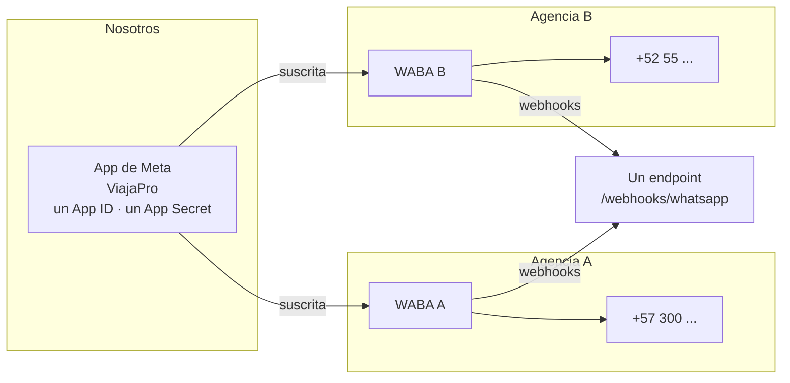
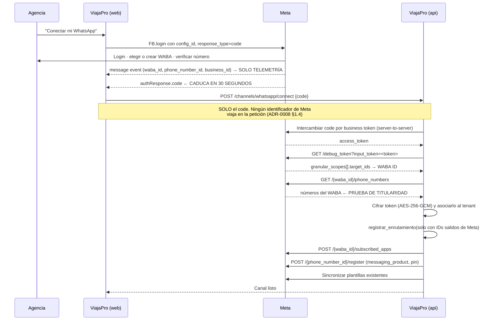

# Integración — WhatsApp Cloud API

> **Esta es la integración más crítica del producto.** Si el número de una agencia pierde calidad
> o se bloquea, esa agencia deja de vender ese día, y nos lo cobrará a nosotros.

Decisión de fondo: [ADR-0002](../03-adr/0002-whatsapp-cloud-api.md).

---

## 0. Estado de verificación de este documento

Reescrito y verificado contra la documentación oficial de Meta el **2026-10-07**.

| Dato | Valor verificado | Fuente |
|---|---|---|
| Versión vigente de Graph API | **v26.0** (publicada 2026-07-29) | [Graph API Changelog](https://developers.facebook.com/docs/graph-api/changelog) |
| Versión recomendada por Meta en las guías de Embedded Signup | v25.0 | [Embedded Signup · Implementation](https://developers.facebook.com/documentation/business-messaging/whatsapp/embedded-signup/implementation/) |
| Raíz de la documentación | `developers.facebook.com/documentation/business-messaging/whatsapp/` | — |

> **Meta movió la documentación.** Las rutas antiguas `developers.facebook.com/docs/whatsapp/cloud-api/...`
> siguen respondiendo pero ya no son la fuente canónica y están desactualizadas en varios puntos.
> Usar siempre `/documentation/business-messaging/whatsapp/`.

**Convención de este documento.** Cada afirmación lleva una marca:

- **[V]** Verificado contra documentación oficial de Meta el 2026-10-07.
- **[S]** Verificado contra fuentes secundarias consistentes (BSPs, proveedores) pero **no**
  confirmado literalmente en la página oficial. Tratar como probable, no como contrato.
- **[?]** No verificado. Hay que comprobarlo antes de implementar.

La sección [§13](#13-lo-que-no-pude-verificar) lista todo lo marcado **[S]** y **[?]**.

**Caducidad.** Meta cambia precios, versiones y políticas varias veces al año. Este documento se
revisa **cada trimestre** (loop del agente `investigador`). Si la fecha de arriba tiene más de tres
meses, no te fíes de los números.

---

## 1. El modelo: somos Tech Provider

Una sola app de Meta sirve a todos los tenants. Cada agencia aporta **su propia** cuenta de WhatsApp
Business (WABA) y su número.



**[V]** Un solo endpoint de webhook para toda la app. Meta lo dice explícitamente:

> «You only need to set up Webhooks once for every application you have. You can use the same
> Webhook to receive multiple event types from multiple WhatsApp Business Accounts, or set up an
> override.»
> — [Get started as a Solution Partner](https://developers.facebook.com/documentation/business-messaging/whatsapp/solution-providers/get-started-for-solution-partners), consultado 2026-10-07

Y al suscribir la app a un WABA:

> «all Webhook events for the phone numbers under this account will be sent to your configured
> Webhooks endpoint.»

**Consecuencia de diseño:** un endpoint, un App Secret, N tenants. Todo el aislamiento multi-tenant
lo ponemos nosotros. Meta no ayuda con eso. Ver [§4](#4-identificación-del-tenant).

---

## 2. Onboarding de una agencia (Embedded Signup)

### 2.1 El flujo



### 2.2 Llamadas exactas

**[V]** Lanzamiento del flujo en el navegador
([Implementation](https://developers.facebook.com/documentation/business-messaging/whatsapp/embedded-signup/implementation/)):

```js
FB.login(fbLoginCallback, {
  config_id: '<CONFIGURATION_ID>',
  response_type: 'code',
  override_default_response_type: true,
  extras: { setup: {} }
});
```

**[V]** El `message` event que llega por `postMessage` al completar trae, entre otros:
`phone_number_id`, `waba_id`, `business_id`, `event: 'FINISH'`. El código de intercambio llega
aparte, en `response.authResponse.code`.

> **Esos identificadores son telemetría, no entrada.** Sirven para pintar la interfaz mientras el
> alta termina y para diagnosticar. **Nunca se envían al backend como parámetros de escritura, y si
> llegan se ignoran.** Ver [§2.3](#23-prueba-de-titularidad-el-phone_number_id-jamás-viene-del-cliente).

**[V] El `code` caduca en 30 segundos.** Esto obliga a un diseño concreto: el frontend **no** puede
guardar el código, mostrar una pantalla de confirmación y enviarlo después. Lo manda al backend de
inmediato y el backend lo intercambia de forma síncrona en esa misma petición. El resto del
onboarding (suscripción, registro, sincronización de plantillas) sí va por cola.

**[V] Descubrir el WABA desde el token, sin preguntarle al navegador.** Este es el paso que hace
posible que el cliente no mande ningún identificador. De
[Manage Messaging accounts](https://developers.facebook.com/documentation/business-messaging/whatsapp/solution-providers/manage-accounts),
consultado 2026-10-07:

```http
GET https://graph.facebook.com/v26.0/debug_token?input_token=<BUSINESS_TOKEN_DEL_TENANT>
Authorization: Bearer <NUESTRO_SYSTEM_USER_TOKEN>
```

La respuesta trae `granular_scopes[]`, y cada entrada tiene un `scope` y un `target_ids[]` con los
WABA que han concedido ese permiso a nuestra app. Meta:

> «IDs for the most recently onboarded WABAs appear first, so capture the first ID in the
> `target_ids` array for the `whatsapp_business_management` scope.»

**[?]** Listar los números de ese WABA: `GET /v26.0/<WABA_ID>/phone_numbers` con el token del
negocio. Es el endpoint conocido y estable, pero **no pude confirmarlo verbatim** en la página
consultada. Verificar la forma exacta de la respuesta antes de implementar.

**[V]** Suscribir nuestra app al WABA del cliente:

```http
POST https://graph.facebook.com/v26.0/<WABA_ID>/subscribed_apps
Authorization: Bearer <BUSINESS_TOKEN_DEL_TENANT>
```

Respuesta esperada: `{"success": true}`.

**[V]** Registrar el número con PIN de verificación en dos pasos:

```http
POST https://graph.facebook.com/v26.0/<PHONE_NUMBER_ID>/register
Authorization: Bearer <BUSINESS_TOKEN_DEL_TENANT>
Content-Type: application/json

{ "messaging_product": "whatsapp", "pin": "<6 dígitos>" }
```

**[?]** El intercambio `code → business token` usa el endpoint `oauth/access_token` de Graph con
`client_id`, `client_secret` y `code`. La página oficial de *Access Tokens* **no** publica la firma
exacta: remite a la documentación de Facebook Login for Business. **Verificar la forma exacta de la
llamada y de la respuesta antes de implementar.**

**[V]** Permisos necesarios: `whatsapp_business_management`, `whatsapp_business_messaging`,
`business_management`
([Access Tokens Guide](https://developers.facebook.com/documentation/business-messaging/whatsapp/access-tokens/)).

**[S]** El token resultante es un *Business Integration System User token*: pertenece al negocio del
cliente, está acotado a los activos que nos concedió, se emite a nuestra app y **no caduca por
tiempo**. Sí puede revocarse. Eso no significa que no haya que manejar el fallo: ver `190` y `10` en
[§9](#9-errores-de-meta).

**[V]** Embedded Signup **v4** está en vista previa pública desde el 2026-05-12, con un flujo
*Phone Number First* en el que el cliente verifica el número antes de elegir activos, de modo que
los problemas de elegibilidad aparecen antes
([Changelog](https://developers.facebook.com/documentation/business-messaging/whatsapp/changelog)).
Decisión pendiente de `arquitecto`: arrancar en v3 estable o en v4 preview.

### 2.3 Prueba de titularidad: el `phone_number_id` jamás viene del cliente

> **Regla inviolable, simétrica a la de ADR-0003 §5 y con el mismo rango:
> el `phone_number_id` y el `waba_id` jamás vienen del cliente.**
> Un identificador de Meta tomado del cuerpo de la petición y escrito en el directorio de
> enrutamiento es un hallazgo crítico de auditoría. Ver
> [ADR-0008 §1.4](../03-adr/0008-resolucion-de-tenant-en-webhooks-entrantes.md) y la
> [auditoría del 2026-10-07](../_auditorias/2026-10-07-adr-0008-aislamiento-en-webhooks.md).

**Cuál es el ataque, porque no es el obvio.** Validar el `tenant_id` contra la sesión resuelve una
pregunta que nadie estaba haciendo. El ataque no es reclamar un número *para otro tenant* —la sesión
lo impide— sino **reclamar el número de otra agencia para el tenant propio**. El atacante es un
cliente legítimo, con sesión válida y rol de administrador, que llama al endpoint de conexión con el
`phone_number_id` de una agencia competidora. Ese dato no es secreto: aparece en integraciones, en
tickets de soporte, y basta un empleado que pasó por las dos agencias.

Si no existía fila para ese identificador, se crea apuntando al atacante, y **desde el siguiente
webhook las conversaciones de la víctima entran en la bandeja del atacante**: nombres de clientes,
itinerarios, pasaportes enviados por chat. En un CRM de turismo eso es exactamente el material del
R10. Y hay variante de denegación de servicio: registrar en lote los identificadores de veinte
competidores para que no puedan darse de alta.

**De dónde salen entonces los identificadores:**

1. El cliente envía **solo el `code`** del Embedded Signup. Lo que venga además en el cuerpo se
   ignora: sirve para telemetría, nunca para escribir.
2. El servidor canjea el `code` por el token de negocio y, **con ese token**, pide a Meta el WABA
   (`debug_token` → `granular_scopes[].target_ids`) y sus números.
3. **Esa respuesta de Meta es la prueba de titularidad**, y es la única que no se puede falsear desde
   el navegador: el token se emitió sobre el WABA que ese usuario administra de verdad.
4. El registro en el directorio de enrutamiento se invoca **únicamente** con identificadores salidos
   de esa respuesta.
5. Si la fila existe y pertenece a otro tenant, se rechaza **y se emite un evento de seguridad**, no
   un error de usuario: intentar reclamar un número ajeno es una señal, no una equivocación.
6. Una fila revocada cuyo número Meta reasignó a otra agencia puede reasignarse, pero **solo con la
   prueba del punto 2**, y queda en el historial con ambos tenants.

**Un apunte que importa al implementar, y que no es cómodo: la ruta documentada por Meta no sirve
para nuestro modelo de amenaza.** La guía oficial de onboarding dice «capture the customer's asset
IDs and exchangeable token code and use them to onboard the customer», es decir, trata como
utilizables los identificadores que llegan al navegador. Eso es razonable para quien integra **su
propio** WABA, y es inseguro para un SaaS multi-tenant donde el emisor de la petición es un cliente
más. **Nos desviamos de la guía de Meta deliberadamente**, y el paso 2 es lo que nos permite hacerlo
sin perder nada: `debug_token` está igualmente documentado por Meta y nos da el mismo dato sin
confiar en el navegador.

### 2.4 Dónde falla esto en la vida real

| Fallo | Qué hacer |
|---|---|
| El número ya está en otra WABA | Mensaje claro: debe migrarlo o usar otro. Es la causa más común de fricción |
| El negocio de la agencia no está verificado en Meta | Explicar el trámite y sus tiempos. No podemos hacerlo por ellos |
| El número está en uso en la app de WhatsApp Business | Debe desvincularlo primero. Advertirlo **antes** de empezar |
| El `code` expira antes de llegar al backend | Reintentar el flujo completo. Un code caducado no se recupera |
| El número que devuelve Meta ya está registrado para otro tenant | Rechazar el alta **y emitir evento de seguridad** (§2.3). Al usuario, un mensaje neutro: nunca confirmarle si ese número está o no en la plataforma |
| Registro fallido por el PIN (`133005`) | Reintento con PIN nuevo, guiando paso a paso. Ojo con `133008`/`133009`: hay throttling de intentos |
| El token se revoca (`190`, `10`, `131005`) | Marcar el canal como desconectado y avisar al dueño **antes** de que pierda mensajes |

El canal tiene estado explícito —`PENDING`, `CONNECTED`, `DISCONNECTED`, `SUSPENDED`— visible en la
interfaz. Una agencia nunca debe descubrir que está desconectada porque un cliente le reclamó.

### 2.5 Lo que la agencia NO necesita — y es una ventaja comercial

**[V]** La verificación del negocio ante Meta **no** es requisito para empezar a enviar. Una agencia
puede conectar su número y operar sin verificarse.

**[V] Corrección importante respecto a la versión anterior de este documento:** desde el
**2025-10-08** los límites de mensajería **ya no son por número de teléfono sino por portafolio de
negocio**, y el primer escalón de ampliación pasó de 1.000 a **2.000**
([Changelog](https://developers.facebook.com/documentation/business-messaging/whatsapp/changelog),
entrada del 2025-10-08).

| Sin verificar, la agencia puede | Límite |
|---|---|
| Responder conversaciones iniciadas por el cliente | **Ilimitado** (no consume límite de mensajería) |
| Iniciar conversación (plantillas) | **250 clientes únicos / 24 h**, compartido por todos los números del portafolio |

**[?]** El tope de 250 plantillas por WABA para cuentas no verificadas no pudo confirmarse en la
documentación vigente. No usarlo como argumento comercial hasta verificarlo.

Para una agencia minorista eso sobra durante meses: la inmensa mayoría de sus conversaciones las
inicia el viajero, y esas no consumen límite de mensajería.

**Lo que sí necesita, y hay que decirlo desde el primer contacto comercial:**

1. Un número **sin cuenta activa en la app de WhatsApp**. Es la causa número uno de fricción en el
   alta, y si lo borra sin preparación pierde su historial.
2. Una cuenta de Facebook y un portafolio de negocio en Meta.
3. **Un medio de pago asociado a su WABA.** Es requisito de Meta, no nuestro. Anticiparlo para que
   no aparezca como sorpresa a mitad del alta. Error asociado: `131042`.

Guía para enviar al cliente: [`docs/10-onboarding/01-requisitos-para-la-agencia.md`](../10-onboarding/01-requisitos-para-la-agencia.md).

---

## 3. Webhooks — el contrato

### 3.1 Verificación inicial (`GET`)

**[V]** Al registrar la URL en el App Dashboard, Meta hace un `GET` con tres parámetros de consulta:

| Parámetro | Valor |
|---|---|
| `hub.mode` | «This value will always be set to `subscribe`» |
| `hub.verify_token` | La cadena que configuramos en el App Dashboard |
| `hub.challenge` | «An `int` you must pass back to us» |

Petición real:

```http
GET /webhooks/whatsapp?hub.mode=subscribe&hub.verify_token=<NUESTRO_TOKEN>&hub.challenge=1158201444 HTTP/1.1
```

Respuesta obligatoria:

```http
HTTP/1.1 200 OK
Content-Type: text/plain

1158201444
```

Reglas de implementación:

1. Validar `hub.mode === 'subscribe'` **y** que `hub.verify_token` coincide con
   `WHATSAPP_WEBHOOK_VERIFY_TOKEN`, con comparación en tiempo constante.
2. Devolver **solo** el `challenge`, en texto plano: sin comillas, sin JSON, sin salto de línea
   añadido. NestJS serializa a JSON por defecto, así que hay que forzar `text/plain` y devolver la
   cadena cruda, o Meta rechaza la verificación.
3. Si no coincide: `403`, cuerpo vacío, y registro del intento. Nunca devolver el challenge.
4. El token de verificación **no** identifica a ningún tenant. Es uno solo, de la app, y vive en
   variable de entorno. No se deriva ni se parametriza.

Fuentes: [Webhooks: Getting Started](https://developers.facebook.com/docs/graph-api/webhooks/getting-started)
y [WhatsApp webhooks · Overview](https://developers.facebook.com/documentation/business-messaging/whatsapp/webhooks/overview/),
consultados 2026-10-07.

### 3.2 Firma de los `POST` — la pregunta que define el diseño multi-tenant

**La respuesta corta: es el App Secret de NUESTRA app de Meta. Uno solo, para todos los tenants.
No existe secreto de firma por WABA ni por número.**

**[V]** Meta:

> «We sign all Event Notification payloads with a **SHA256** signature and include the signature in
> the request's `X-Hub-Signature-256` header, preceded with `sha256=`.»
>
> «Generate a **SHA256** signature using the payload and your app's **App Secret**. Compare your
> signature to the signature in the `X-Hub-Signature-256` header (everything after `sha256=`). If
> the signatures match, the payload is genuine.»
>
> — [Webhooks: Getting Started](https://developers.facebook.com/docs/graph-api/webhooks/getting-started), consultado 2026-10-07

Contrato exacto:

| Elemento | Valor |
|---|---|
| Cabecera | `X-Hub-Signature-256` (insensible a mayúsculas en HTTP/1.1; en HTTP/2 llega en minúsculas) |
| Formato del valor | `sha256=<hexadecimal en minúsculas, 64 caracteres>` |
| Algoritmo | HMAC-SHA256 |
| Clave | **App Secret de la app de Meta de ViajaPro** — único, global, en `META_APP_SECRET` |
| Mensaje | **El cuerpo crudo de la petición, byte a byte, antes de cualquier parseo** |
| Comparación | Tiempo constante (`crypto.timingSafeEqual`) |

**[V]** Sobre qué bytes: sobre el cuerpo tal cual llegó. Meta serializa con **escapes Unicode**
(`\uXXXX`) para los caracteres no ASCII. Si recibes `"body": "¿Cuánto cuesta?"`, parseas y vuelves a
serializar, los bytes ya no son los mismos y la firma nunca coincidirá. Esto no es teórico: es **el
error número uno** de esta integración, y aparece solo cuando un cliente escribe con tilde o emoji
—es decir, en producción y no en las pruebas.

En NestJS/Express hay que desactivar el parser JSON global para esta ruta y usar
`express.raw({ type: 'application/json' })`, o registrar un `verify` en `bodyParser.json` que guarde
el `Buffer` original. Es un detalle de infraestructura, pero es el que rompe el sistema.

**Qué implica esto para el multi-tenant, y hay que entenderlo bien:**

1. La firma demuestra que **Meta** envió el payload. **No demuestra nada sobre el tenant.**
2. Un App Secret comprometido compromete la autenticidad de los webhooks de **todos** los tenants a
   la vez. Es un secreto de nivel plataforma: rotación planificada, acceso restringido, nunca en el
   repositorio (R6).
3. La firma válida es condición **necesaria y no suficiente**. Después de validarla hay que resolver
   el tenant ([§4](#4-identificación-del-tenant)) y, a partir de ahí, toda escritura va con el
   `tenant_id` resuelto en el servidor.
4. **El `tenant_id` nunca sale de un parámetro de la petición** (regla del proyecto): sale de la
   resolución contra nuestra propia tabla de canales.

```
POST /webhooks/whatsapp
  │
  ├─ 1. Leer CUERPO CRUDO (Buffer). Sin parsear. Sin tocar.
  ├─ 2. HMAC-SHA256(cuerpo, META_APP_SECRET) vs X-Hub-Signature-256
  │       └─ no coincide o falta la cabecera → 403, registrar, FIN
  ├─ 3. JSON.parse del cuerpo
  │       └─ falla → 200 (ya está firmado; no pedir reintento de algo que no sabemos leer)
  │                  + alerta interna
  ├─ 4. Encolar el payload crudo en BullMQ
  └─ 5. 200 OK. Punto.
```

Nada más. Sin consultas a base de datos, sin resolución de tenant, sin lógica de negocio.

### 3.3 Requisitos de respuesta y reintentos

**[V]** Meta, en la documentación de webhooks de WhatsApp:

> «If a webhook request to your endpoint receives an HTTP status code other than 200, or if the
> webhook cannot be delivered for another reason, Meta retries delivery with decreasing frequency
> until the request succeeds, for up to **7 days**.»
>
> — [WhatsApp webhooks · Overview](https://developers.facebook.com/documentation/business-messaging/whatsapp/webhooks/overview/), consultado 2026-10-07

**[V]** La documentación genérica de Graph API, en cambio, dice:

> «If any update sent to your server fails, we will retry immediately, then try a few more times
> with decreasing frequency over the next **36 hours**. Unacknowledged responses will be dropped
> after 36 hours.»

**Las dos páginas de Meta se contradicen.** La de WhatsApp es la específica y la más reciente
(7 días); la genérica dice 36 horas. **Diseñar para 7 días de reintentos** —es el peor caso para
nosotros, porque significa que un evento puede reaparecer una semana después— y no asumir que a las
36 horas deja de llegar.

**[S]** Tamaño máximo del payload: 3 MB. El reintento usa retroceso exponencial.

**[?] Meta no publica un timeout numérico explícito.** La cifra de «5 segundos» que circula no está
en la documentación actual. Nuestro objetivo operativo —**p99 < 500 ms**— no viene de Meta: viene de
que no queremos descubrir cuál es el timeout real en producción.

**Por qué esto obliga a encolar, y no es negociable:**

- Un endpoint, todos los tenants. Si procesar en línea el mensaje de la Agencia A tarda 4 segundos
  (descargar media, escribir en base, llamar a Claude), ese retraso lo sufre **la cola de entrega de
  Meta hacia nuestra app entera**, no solo la Agencia A.
- Si devolvemos 500 porque falló la base de datos de un tenant, Meta reintenta **ese lote completo**
  durante 7 días. Multiplicado por todos los tenants, es una tormenta de reintentos autoinfligida.
- Meta degrada la entrega a endpoints que fallan sistemáticamente. El daño es a nivel de app: lo
  pagan todos los clientes.

Por eso: **200 siempre que la firma sea válida**, incluso si el procesamiento posterior va a fallar.
Los fallos de proceso se resuelven en nuestra cola, con nuestros reintentos y nuestra DLQ, donde
podemos verlos. No se delegan a Meta. Esto es R5 aplicado al lado de entrada.

### 3.4 Campos a los que suscribirse

**[S]** Campos relevantes para ViajaPro (el `field` dentro de `changes[]`):

| Campo | Para qué | Prioridad |
|---|---|---|
| `messages` | Mensajes entrantes **y** estados de los salientes. Es el principal | Fase 1 |
| `message_template_status_update` | Cambios de estado de plantilla: `APPROVED`, `REJECTED`, `PAUSED`, `DISABLED`, `LIMIT_EXCEEDED` | Fase 1 |
| `phone_number_quality_update` | Cambio de calidad del número y eventos `FLAGGED`/`UNFLAGGED` | Fase 1 |
| `account_update` | Restricciones y violaciones de política sobre la cuenta | Fase 1 |
| `template_category_update` | Meta recategoriza una plantilla (afecta el costo) | Fase 2 |
| `business_capability_update` | Cambio de límite de mensajería del portafolio | Fase 2 |
| `account_alerts` | Avisos, incluida la denegación de una ampliación de límite | Fase 2 |

**[?]** La lista completa de campos de suscripción y la forma exacta de cada payload de gestión
(`phone_number_quality_update`, `account_update`) **no** pudo extraerse de la página oficial.
Verificar antes de implementar los manejadores de Fase 1.

---

## 4. Identificación del tenant

Este es el punto crítico del diseño: llega un `POST` a un único endpoint y hay que saber de qué
agencia es, sin que el payload pueda mentirnos.

### 4.1 Los dos identificadores

**[V]** Estructura de todo webhook de WhatsApp:

| Campo | Qué es | Presencia |
|---|---|---|
| `entry[].id` | **El WABA ID** — la cuenta de WhatsApp Business del cliente | Siempre |
| `entry[].changes[].value.metadata.phone_number_id` | **El ID del número de negocio** que recibió o envió | Siempre, en eventos de `messages` |
| `entry[].changes[].value.metadata.display_phone_number` | El número en formato legible | Siempre, en eventos de `messages` |

**Cuál usar, y por qué:**

- **`metadata.phone_number_id` es la clave de enrutamiento del tráfico de conversación.** Es el
  identificador con el que también se envía (`POST /v26.0/<PHONE_NUMBER_ID>/messages`), así que es
  el que de verdad ata el evento a un canal operativo. Un WABA puede tener varios números, y una
  agencia podría tener dos números con equipos distintos: enrutar por WABA perdería esa distinción.
- **`entry[].id` (WABA ID) es la clave de respaldo y la única disponible en eventos de gestión.**
  Los webhooks de plantillas y de cuenta no traen `metadata`: solo el WABA ID. Hay que poder
  resolver por ambos.

**[V]** `display_phone_number` **no** se usa jamás para enrutar. Es presentación.

### 4.2 Estabilidad

**[?]** Meta no documenta explícitamente garantías de inmutabilidad de `phone_number_id` ni de
`waba_id`. Lo que sí se sabe con certeza:

- **[V]** Un número borrado y vuelto a añadir **no** conserva su `phone_number_id`. Los errores `33`
  («Business phone number deleted») y `133015` («Recently deleted phone number; deletion
  incomplete — wait 5 minutes») confirman que el ciclo de vida del número puede romper el ID.
- **[V]** Una migración de número entre WABAs cambia el WABA asociado.

**Decisión de diseño que se sigue de esto:** no tratar `phone_number_id` como clave primaria del
canal. El canal es una entidad nuestra con su propio UUID; `phone_number_id` y `waba_id` son
**atributos indexados y únicos** que pueden reasignarse. Si no, la migración de número de un cliente
obliga a tocar claves foráneas por todo el esquema.

### 4.3 Resolución, paso a paso

```
Evento desencolado
  │
  ├─ ¿Trae metadata.phone_number_id?
  │     SÍ → buscar canal por (phone_number_id)           ← camino normal
  │     NO → buscar canal(es) por (waba_id = entry[].id)  ← eventos de gestión
  │
  ├─ Encontrado → tenant_id = canal.tenant_id
  │               Abrir transacción fijando app.current_tenant = <tenant_id>
  │               (set_config('app.current_tenant', $1, true) — local a la transacción)
  │               A partir de aquí, RLS protege todo (R1, R2)
  │
  └─ No encontrado → DESCONOCIDO
        ├─ NO crear nada. NO inferir el tenant. NO escribir en ninguna tabla de negocio.
        ├─ Registrar en una bitácora de eventos huérfanos, fuera de las tablas con RLS,
        │  guardando phone_number_id, waba_id, tipo y timestamp. NUNCA el contenido del mensaje
        │  (es PII de un tercero sobre el que no tenemos base legal — R10).
        ├─ Alertar: es señal de (a) onboarding a medias, (b) canal borrado con la suscripción viva,
        │  (c) app suscrita a un WABA que ya no gestionamos.
        └─ Marcar como procesado y seguir. No reintentar: reintentar no lo hará conocido.
```

**La tabla de canales es la única fuente de verdad del mapeo.** Nunca se deriva el tenant de nada que
venga en el payload salvo a través de esa tabla. El payload es entrada no confiable aunque la firma
sea válida: la firma dice «esto viene de Meta», no «esto pertenece a la Agencia A».

**Un payload puede traer varios `entry[]` y varios `changes[]`, de WABAs distintos.** La resolución
de tenant es **por cada `change`**, no por petición. Encolar un job por `change`, no uno por POST.

---

## 5. Forma del payload entrante

### 5.1 Envoltorio común

```json
{
  "object": "whatsapp_business_account",
  "entry": [
    {
      "id": "<WABA_ID>",
      "changes": [
        {
          "value": { "messaging_product": "whatsapp", "metadata": { "...": "..." } },
          "field": "messages"
        }
      ]
    }
  ]
}
```

**[V]** Presencia de los campos dentro de `value`:

| Campo | Tipo | Presencia |
|---|---|---|
| `messaging_product` | string, siempre `"whatsapp"` | Garantizado |
| `metadata.display_phone_number` | string | Garantizado en `field: "messages"` |
| `metadata.phone_number_id` | string | Garantizado en `field: "messages"` |
| `contacts[]` | array | **Opcional** — solo en mensajes entrantes |
| `messages[]` | array | **Opcional** — solo en mensajes entrantes |
| `statuses[]` | array | **Opcional** — solo en estados de mensajes salientes |
| `errors[]` | array | **Opcional** — fallos a nivel de sistema, app o cuenta |

Regla de parseo: **`messages` y `statuses` son mutuamente excluyentes en la práctica, pero el
esquema Zod no debe asumirlo.** Modelar `value` con todos los arrays opcionales y despachar por
presencia, no por `field`.

### 5.2 Mensaje de texto entrante — **[V] verbatim de Meta**

Copiado literalmente de
[WhatsApp webhooks · Overview](https://developers.facebook.com/documentation/business-messaging/whatsapp/webhooks/overview/),
consultado 2026-10-07:

```json
{
  "object": "whatsapp_business_account",
  "entry": [
    {
      "id": "102290129340398",
      "changes": [
        {
          "value": {
            "messaging_product": "whatsapp",
            "metadata": {
              "display_phone_number": "15550783881",
              "phone_number_id": "106540352242922"
            },
            "contacts": [
              {
                "profile": {
                  "name": "Sheena Nelson"
                },
                "wa_id": "16505551234"
              }
            ],
            "messages": [
              {
                "from": "16505551234",
                "id": "wamid.HBgLMTY1MDM4Nzk0MzkVAgASGBQzQTRBNjU5OUFFRTAzODEwMTQ0RgA=",
                "timestamp": "1749416383",
                "type": "text",
                "text": {
                  "body": "Does it come in another color?"
                }
              }
            ]
          },
          "field": "messages"
        }
      ]
    }
  ]
}
```

Observaciones que importan al implementar:

- `timestamp` es **una cadena**, no un número, y son **segundos** Unix, no milisegundos:
  `new Date(Number(ts) * 1000)`. Guardar en UTC (R9).
- `contacts[].profile.name` es el nombre que el usuario puso en su perfil de WhatsApp. **No es un
  dato verificado** y puede cambiar entre mensajes. Sirve como sugerencia para crear el contacto en
  el CRM, nunca como identidad.
- `wamid` es una cadena larga en base64. Columna `text`, no `varchar(n)`.

### 5.3 Los demás tipos de mensaje — **[?] estructura, no verbatim**

> **Aviso.** Meta reorganizó la documentación y ahora cada tipo de mensaje tiene su página dedicada;
> no pude extraer los ejemplos JSON literales de esas páginas. Los bloques siguientes reflejan la
> estructura conocida y estable de la API, pero **no son citas verificadas el 2026-10-07**. Antes de
> escribir los esquemas Zod definitivos hay que contrastar campo por campo contra la referencia de
> cada tipo o —mejor— capturar payloads reales contra el número de prueba de Meta y generar los
> esquemas desde ahí. Dedicar un día a esto ahorra semanas después.

Todos los mensajes entrantes comparten `from` (u `from_user_id`, ver [§8](#8-usernames-y-bsuid)),
`id`, `timestamp` y `type`. El resto depende de `type`.

**Media (imagen, documento, audio, video, sticker)** — el objeto lleva el nombre del tipo:

```json
{
  "from": "16505551234",
  "id": "wamid.HBgLM...",
  "timestamp": "1749416383",
  "type": "image",
  "image": {
    "id": "1234567890123456",
    "mime_type": "image/jpeg",
    "sha256": "<hash>",
    "caption": "La factura del hotel"
  }
}
```

- `caption` es opcional (y no existe para audio ni sticker).
- `document` añade `filename`.
- `audio` añade `voice: true|false`.
- **[V]** Los webhooks de media entrante **ahora incluyen también la URL de descarga**, en la
  propiedad `url`
  ([Media](https://developers.facebook.com/documentation/business-messaging/whatsapp/business-phone-numbers/media)).
  Esa URL caduca en 5 minutos: ver [§10](#10-media).

**Respuesta a botón interactivo:**

```json
{
  "from": "16505551234",
  "id": "wamid.HBgLM...",
  "timestamp": "1749416383",
  "type": "interactive",
  "interactive": {
    "type": "button_reply",
    "button_reply": { "id": "cotizar_cartagena", "title": "Ver cotización" }
  }
}
```

**Respuesta a lista interactiva:**

```json
{
  "type": "interactive",
  "interactive": {
    "type": "list_reply",
    "list_reply": { "id": "destino_sanandres", "title": "San Andrés", "description": "4 noches" }
  }
}
```

El `id` lo definimos nosotros al enviar: es nuestro punto de enganche con `automation`. **Debe llevar
un prefijo versionado** (`v1:quote:<uuid>`), porque un usuario puede responder a un botón enviado
hace semanas, cuando el significado de ese `id` era otro.

**Reacción** — apunta a un mensaje anterior:

```json
{
  "from": "16505551234",
  "id": "wamid.HBgLM...",
  "timestamp": "1749416383",
  "type": "reaction",
  "reaction": { "message_id": "wamid.HBgLM<EL MENSAJE REACCIONADO>", "emoji": "👍" }
}
```

Quitar una reacción llega como el mismo evento con `emoji` ausente o vacío. Una reacción **no** es un
mensaje de la conversación: no debe aparecer como burbuja ni disparar automatizaciones. Es una
anotación sobre otro mensaje. **Sí reinicia la ventana de 24 h**, porque es un evento del usuario.

**Ubicación:**

```json
{
  "type": "location",
  "location": { "latitude": 10.3932, "longitude": -75.4832, "name": "Hotel Caribe", "address": "Bocagrande" }
}
```

`name` y `address` son opcionales.

**Contactos:** `type: "contacts"` con `contacts[]`, cada uno con `name`, `phones[]`, `emails[]`,
`org`… Estructura profunda y muy opcional. Modelar permisivo y guardar siempre el crudo.

**Contexto (respuesta citada, reenvío, anuncio Click-to-WhatsApp):** cualquier mensaje puede traer
`context`:

```json
"context": {
  "from": "15550783881",
  "id": "wamid.<MENSAJE CITADO>",
  "forwarded": true,
  "frequently_forwarded": false
}
```

Para un CRM de turismo, el `referral` de los anuncios Click-to-WhatsApp es valioso (atribución de
campaña) **[V] y abre una ventana de entrada gratuita de 72 h** — ver
[§7](#7-ventana-de-24-horas-y-modelo-de-precios).

**No soportado / desconocido:** **[V]** desde el 2025-11-03 el webhook de mensaje no soportado
incluye el tipo real del mensaje
([Changelog](https://developers.facebook.com/documentation/business-messaging/whatsapp/changelog)).
El esquema Zod **debe** tener un caso por defecto que acepte cualquier `type` desconocido, lo
persista con el crudo y lo muestre como «mensaje no soportado» en la bandeja. Meta añade tipos sin
avisar; un `type` nuevo no puede tirar el worker.

### 5.4 Estados de mensajes salientes (`statuses`)

```json
{
  "object": "whatsapp_business_account",
  "entry": [
    {
      "id": "102290129340398",
      "changes": [
        {
          "value": {
            "messaging_product": "whatsapp",
            "metadata": {
              "display_phone_number": "15550783881",
              "phone_number_id": "106540352242922"
            },
            "statuses": [
              {
                "id": "wamid.HBgLMTY1MDM4Nzk0MzkVAgARGBI1RkYyNDc0MkQ1RTZBNjJCRjAA",
                "status": "delivered",
                "timestamp": "1749416400",
                "recipient_id": "16505551234"
              }
            ]
          },
          "field": "messages"
        }
      ]
    }
  ]
}
```

**[V]** Valores de `status`:

| Valor | Significado |
|---|---|
| `sent` | Meta aceptó el mensaje y lo encaminó |
| `delivered` | Llegó al dispositivo |
| `read` | El usuario lo abrió (solo si tiene activadas las confirmaciones de lectura) |
| `failed` | No se pudo entregar. Trae `errors[]` |
| `played` | **Nuevo desde 2025-11-03**: el usuario reprodujo un mensaje de voz |

**[V] `played` es nuevo.** La máquina de estados tiene que contemplarlo desde el primer día o
tendremos eventos cayendo en el caso por defecto.

**[S] Cambio importante en el objeto `conversation`.** Para peticiones en **v24.0 y superiores**, el
webhook de estado **ya no incluye el objeto `conversation`**, salvo cuando el mensaje se envió dentro
de una ventana de entrada gratuita (*Free Entry Point*). Es consecuencia directa del paso a precio
por mensaje: ya no hay «conversaciones» que facturar.

> **Esto cambia el diseño de la ventana de 24 h.** La técnica clásica —leer
> `conversation.expiration_timestamp` del webhook de estado y guardarlo— **ya no funciona**. La
> ventana hay que calcularla nosotros a partir del `timestamp` del último evento entrante.
> Ver [§7](#7-ventana-de-24-horas-y-modelo-de-precios).

**[S]** Particularidades de `failed`:

- Omite por completo el array `contacts`.
- Omite `recipient_user_id` si el mensaje se envió al número de teléfono del usuario.
- Trae `errors[]` con `code`, `title`, `message` y `error_data.details`. **Ese `details` es el texto
  que explica de verdad qué pasó** y el que hay que traducir al asesor.

```json
{
  "id": "wamid.HBgLM...",
  "status": "failed",
  "timestamp": "1749416400",
  "recipient_id": "16505551234",
  "errors": [
    {
      "code": 131047,
      "title": "Re-engagement message",
      "message": "Re-engagement message",
      "error_data": {
        "details": "Message failed to send because more than 24 hours have passed since the customer last replied to this number."
      }
    }
  ]
}
```

**[S] Un mismo mensaje puede disparar estados contradictorios.** Meta documenta que, en casos raros,
el mismo mensaje genera un webhook con `delivered` y otro con `failed`. La máquina de estados tiene
que decidir qué gana. **Decisión para ViajaPro: `failed` es terminal y gana siempre**, incluso si
llega después de `read`. Un `failed` tardío significa que algo salió mal de verdad, y es mejor
mostrarle al asesor un mensaje marcado como fallido que dejarlo creyendo que se entregó.

---

## 6. Idempotencia, orden y duplicados

### 6.1 `wamid`

**[S]** El `wamid` (`messages[].id` al recibir, `statuses[].id` en los estados, y el `id` que
devuelve la API al enviar) es el identificador único del mensaje en la plataforma. Es estable: el
`wamid` que devuelve `POST /messages` es el mismo que aparecerá después en todos los webhooks de
estado de ese mensaje. Eso es lo que permite correlacionar envío y estados.

**[?]** Meta no publica una garantía formal de unicidad **global** del `wamid`. Por eso la clave de
unicidad en nuestra base **no** es el `wamid` solo, sino `(tenant_id, provider_message_id)`: cumple
R1, permite el índice por tenant que RLS necesita, y nos protege si la unicidad global resultara no
ser tal.

### 6.2 Entrega «al menos una vez»

**[V]** Meta reintenta durante hasta 7 días cualquier webhook que no reciba `200`. **[S]** La entrega
es *at-least-once*: los duplicados son condición normal de operación, no una anomalía.

Hay tres fuentes de duplicado y las tres son reales:

1. **Reintento de Meta** porque devolvimos error o tardamos.
2. **Reintento de Meta pese a haber devuelto 200**, si la respuesta se perdió en la red.
3. **Reintento de nuestra propia cola** si el worker muere después de escribir y antes del ack.

Por eso la idempotencia va **en el worker**, no en el endpoint. El endpoint solo encola.

```
Mensaje entrante:
  INSERT ... ON CONFLICT (tenant_id, provider_message_id) DO NOTHING
  ¿afectó 0 filas? → duplicado → descartar en silencio: NO publicar eventos de dominio,
                      NO disparar automatizaciones, NO notificar por Socket.IO.

Evento de estado:
  UPDATE message SET status = $nuevo
   WHERE tenant_id = $t AND provider_message_id = $w
     AND rank($nuevo) > rank(status)
```

**Lo que más se rompe en la práctica no es el `INSERT` duplicado, sino los efectos secundarios.**
Insertar dos veces lo para la restricción única; notificar dos veces por Socket.IO, o lanzar dos
veces la extracción de intención con Claude, no lo para nadie. **Los efectos laterales van después de
confirmar que la fila es nueva, dentro de la misma transacción, por outbox.**

### 6.3 Orden

**Los eventos llegan fuera de orden. Siempre. Es lo normal, no el caso raro.**

Máquina de estados que solo avanza:

```
rank: pending(0) → sent(1) → delivered(2) → read(3) → played(4)
failed: terminal, gana siempre (ver §5.4)
```

Un `delivered` que llega después de un `read` se descarta. Nunca se retrocede.

**[?] ¿Puede llegar un `status` antes que el mensaje al que se refiere?** Meta no lo documenta. Para
los mensajes **salientes** el escenario es perfectamente posible y hay que manejarlo: hacemos
`POST /messages`, Meta responde con el `wamid`, y el webhook `sent` puede llegar **antes** de que
nuestra transacción de envío haya terminado de guardar ese `wamid`.

**Diseño que lo resuelve, y hay que hacerlo así desde el principio:**

1. Antes de llamar a la API de Meta, crear la fila del mensaje con estado `PENDING` y un
   `client_message_id` propio (UUID).
2. Al recibir la respuesta de Meta, actualizar esa fila con el `wamid`.
3. Si llega un `status` cuyo `wamid` no existe en nuestra base: **no descartarlo**. Guardarlo en una
   tabla de estados huérfanos (con `tenant_id`, RLS incluido) y reintentar la conciliación con
   retroceso. Si en 15 minutos sigue sin aparecer el mensaje, alertar.

Descartar estados huérfanos produce mensajes eternamente «enviando» en la bandeja. Es un bug que
solo aparece bajo carga y que es carísimo de diagnosticar después.

El `timestamp` del evento es el reloj de Meta. Guardar ambos: el de Meta (verdad del dominio) y el de
recepción (diagnóstico). Nunca ordenar por hora de llegada.

---

## 7. Ventana de 24 horas y modelo de precios

### 7.1 La regla

**[V]** De [Service messages](https://developers.facebook.com/documentation/business-messaging/whatsapp/messages/send-messages),
consultado 2026-10-07: la ventana de atención al cliente **se abre cuando un usuario de WhatsApp te
escribe o te llama**, dura 24 horas, y

> «If the user messages or calls you again before the timer expires, the timer resets to 24 hours.»

| Estado | Qué se puede enviar |
|---|---|
| Ventana abierta (< 24 h desde el último mensaje **o llamada** del cliente) | Cualquier *service message*: texto, media, interactivos, documentos |
| Ventana cerrada | **Solo plantillas aprobadas** |

**[V] Novedad que hay que incorporar: una llamada entrante también abre y reinicia la ventana.** Con
la WhatsApp Business Calling API el disparador ya no es solo un mensaje. Aunque no habilitemos
llamadas, un cliente puede llamar al número de la agencia y abrir la ventana sin que nosotros veamos
un mensaje. **Suscribirse a los webhooks de llamada aunque no ofrezcamos llamadas**, solo para que
nuestro cálculo de la ventana no se desincronice de la realidad de Meta.

### 7.2 Desde qué instante exacto cuenta

Desde el **`timestamp` del evento entrante tal como lo reporta Meta**, no desde el momento en que
nuestro worker lo procesó. Con reintentos de hasta 7 días, la diferencia puede ser enorme.

```
service_window_expires_at = to_timestamp(evento.timestamp::bigint) + interval '24 hours'
```

Y se actualiza con `GREATEST`, nunca con asignación directa, porque los eventos llegan desordenados:

```sql
UPDATE conversation
   SET service_window_expires_at = GREATEST(
         COALESCE(service_window_expires_at, 'epoch'::timestamptz),
         to_timestamp($1::bigint) + interval '24 hours')
 WHERE tenant_id = $2 AND id = $3;
```

Qué reinicia la ventana: **cualquier evento originado por el usuario** — texto, media, ubicación,
contacto, respuesta a botón o lista, **reacción**, y llamada entrante. Lo que **no** la reinicia:
nuestros propios mensajes, y los eventos de estado de mensajes salientes.

**[S]** Como el objeto `conversation` desapareció de los webhooks de estado en v24.0+, **este cálculo
es ahora la única fuente de verdad de la ventana en nuestro sistema.** Antes se podía contrastar
contra `conversation.expiration_timestamp`; ya no. Conviene una verificación continua: si un envío de
texto libre falla con `131047` y nosotros creíamos la ventana abierta, hay deriva, y eso se registra
como incidente, no solo como error del mensaje.

### 7.3 Aplicación en el producto

- La interfaz muestra **cuánto queda** de la ventana, no solo si está abierta.
- Cuando faltan menos de 2 horas, se avisa al asesor asignado.
- Con la ventana cerrada, el campo de texto libre se bloquea y **se ofrecen ahí mismo las plantillas
  aprobadas disponibles**. Un error seco sin alternativa es una venta perdida.
- La comprobación se hace **en el servidor**, en el caso de uso de envío, antes de encolar. La
  interfaz es ayuda, no control. Error asociado si se escapa: `131047`.

### 7.4 Precios y categorías — lo que hay que medir desde el primer día

**[V]** Desde el **2025-07-01** Meta cobra **por mensaje**, no por conversación:

> «Effective July 1, 2025, Meta charges on a per-message basis.»
> — [Pricing](https://developers.facebook.com/documentation/business-messaging/whatsapp/pricing), consultado 2026-10-07

**[V]** Categorías vigentes: `MARKETING`, `UTILITY`, `AUTHENTICATION`, `SERVICE`.

**[V]** Ventana de entrada gratuita (*Free Entry Point*): se abre cuando el usuario llega por un
anuncio Click-to-WhatsApp o un botón de página. **Dura 72 horas** y mientras está abierta se puede
enviar cualquier tipo de mensaje sin costo. Es el único caso en que el objeto `conversation` sigue
apareciendo en los webhooks de estado.

**[V]** Las tarifas se actualizan trimestralmente: 1 de enero, 1 de abril, 1 de julio, 1 de octubre.

#### El cambio del 2026-10-01 — confirmado en fuente primaria

> **Lo más relevante de toda esta revisión.** Está vigente desde hace seis días.

**[V]** Hay una página oficial de Meta, **distinta de la página general de precios**:
[Upcoming pricing updates for Meta Business Agent, service and utility messages](https://developers.facebook.com/documentation/business-messaging/whatsapp/pricing/non-template-messages),
consultada 2026-10-07. Dice literalmente:

> «Effective October 1, 2026, Meta will charge on a per-message basis for service messages.»

Y define qué cuenta como mensaje de servicio:

> «Service messages are any non-template message not powered by the Meta Business Agent Platform,
> and can be powered by a 3rd-party AI solution or people like customer service representatives.»

De esa misma página:

1. **[V]** Los mensajes de servicio se cobran **por mensaje entregado**, no por conversación, a la
   tarifa de `UTILITY`/`AUTHENTICATION` del mercado del destinatario.
2. **[V] Las plantillas `UTILITY` entregadas dentro de la ventana de 24 h abierta dejan de ser
   gratuitas** desde esa misma fecha.
3. **[V]** Sigue gratis la ventana de entrada gratuita de 72 h, y todo lo que envía el cliente.
4. **[V]** Las plantillas `MARKETING` no cambian con esta actualización, y el cargo por mensaje de
   servicio es único: no se duplica si además hay IA de por medio.
5. **[S]** La **franquicia de 1.000 mensajes de servicio gratis por número de negocio y por mes**,
   sin acumulación, con reinicio mensual y cobro desde el mensaje 1.001. Consenso unánime de más de
   diez BSPs independientes que citan esa página, pero el párrafo **no** se pudo extraer de la
   página oficial de forma reproducible. Es el único punto del cambio que sigue sin fuente primaria
   citable.

**[V] La contradicción entre páginas oficiales de Meta es real, y conviene saberlo:** mientras esa
página anuncia el cobro, la **página general de precios sigue describiendo los mensajes de servicio
como gratuitos** («Service conversations are now free for all businesses», vigente desde 2024-11-01)
con un rate card que dice estar vigente desde 2026-07-01; y el **changelog oficial no tiene ninguna
entrada** sobre el cambio —su entrada más reciente es del 2026-05-12—. Tres páginas oficiales dicen
cosas distintas a la vez. **Moraleja operativa: la página general de precios no es fuente suficiente,
y el changelog tampoco.** Verificación completa en
[`docs/_auditorias/2026-10-07-precios-de-meta.md`](../_auditorias/2026-10-07-precios-de-meta.md).

**[?] Dos cosas relacionadas que quedan sin confirmar y conviene vigilar:**

- Varias fuentes secundarias afirman que Meta exige **medio de pago registrado antes del
  2026-09-30** o deja de entregar mensajes de servicio desde el 2026-10-01. No aparece en la página
  oficial. Si fuera cierto, afecta al alta de toda agencia nueva: confianza baja-media, verificar.
- Desde el **2026-08-01** Meta cobra **por token** ($2,00 USD por millón) los mensajes generados por
  su **Meta Business Agent Platform** **[V]**. Es un producto de Meta, distinto de que una agencia
  use su propio agente o un asesor humano: **no nos aplica hoy**, pero sí nos aplicaría si algún día
  integramos ese producto. No confundirlo con el cobro de mensajes de servicio.

**Por qué importa aunque esté marcado [S], y por qué no se pospone:**

- Nuestro negocio es un inbox conversacional. **La mayoría de nuestro tráfico son mensajes de
  servicio.** Hasta hace una semana ese tráfico era gratis; ahora es nuestro mayor costo variable por
  encima de cierto volumen, y una agencia activa supera 1.000 mensajes/mes sin esfuerzo.
- La franquicia es **por número de negocio y por mes**: exactamente la granularidad de nuestro modelo
  de canal. **Es medible desde el día uno y hay que medirlo desde el día uno.**

**Lo que el producto tiene que registrar en cada mensaje saliente, desde la primera versión:**

| Campo | Para qué |
|---|---|
| `tenant_id`, `channel_id` (→ número) | La franquicia es por número |
| `billing_category` (`SERVICE`, `UTILITY`, `MARKETING`, `AUTHENTICATION`) | Determina la tarifa |
| `billed_month` (UTC) | La franquicia se reinicia mensualmente |
| `recipient_country` | La tarifa depende del mercado del destinatario |
| `inside_service_window` / `inside_free_entry_point` | Determina si es gratis |
| `delivered_at` | **Solo se cobra lo entregado**, no lo enviado |

Si no registramos esto ahora, cuando queramos construir el modelo de costos por agencia nos faltarán
los datos históricos y no habrá forma de reconstruirlos. **El esquema de `inbox` debe llevar estos
campos desde la primera migración**, aunque la lógica de facturación llegue en Fase 3.

**Tarea para `investigador` y `analista-datos`, prioridad alta:** confirmar el cambio contra la página
oficial de precios y contra el rate card de Colombia y México, y recalcular el *unit economics* del
plan de entrada. Si el plan de entrada se diseñó asumiendo mensajes de servicio gratis, hay que
rehacerlo.

---

## 8. Usernames y BSUID — el contacto ya no es un número de teléfono

**[V]** Cambio de 2026 que afecta al núcleo del CRM, no solo a la integración. Fuente:
[Business-scoped user IDs](https://developers.facebook.com/documentation/business-messaging/whatsapp/business-scoped-user-ids/),
consultado 2026-10-07.

Un **BSUID** (*business-scoped user ID*) es un identificador único de usuario, acotado a un
portafolio de negocio, que permite mensajear a alguien **sin conocer su número de teléfono**.
Formato: código de país, punto y alfanuméricos — por ejemplo `US.13491208655302741918`.

**[V]** El número de teléfono puede **faltar** en el webhook cuando se cumplen todas estas
condiciones: el usuario adoptó un *username*, no le hemos escrito ni llamado en 30 días, él no nos ha
escrito ni llamado en 30 días, y no está en nuestra libreta de contactos. En cualquier otro caso
llegan BSUID y teléfono juntos.

**[V]** Campos afectados:

| Campo | Comportamiento |
|---|---|
| `contacts[].wa_id` | **Se omite** si no se puede incluir el teléfono |
| `contacts[].user_id` | **Nuevo. Siempre presente.** Es el BSUID |
| `messages[].from` | **Se omite** si no se puede incluir el teléfono |
| `messages[].from_user_id` | **Nuevo. Siempre presente.** Es el BSUID |
| `statuses[].recipient_id` | **Se omite** si enviaste al BSUID |
| `statuses[].recipient_user_id` | **Nuevo. Siempre incluido.** |

**[V]** Para enviar, el parámetro `recipient` acepta el BSUID y `to` acepta el teléfono. Si se envían
ambos, **el teléfono tiene precedencia**.

**[V]** Cronología: BSUIDs en webhooks desde **abril de 2026**; reserva y adopción de usernames desde
el **2026-06-29**; envío por BSUID desde **julio de 2026**; despliegue gradual durante 2026. **Ya
está vivo.**

### Consecuencias para ViajaPro — hay que decidir esto antes de escribir la migración

1. **El teléfono deja de ser la identidad del contacto.** El `Contact` del contexto `crm` necesita
   `whatsapp_bsuid` como identificador de primera clase, único por `(tenant_id, channel_id)`: **es
   *business-scoped*, el mismo humano tiene BSUIDs distintos en portafolios distintos**, y nuestras
   agencias tienen portafolios distintos. **No es un identificador global.**
2. **La resolución de contacto debe mirar ambos**, con el BSUID como clave primaria de emparejamiento
   y el teléfono como secundaria. Si llega un mensaje con BSUID conocido y teléfono nuevo, es el
   mismo contacto. Si llega sin teléfono y sin BSUID conocido, es un contacto nuevo sin teléfono, y
   el producto tiene que poder manejarlo.
3. **Rompe supuestos del dominio.** El value object `PhoneNumber` de `packages/domain` no puede ser
   obligatorio en `Contact`. Y un contacto sin teléfono no se puede llamar, no se puede pasar a una
   reserva aérea y no se puede exportar al sistema de un proveedor. **Eso es una conversación con
   `experto-turismo` y `arquitecto`, no una decisión de esta capa.**
4. **Los esquemas Zod deben tratar `from` y `wa_id` como opcionales desde ya.** Si los marcamos
   requeridos, el worker empezará a rechazar mensajes legítimos en cuanto un cliente de una agencia
   adopte un username, y el síntoma será «faltan mensajes en la bandeja» sin error visible.

**Prioridad: alta.** No es futuro, es presente, y el modo de fallo es silencioso.

---

## 9. Errores de Meta

**[V]** Tabla extraída de
[Error codes](https://developers.facebook.com/documentation/business-messaging/whatsapp/support/error-codes/),
consultada 2026-10-07. Es la referencia para implementar la clasificación; no es exhaustiva.

### 9.1 Autorización — el canal está roto

| Código | HTTP | Qué pasa | Acción |
|---|---|---|---|
| `0` | 401 | No se puede autenticar al usuario de la app | Canal → `DISCONNECTED`. Alertar al dueño |
| `190` | 401 | Token caducado | Canal → `DISCONNECTED`. Pedir reconexión |
| `3` | 403 | Problema de capacidad o permisos | Canal → `DISCONNECTED`. Revisar permisos concedidos |
| `10` | 403 | Permiso no concedido o retirado | Canal → `DISCONNECTED` |
| `131005` | 403 | Permiso no concedido o retirado | Canal → `DISCONNECTED` |

**Nunca reintentar.** Reintentar con un token revocado no lo revive y ensucia las métricas. El
mensaje queda en `PENDING_CHANNEL`, no en `FAILED`: cuando la agencia reconecte, se puede reencolar.

### 9.2 Throttling — reintentar con retroceso

| Código | HTTP | Qué pasa | Acción |
|---|---|---|---|
| `4` | 429 | Límite de llamadas a la API de la app | Retroceso exponencial + jitter |
| `80007` | 429 | Límite de tasa del WABA | Retroceso **por tenant**, no global |
| `130429` | 429 | Throughput de Cloud API alcanzado | Retroceso. Reducir concurrencia del worker |
| `131056` | 429 | Demasiados mensajes al **mismo destinatario** en poco tiempo | Retroceso **por conversación**. Otros destinatarios siguen |
| `132069` | 429 | Flow limitado (10 mensajes en la última hora) | Retroceso |
| `133008` / `133009` | 429 | Demasiados intentos de PIN / demasiado rápidos | Respetar el tiempo que indica `error_data` |

**[V]** Rate limiting importante de diseño: `80007` es **por WABA** y `131056` es **por
destinatario**. Un solo tenant abusando no puede frenar la cola de los demás: **la cola de envío se
particiona por tenant** (BullMQ con un *limiter* por grupo). Si no, el peor cliente determina la
latencia de todos.

### 9.3 Permanentes de datos — no reintentar nunca

| Código | HTTP | Qué pasa | Qué decirle al asesor |
|---|---|---|---|
| `131026` | 400 | El destinatario no tiene WhatsApp, lo tiene desactualizado o no aceptó los términos | «Este número no está en WhatsApp» |
| `131047` | 400 | Pasaron más de 24 h desde la última respuesta del cliente | «Ventana cerrada: envía una plantilla» + ofrecerlas |
| `131021` | 400 | Remitente y destinatario son el mismo número | Bug nuestro. Alertar a ingeniería |
| `131051` | 400 | Tipo de mensaje no soportado | Bug nuestro |
| `132000` | 400 | El número de variables no coincide con la plantilla | Bug nuestro o plantilla desincronizada. Resincronizar |
| `132001` | 400 | La plantilla no existe en ese idioma o no está aprobada | Resincronizar plantillas y avisar |
| `132012` | 400 | Variables mal formateadas | Validar con Zod **antes** de encolar |
| `132005` | 400 | Texto traducido demasiado largo | Mostrarlo en el editor de plantillas |
| `131008` / `131009` / `100` | 400 | Parámetro faltante o inválido | Bug nuestro. Alertar |
| `133010` | 400 | Número no registrado en la plataforma | Canal mal onboardado. Reintentar el registro |
| `131045` | 400 | Error de registro del número | Reejecutar el registro con PIN |

### 9.4 Calidad, política y facturación — requieren intervención humana

| Código | HTTP | Qué pasa | Acción |
|---|---|---|---|
| `132015` | 400 | **Plantilla pausada por baja calidad** | Marcar `PAUSED`, bloquear su uso, avisar al dueño |
| `132016` | 400 | **Plantilla deshabilitada permanentemente** tras pausas repetidas | Marcar `DISABLED`. Hay que crear otra |
| `131031` | 403 | **Cuenta restringida o deshabilitada** por violación de política | Canal → `SUSPENDED`. Alerta máxima |
| `368` | 403 | **WABA restringida o deshabilitada** por violación de política | Canal → `SUSPENDED`. Alerta máxima |
| `131042` | 400 | Problema con el método de pago | Avisar al dueño: su tarjeta o línea de crédito |

`131031` y `368` son los que de verdad duelen: la agencia dejó de vender. Notificación inmediata por
todos los canales que tengamos, no solo un aviso en la interfaz.

### 9.5 Transitorios

| Código | HTTP | Acción |
|---|---|---|
| `1` | 400/500 | Si es 500, reintentar; si 400, tratar como permanente |
| `2` | 500 | Caída o sobrecarga de Meta. Reintentar |
| `131000` | 500 | Error desconocido. Reintentar |
| `131016` | 503 | Servicio no disponible. Reintentar |
| `133004` | 503 | Servidor no disponible. Reintentar |
| `133015` | 400 | Número borrado hace poco. Esperar 5 minutos |
| `131057` | — | **[V]** Aparece durante el minuto que tarda una ampliación automática de throughput. Reintentar |
| `131052` | 400 | No se pudo **descargar** media del usuario | No reintentar indefinidamente: 3 intentos y marcar la media como no disponible |
| `131053` | 400 | No se pudo **subir** media | Validar MIME y tamaño antes de enviar |

### 9.6 Política de reintento

```
Transitorio   → 6 intentos, retroceso exponencial con jitter: 1s, 4s, 15s, 60s, 5m, 30m → DLQ
Throttling    → igual, respetando el tiempo de error_data si viene, con limiter por tenant
Autorización  → 0 intentos. Canal DISCONNECTED. Mensaje en PENDING_CHANNEL
Permanente    → 0 intentos. Mensaje FAILED con motivo traducido
Política      → 0 intentos. Canal SUSPENDED. Alerta
```

**Los mensajes de error de Meta no son para usuarios finales.** Se traducen a lenguaje que un asesor
entienda, con la acción concreta que debe tomar. La tabla de traducción vive en el código,
versionada y probada, no en comentarios.

---

## 10. Media

**[V]** De [Media](https://developers.facebook.com/documentation/business-messaging/whatsapp/business-phone-numbers/media),
consultado 2026-10-07:

| Dato | Valor |
|---|---|
| **Validez de la URL de descarga** | **5 minutos** |
| Validez del media ID de un webhook | **7 días** |
| Validez del media ID de media subida por nosotros | **30 días** |
| URL expirada | `404 Not Found`. Hay que pedir una nueva con `GET /<MEDIA_ID>` |
| Autorización | `Authorization: Bearer <token>` obligatorio. «If you omit your token, the request will fail» |

Límites de tamaño **[V]**:

| Tipo | Formatos | Máximo |
|---|---|---|
| Audio | AAC, AMR, MP3, M4A, OGG | 16 MB |
| Documento | TXT, XLS, XLSX, DOC, DOCX, PPT, PPTX, PDF | 100 MB |
| Imagen | JPEG, PNG (8-bit RGB/RGBA) | 5 MB |
| Sticker | WebP | 500 KB animado / 100 KB estático |
| Video | 3GP, MP4 (H.264 + AAC) | 16 MB |

**Diseño de la descarga:**

1. **[V]** El webhook de media entrante ya incluye la URL en la propiedad `url`. **Pero caduca en 5
   minutos.** Si el job se encola y tarda más —cola saturada, reintento, worker caído—, la URL ya no
   sirve.
2. Por eso el job de descarga **siempre** guarda el `media_id`, no solo la URL: intenta la URL del
   webhook primero y, si da `404`, pide una nueva con `GET /v26.0/<MEDIA_ID>` y reintenta.
3. Si el `media_id` tiene más de 7 días, la media ya no es recuperable. Marcarla como no disponible y
   mostrarlo así en la bandeja, con la fecha. No dejar un icono roto sin explicación.
4. **La media se persiste en nuestro S3.** Nunca se guarda la URL de Meta en base de datos: expira y
   además lleva el token en claro.
5. El documento de un viajero (pasaporte, visa) que llega por WhatsApp es **PII sensible** (R10):
   cifrado en reposo, acceso auditado, nunca en un bucket público.
6. **La cola de descarga de media es independiente de la de procesamiento de mensajes.** El mensaje
   aparece en la bandeja de inmediato, con la media en estado «descargando». Acoplarlas significa
   que un PDF de 100 MB bloquea la aparición de los mensajes de texto.

**[?]** Meta no documenta rate limits específicos para la descarga de media. Limitar la concurrencia
por tenant por prudencia.

---

## 11. Plantillas, calidad y límites

### 11.1 Plantillas

Las plantillas son por tenant, las aprueba Meta y tienen ciclo de vida propio.

**[V]** Categorías: `MARKETING`, `UTILITY`, `AUTHENTICATION`.

**[S]** Estados que llegan por `message_template_status_update`: `APPROVED`, `REJECTED`, `PENDING`,
`DISABLED`, `PAUSED`, `LIMIT_EXCEEDED`.

Lo que el producto debe gestionar:

- Crear, editar y enviar a aprobación desde nuestra interfaz.
- Reflejar el estado real vía webhook y **bloquear el envío** de plantillas que no estén `APPROVED`.
- **[S]** Reaccionar a `template_category_update`: Meta puede recategorizar una plantilla y eso
  cambia su costo. Si una `UTILITY` pasa a `MARKETING`, la agencia tiene que enterarse.
- Variables tipadas con vista previa antes de enviar. Validación Zod antes de encolar (evita `132012`).
- **[V]** Desde el 2025-12-08 existe *business portfolio pacing*: Meta entrega las plantillas de una
  campaña grande por lotes para recoger señal de calidad antes de completar el envío. **Consecuencia
  práctica: en una campaña, los `sent` llegan escalonados durante un rato largo.** La interfaz no
  puede presentar eso como «fallo» ni como «atascado».

Plantillas base sugeridas para turismo: confirmación de cotización, recordatorio de *time limit*,
recordatorio de pago, documentos de viaje listos, bienvenida al destino, seguimiento post-viaje. Una
agencia que empieza con seis plantillas útiles ya aprobadas arranca vendiendo, no configurando.

### 11.2 Límites de mensajería — cambió el modelo

**[V]** De [Messaging limits](https://developers.facebook.com/documentation/business-messaging/whatsapp/messaging-limits),
consultado 2026-10-07:

> «Messaging limits are calculated and set at the **business portfolio level** and are shared by all
> business phone numbers within a portfolio.»

Escalones **[V]**: **250 → 2.000 → 10.000 → 100.000 → ilimitado** (clientes únicos por 24 h).

**[V]** Cómo se sube: completando un camino de escalado (verificación del negocio **o** entregar
2.000 mensajes con plantillas de alta calidad) y después, automáticamente, cuando los mensajes son de
alta calidad en todos los números del portafolio **y** se ha usado al menos la mitad del límite
actual en los últimos 7 días.

**[?]** La documentación consultada **no** explica cómo bajan los límites ni qué dispara una
degradación. Verificar.

**Consecuencia para nosotros:** el límite es del **portafolio de la agencia**, no de su número. Si una
agencia tiene tres números, comparten límite. La interfaz debe mostrarlo a nivel de portafolio, no
por número, o el dueño sacará conclusiones equivocadas sobre por qué no puede enviar.

### 11.3 Throughput

**[V]** De [Throughput](https://developers.facebook.com/documentation/business-messaging/whatsapp/throughput):

- Por defecto: **hasta 80 mensajes por segundo (mps)**.
- Máximo por ampliación automática: **1.000 mps**.
- Números de la app WhatsApp Business: fijos en **20 mps**.
- Al superarlo: error `130429`.
- Ampliación automática si: el portafolio tiene límite ilimitado, el número mensajea a 100.000+
  usuarios únicos fuera de ventana en 24 h, y la calidad del número es `YELLOW` o superior. La
  ampliación tarda «hasta 1 minuto» y durante ese lapso devuelve `131057`.

80 mps es más de lo que cualquier agencia de turismo va a necesitar. **El límite que nos va a morder
antes es el de clientes únicos por 24 h, no el throughput.**

### 11.4 Calidad del número

**[S]** Valores de calidad: **GREEN (alta) / YELLOW (media) / RED (baja)**, calculados sobre los
mensajes recibidos por los clientes en los **últimos 7 días**. Al bajar a baja calidad el número pasa
a estado *Flagged*: no se puede subir de escalón y, si la calidad no mejora en 7 días, el límite se
reduce.

**[S]** El webhook `phone_number_quality_update` notifica los cambios de calificación y los eventos
`FLAGGED`/`UNFLAGGED`.

**Qué significa, en términos de producto, que un número baje de calidad:**

1. **Primera señal: `GREEN → YELLOW`.** Todavía no pasa nada operativo, pero es el momento de actuar.
   Aviso al dueño de la agencia con la causa probable y qué revisar.
2. **`YELLOW → RED` / Flagged:** congelación del escalado. **El producto debe frenar activamente las
   campañas de marketing de ese tenant**, no solo avisar. Si en 7 días no mejora, baja el límite.
3. **Degradación del límite:** la agencia deja de poder iniciar conversaciones al ritmo que tenía.
   En temporada alta, eso es dinero perdido ese día.
4. **Restricción de cuenta (`131031`, `368`):** la agencia no vende. Y como somos Tech Provider, la
   calidad agregada de nuestros clientes se refleja sobre nuestra app.

Obligaciones del producto, que son de diseño y no de términos de uso:

- Exponer calidad y límite actual del portafolio al dueño de la agencia, siempre visibles.
- **Alertar en `YELLOW`, no en `RED`.** En `RED` ya es tarde.
- **Desincentivar el envío masivo no solicitado por diseño.** Fricción deliberada en los envíos
  masivos: confirmación explícita, tope por defecto, obligación de declarar el origen del opt-in, y
  bloqueo automático si la calidad está en `YELLOW` o peor.
- Registrar el opt-in de cada contacto con fecha, canal y finalidad. Auditable. **Ningún envío de
  plantilla sale sin opt-in registrado.** Es regla inviolable de la integración, no una configuración
  del tenant.

---

## 12. Abstracción: el puerto `MessagingProvider`

Toda la integración vive detrás de un puerto. El dominio no sabe que existe Meta.

```typescript
interface MessagingProvider {
  sendText(params: SendTextParams): Promise<ProviderMessageId>;
  sendTemplate(params: SendTemplateParams): Promise<ProviderMessageId>;
  sendMedia(params: SendMediaParams): Promise<ProviderMessageId>;
  sendInteractive(params: SendInteractiveParams): Promise<ProviderMessageId>;
  downloadMedia(ref: MediaRef): Promise<MediaStream>;
  getPhoneNumberHealth(channelId: ChannelId): Promise<NumberHealth>;
}
```

Dos ajustes respecto a la versión anterior, derivados de lo verificado:

- `downloadMedia` recibe un `MediaRef` (`media_id` + URL opcional), no un `mediaId` suelto: la URL del
  webhook es un atajo que puede haber caducado, y el adaptador necesita ambos para decidir.
- `getPhoneNumberHealth` recibe nuestro `ChannelId`, no el `phone_number_id` de Meta: ese ID es un
  detalle del adaptador y no debe cruzar el puerto.

Esto es la póliza de seguro del ADR-0002: si algún día hay que pasar a un BSP, se escribe un adaptador
nuevo y el resto del sistema no se entera.

---

## 13. Lo que NO pude verificar

Todo lo marcado **[S]** o **[?]** en este documento, por orden de riesgo. Las filas que se resuelven
no se borran: se tachan y se deja la fuente, para que la próxima revisión trimestral sepa qué ya se
comprobó y contra qué.

| # | Afirmación | Marca | Riesgo si es falsa | Quién lo resuelve |
|---|---|---|---|---|
| 1 | ~~Cobro de mensajes de servicio desde 2026-10-01 y fin de la gratuidad de plantillas `UTILITY` dentro de la ventana~~ **Confirmado en fuente primaria** el 2026-10-07 ([página oficial](https://developers.facebook.com/documentation/business-messaging/whatsapp/pricing/non-template-messages)) | **[V]** | Resuelto. Queda **recalcular el *unit economics*** del plan de entrada | `analista-datos` |
| 1b | La **franquicia de 1.000 mensajes de servicio/número/mes** — consenso de >10 BSPs, sin párrafo citable en la página oficial | **[S]** | Medio. Cambia el umbral a partir del cual el tráfico cuesta, no el hecho de que cueste | `investigador` |
| 1c | Exigencia de medio de pago registrado antes del 2026-09-30 so pena de no entregar mensajes de servicio | **[?]** | Medio. Afectaría al alta de toda agencia nueva | `investigador` |
| 2 | El objeto `conversation` desapareció de los webhooks de estado en v24.0+ salvo en Free Entry Point | **[S]** | **Alto.** Define cómo calculamos la ventana de 24 h | `whatsapp` |
| 3 | Ejemplos JSON de media, interactivos, reacciones, ubicación, contactos y de los estados `sent`/`read`/`failed` | **[?]** | **Alto.** Son el contrato de los esquemas Zod | `whatsapp` + `qa`, capturando payloads reales |
| 4 | Forma exacta del intercambio `code → business token` | **[?]** | Alto. Bloquea el onboarding | `whatsapp` |
| 4b | `GET /<WABA_ID>/phone_numbers` y la forma de su respuesta | **[?]** | **Alto.** Es el paso que materializa la prueba de titularidad de §2.3 | `whatsapp` |
| 5 | Un mismo mensaje puede producir `delivered` y `failed` | **[S]** | Medio. Define la máquina de estados | `whatsapp` |
| 6 | Lista completa de campos de suscripción y payloads de `phone_number_quality_update` y `account_update` | **[?]** | Medio | `whatsapp` |
| 7 | Cómo **bajan** los límites de mensajería y qué los dispara | **[?]** | Medio. Afecta las alertas al dueño | `investigador` |
| 8 | Valores `GREEN`/`YELLOW`/`RED` y la mecánica de *Flagged* a 7 días | **[S]** | Medio | `investigador` |
| 9 | Estabilidad/inmutabilidad de `phone_number_id` y `waba_id` | **[?]** | Medio. Mitigado por diseño (UUID propio como PK) | `whatsapp` |
| 10 | Timeout exacto del webhook. Meta no publica un número | **[?]** | Bajo. Mitigado por el objetivo de p99 < 500 ms | — |
| 11 | ¿Puede un `status` preceder al mensaje? No documentado | **[?]** | Bajo. Mitigado por la tabla de estados huérfanos | — |
| 12 | Garantía de unicidad **global** del `wamid` | **[?]** | Bajo. Mitigado por la clave `(tenant_id, provider_message_id)` | — |
| 13 | Tope de 250 plantillas para cuentas no verificadas | **[?]** | Bajo, pero **se usa como argumento comercial**: no repetirlo hasta verificarlo | `investigador` |
| 14 | Payload máximo de 3 MB y retroceso exponencial del reintento | **[S]** | Bajo | — |
| 15 | Contradicción oficial: 7 días (docs WhatsApp) vs 36 horas (docs Graph) de reintentos | **[V]** en ambas | Bajo. Diseñamos para 7 días | — |

**Además:** `docs/05-seguridad/03-politicas-whatsapp.md` sigue siendo un marcador vacío. Los
requisitos de opt-in, antiabuso y desincentivo del envío masivo están descritos aquí a nivel de
integración, pero necesitan su documento de política. Responsable: `whatsapp`, Fase 1.

---

## 14. Lista de verificación antes de producción

**Webhook de entrada**

- [ ] El `GET` de verificación devuelve el `challenge` en `text/plain`, sin JSON, con `200`
- [ ] `hub.verify_token` comparado en tiempo constante; `403` sin cuerpo si no coincide
- [ ] HMAC-SHA256 sobre el **cuerpo crudo** con `META_APP_SECRET`, comparación en tiempo constante
- [ ] Probado con un mensaje con tildes y emojis (el caso que rompe la firma al reserializar)
- [ ] El endpoint **no** consulta la base de datos ni resuelve tenant: valida, encola y responde
- [ ] `200` devuelto incluso cuando el JSON es ilegible (con alerta interna)
- [ ] p99 de respuesta < 500 ms bajo carga de pico
- [ ] Un job por `change`, no uno por POST

**Multi-tenant**

- [ ] Resolución de tenant por `phone_number_id`, con respaldo por `waba_id`
- [ ] `tenant_id` **nunca** tomado del payload sin pasar por la tabla de canales
- [ ] `app.current_tenant` fijado (local a la transacción) antes de toda escritura; RLS activa (R1, R2)
- [ ] El nombre del GUC es **`app.current_tenant`**, el mismo que usan `001-aislamiento-tenant.sql` y
      `prisma.service.ts`. Un nombre distinto no da error: deja el contexto sin fijar y RLS devuelve
      cero filas
- [ ] Evento de tenant desconocido: descartado, registrado **sin contenido del mensaje**, alertado
- [ ] Probado: un webhook con `phone_number_id` de la Agencia B no escribe nada de la Agencia A

**Alta del canal (§2.3)**

- [ ] El endpoint de conexión acepta **solo el `code`**; cualquier otro identificador del cuerpo se
      ignora explícitamente (no se valida: se descarta)
- [ ] `phone_number_id` y `waba_id` derivados de `debug_token` y de la lista de números de Meta,
      nunca de la petición
- [ ] Probado: una petición de la Agencia A con el `phone_number_id` de la Agencia B no crea ni
      reasigna ninguna fila de enrutamiento
- [ ] Intento de reclamar un número ajeno emite **evento de seguridad**, no error de usuario
- [ ] El mensaje de error al usuario no revela si el número existe en la plataforma (oráculo)

**Idempotencia y orden**

- [ ] Restricción única `(tenant_id, provider_message_id)` y `ON CONFLICT DO NOTHING`
- [ ] Probado con el **mismo payload entregado tres veces**: una fila, una notificación, una automatización
- [ ] Efectos laterales (Socket.IO, IA, automatización) solo si la fila es nueva, vía outbox
- [ ] Máquina de estados monótona, con `played` incluido; `failed` terminal y ganador
- [ ] Probado con estados en orden inverso: `read` → `delivered` → `sent`
- [ ] Tabla de estados huérfanos con conciliación y alerta a los 15 minutos

**Ventana y precios**

- [ ] Ventana calculada desde el `timestamp` de Meta, con `GREATEST`, nunca desde la hora de proceso
- [ ] Reacciones y llamadas entrantes reinician la ventana
- [ ] Bloqueo de texto libre en el **servidor**, no solo en la interfaz
- [ ] Ventana cerrada → plantillas ofrecidas ahí mismo, nunca un error seco
- [ ] Discrepancia entre nuestra ventana y un `131047` registrada como incidente
- [ ] `billing_category`, `billed_month`, `recipient_country`, `inside_service_window` y
      `delivered_at` persistidos en todo mensaje saliente desde la primera migración

**BSUID**

- [ ] `messages[].from` y `contacts[].wa_id` modelados como **opcionales** en Zod
- [ ] `from_user_id` / `user_id` persistidos y usados como clave de emparejamiento
- [ ] `whatsapp_bsuid` único por `(tenant_id, channel_id)` — no global
- [ ] Probado: un mensaje entrante **sin** número de teléfono crea el contacto correctamente

**Envío**

- [ ] Todo envío por cola, particionada por tenant, con limiter (R5)
- [ ] Clasificación de **todos** los códigos de [§9](#9-errores-de-meta) implementada y probada
- [ ] Traducción de errores a lenguaje de asesor, versionada y con pruebas
- [ ] Ningún envío de plantilla sin opt-in registrado y auditable
- [ ] DLQ con alerta y herramienta de reproceso

**Seguridad y operación**

- [ ] Tokens de tenant cifrados AES-256-GCM (R6) y **ausentes de todo log, traza y respuesta de API**
- [ ] Prueba automatizada que falla si un token aparece en logs
- [ ] `META_APP_SECRET` con plan de rotación documentado
- [ ] Media persistida en S3; URLs de Meta nunca almacenadas
- [ ] Documentos de viajeros tratados como PII sensible (R10)
- [ ] Alertas de calidad en `YELLOW`, no en `RED`
- [ ] Campañas bloqueadas automáticamente si la calidad es `YELLOW` o peor
- [ ] Probado con número de prueba **y** con un número real de la agencia piloto
