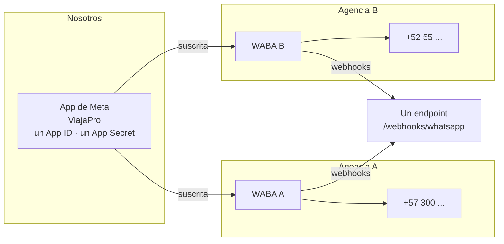
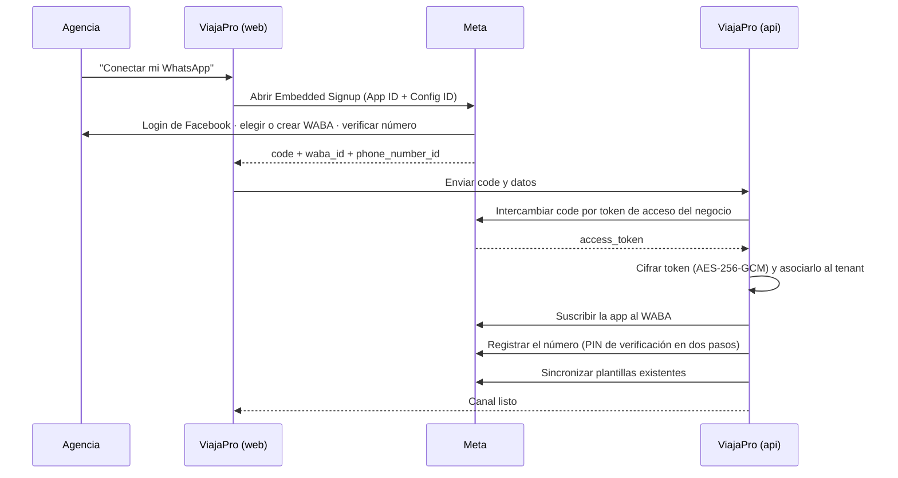

# Integración — WhatsApp Cloud API

> **Esta es la integración más crítica del producto.** Si el número de una agencia pierde calidad
> o se bloquea, esa agencia deja de vender ese día, y nos lo cobrará a nosotros.
>
> **Verifica siempre contra la documentación oficial vigente** (`developers.facebook.com/docs/whatsapp`)
> antes de dar por buena una afirmación sobre precios, límites o versiones de la API. Meta los
> cambia varias veces al año. Este documento describe **la forma de la integración**, que es
> estable; los números concretos se consultan, no se recuerdan.

Decisión de fondo: [ADR-0002](../03-adr/0002-whatsapp-cloud-api.md).

---

## 1. El modelo: somos Tech Provider

Una sola app de Meta sirve a todos los tenants. Cada agencia aporta **su propia** cuenta de WhatsApp
Business (WABA) y su número.



**Un solo endpoint de webhook para todos.** El enrutamiento al tenant se hace por
`phone_number_id`, que viene en cada payload.

---

## 2. Onboarding de una agencia (Embedded Signup)



**Puntos donde esto falla en la vida real** — hay que manejarlos explícitamente, no asumir el
camino feliz:

| Fallo | Qué hacer |
|---|---|
| El número ya está en otra WABA | Mensaje claro: debe migrarlo o usar otro. Es la causa más común de fricción |
| El negocio de la agencia no está verificado en Meta | Explicar el trámite y sus tiempos. No podemos hacerlo por ellos |
| El número está en uso en la app de WhatsApp Business | Debe desvincularlo primero. Advertirlo **antes** de empezar |
| Registro fallido por el PIN | Reintento con PIN nuevo; guiar paso a paso |
| El token caduca o se revoca | Detectarlo, marcar el canal como desconectado y avisar al dueño de la agencia **antes** de que pierda mensajes |

El canal tiene estado explícito —`PENDING`, `CONNECTED`, `DISCONNECTED`, `SUSPENDED`— visible en la
interfaz. Una agencia nunca debe descubrir que está desconectada porque un cliente le reclamó.

### Lo que la agencia NO necesita — y es una ventaja comercial

*Verificado contra la documentación oficial el 2026-10-07. Revisar cada trimestre.*

**La verificación del negocio ante Meta no es requisito para empezar a enviar mensajes.** Una
agencia puede conectar su número y operar sin verificarse, durante el tiempo que quiera:

| Sin verificar, la agencia puede | Límite |
|---|---|
| Responder conversaciones iniciadas por el cliente | **Ilimitado** |
| Iniciar conversación (plantillas) | 250 destinatarios únicos por 24 h |
| Plantillas de mensaje | Hasta 250 |

Para una agencia minorista eso sobra durante meses: la inmensa mayoría de sus conversaciones las
inicia el viajero, y esas no tienen tope.

**Lo que sí necesita, y hay que decirlo desde el primer contacto comercial:**

1. Un número **sin cuenta activa en la app de WhatsApp**. Es la causa número uno de fricción en el
   alta, y si lo borra sin preparación pierde su historial.
2. Una cuenta de Facebook y un portafolio de negocio en Meta.
3. **Un medio de pago asociado a su WABA.** Como Tech Provider, Meta exige que el cliente adjunte
   una tarjeta antes de poder enviar. Es un requisito de Meta, no nuestro, y conviene anticiparlo
   para que no aparezca como sorpresa a mitad del alta.

**Consecuencia de producto.** Esto es un argumento de venta real frente a cualquier competidor:
*«conectas tu WhatsApp hoy y atiendes clientes hoy; no tienes que verificar nada ni tener página
web»*. El producto debe reflejarlo: el alta no puede pedir ni un documento más de los que Meta
exige, y la verificación debe presentarse como un paso posterior opcional, con su beneficio
explicado (más límite, más plantillas, nombre verificado) y sugerida **solo cuando el límite empiece
a estorbar**.

Guía para enviar al cliente: [`docs/10-onboarding/01-requisitos-para-la-agencia.md`](../10-onboarding/01-requisitos-para-la-agencia.md).

---

## 3. Webhooks

### Verificación inicial (`GET`)

Meta envía `hub.mode`, `hub.verify_token` y `hub.challenge`. Si el token coincide con
`WHATSAPP_WEBHOOK_VERIFY_TOKEN`, se devuelve el `challenge` en texto plano.

### Recepción (`POST`) — la ruta más crítica del sistema

```
1. Leer el CUERPO CRUDO (sin parsear).
2. Validar X-Hub-Signature-256 = HMAC-SHA256(cuerpo crudo, APP_SECRET).
   Comparación en tiempo constante. Firma inválida → 403 y registro del intento.
3. Encolar el payload tal cual en BullMQ.
4. Devolver 200. Punto.
```

**Responder en menos de un par de segundos no es una optimización: es un requisito.** Si tardamos o
devolvemos error, Meta reintenta y luego degrada la entrega a nuestro endpoint — para *todos* los
tenants, no solo el afectado.

La validación va sobre el **cuerpo crudo**: cualquier middleware que parsee JSON antes rompe la
firma. Es el error número uno en este tipo de integración.

### Procesamiento asíncrono

```
1. Resolver el tenant por phone_number_id. Desconocido → descartar y alertar.
2. Deduplicar por (tenant_id, wamid). Ya existe → descartar en silencio.
3. Según el tipo:
   - Mensaje entrante → persistir, abrir o reabrir conversación, reiniciar ventana de 24h,
     publicar evento de tiempo real, encolar extracción de intención.
   - Estado (sent/delivered/read/failed) → avanzar la máquina de estados. NUNCA retroceder:
     los estados llegan fuera de orden con frecuencia.
   - Media → descargar de la URL de Meta y persistir en S3. Esas URLs expiran: no se guardan.
   - Cambio de plantilla o de calidad del número → actualizar y alertar si degrada.
```

**Idempotencia por `wamid`**, garantizada por una restricción única en
`(tenant_id, provider_message_id)`. Meta reintenta: el mismo mensaje llegará dos veces.

---

## 4. La ventana de servicio de 24 horas

La regla que más confunde a los usuarios y la que más hay que hacer visible.

| Estado | Qué se puede enviar |
|---|---|
| El cliente escribió hace menos de 24 h | Cualquier mensaje: texto, media, interactivos |
| Pasaron más de 24 h | **Solo plantillas aprobadas** |

Implementación: `conversation.service_window_expires_at`, reiniciado en cada mensaje **entrante**.

Requisitos de producto, no solo técnicos:

- La interfaz muestra **cuánto queda** de la ventana, no solo si está abierta.
- Cuando faltan menos de 2 horas, se avisa al asesor asignado.
- Con la ventana cerrada, el campo de texto libre se bloquea y **se ofrecen las plantillas
  disponibles ahí mismo**. Un error seco sin alternativa es una venta perdida.

---

## 5. Plantillas

Las plantillas son por tenant, las aprueba Meta, y tienen ciclo de vida propio: pueden ser
rechazadas, pausadas por mala calidad o deshabilitadas.

Categorías: `MARKETING`, `UTILITY`, `AUTHENTICATION`. La categoría afecta el costo y las reglas de
envío — **consulta la documentación oficial para el modelo de precios vigente.**

Lo que el producto debe gestionar:

- Crear, editar y enviar a aprobación desde nuestra interfaz.
- Reflejar el estado real (`APPROVED`, `PENDING`, `REJECTED`, `PAUSED`, `DISABLED`) vía webhook.
- Variables tipadas con vista previa antes de enviar.
- Plantillas base sugeridas para turismo: confirmación de cotización, recordatorio de *time limit*,
  recordatorio de pago, documentos de viaje listos, bienvenida al destino, seguimiento post-viaje.

Eso último es valor de producto real: una agencia que empieza con seis plantillas útiles ya
aprobadas arranca vendiendo, no configurando.

---

## 6. Calidad del número y límites de envío

Cada número tiene una **calificación de calidad** y un **límite escalonado** de destinatarios
únicos por período. Ambos suben o bajan según cómo reaccionen los usuarios: los bloqueos y los
reportes destruyen un número.

Obligaciones del producto:

- Exponer calidad y límite actual al dueño de la agencia, siempre visibles.
- **Alertar antes de que duela**, no después.
- **Desincentivar el envío masivo no solicitado por diseño.** No basta con prohibirlo en los
  términos: si el producto facilita quemar un número, los clientes lo quemarán y la culpa agregada
  recaerá sobre nuestra app.
- Registrar el opt-in de cada contacto con fecha, canal y finalidad. Auditable.

---

## 7. Manejo de errores

Clasificación obligatoria — reintentar lo que no es recuperable solo agrava el problema:

| Clase | Ejemplos | Qué hacer |
|---|---|---|
| Transitorio | Límite de tasa, error interno de Meta, timeout | Reintento con backoff exponencial y jitter |
| Permanente de datos | Número inválido, plantilla no aprobada, parámetro mal formado | Marcar `FAILED` con motivo legible y mostrarlo al asesor |
| De autorización | Token caducado o revocado | Marcar el canal desconectado y avisar al dueño de inmediato |
| De política | Ventana cerrada, categoría no permitida | Bloquear en la interfaz **antes** de intentar el envío |

Los mensajes de error de Meta no son para usuarios finales: se traducen a lenguaje que un asesor
entienda, con la acción que debe tomar.

---

## 8. Abstracción: el puerto `MessagingProvider`

Toda la integración vive detrás de un puerto. El dominio no sabe que existe Meta.

```typescript
interface MessagingProvider {
  sendText(params: SendTextParams): Promise<ProviderMessageId>;
  sendTemplate(params: SendTemplateParams): Promise<ProviderMessageId>;
  sendMedia(params: SendMediaParams): Promise<ProviderMessageId>;
  downloadMedia(mediaId: string): Promise<MediaStream>;
  getPhoneNumberHealth(phoneNumberId: string): Promise<NumberHealth>;
}
```

Esto es la póliza de seguro del ADR-0002: si algún día hay que pasar a un BSP, se escribe un
adaptador nuevo y el resto del sistema no se entera.

---

## 9. Lista de verificación antes de producción

- [ ] Firma HMAC validada sobre el cuerpo crudo, con comparación en tiempo constante
- [ ] Webhook responde 200 en menos de 500 ms bajo carga
- [ ] Idempotencia por `wamid` probada con entregas duplicadas
- [ ] Estados fuera de orden no retroceden la máquina de estados
- [ ] Tokens de tenant cifrados en reposo y **ausentes de todo log y traza**
- [ ] Ventana de 24 h aplicada en el servidor, no solo en la interfaz
- [ ] Todos los códigos de error de Meta clasificados y traducidos
- [ ] Alertas de calidad de número y de límite de envío configuradas
- [ ] Opt-in registrado y auditable
- [ ] Probado con número de prueba **y** con un número real de la agencia piloto
