# El recorrido del asesor

De la conversación de WhatsApp al saldo cobrado, en diez pasos. Cada paso dice **qué haces**, **qué ves**
y, cuando algo todavía no existe, **lo dice**.

> **Antes de empezar:** las capturas son de la demostración («Viajes El Sol», datos de muestra), no
> de una agencia real. Léete las [tres advertencias](README.md#léelo-con-estas-tres-advertencias).

El menú de la izquierda (en el celular, la barra de abajo y la hoja «Más») tiene siempre las mismas
entradas: **Hoy · Conversaciones · Oportunidades · Cotizaciones · Archivos de viaje · Seguimientos ·
Contactos · Catálogo · Mis números**. Con la lupa de arriba («Buscar o comandos…», también `Ctrl K` o
`⌘K`) llegas a cualquier pantalla escribiendo su nombre.

---

## 1. Entrar

**Qué haces.** Abres la dirección de tu agencia, escribes tu **usuario o tu correo** y tu
**contraseña**, y pulsas **«Ingresar a ViajaPro»**. Tu usuario te lo da el dueño de la agencia al
invitarte (ver [el recorrido del dueño](02-recorrido-del-dueno.md#2-invitar-al-equipo)).

**Qué ves.** La pantalla de ingreso y, al entrar, **«Hoy»**.

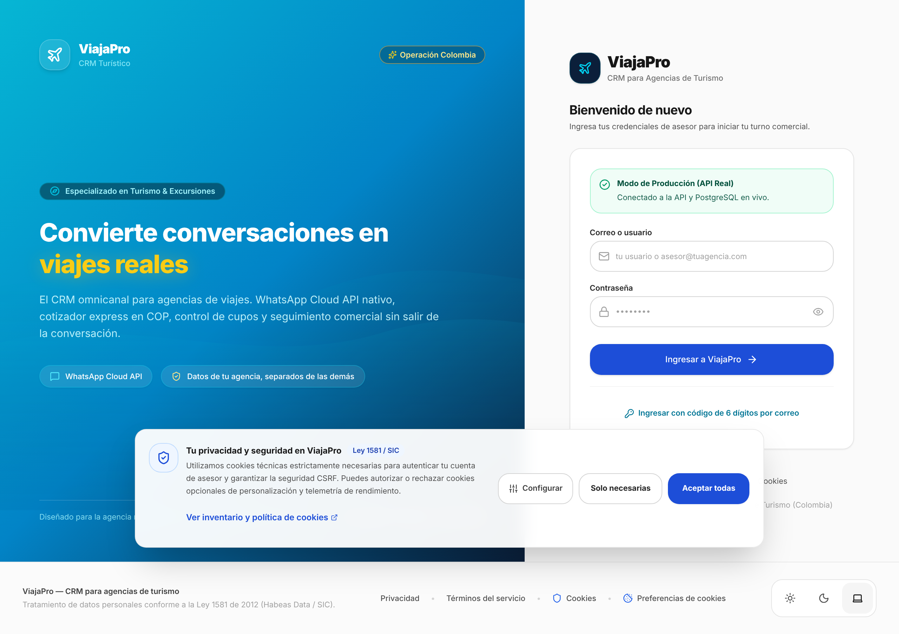

**El aviso de cookies.** La primera vez que abres ViajaPro en un navegador, abajo aparece el aviso
«Tu privacidad y seguridad en ViajaPro» (Ley 1581 de 2012). Elige una opción para continuar:
**«Solo necesarias»** (las que hacen falta para autenticarte y proteger tu sesión),
**«Aceptar todas»**, o **«Configurar»** para decidir una por una. Después ya no vuelve a salir en ese
navegador. Las demás capturas de este manual se tomaron con el aviso ya resuelto.

**Claro u oscuro, antes de entrar.** En el pie de la pantalla de ingreso (abajo a la derecha) hay tres botones
para elegir el tema visual: **sol (claro)**, **luna (oscuro)** y **pantalla (sistema)**, que sigue el modo de
tu computador o celular. Dentro de la aplicación, el mismo ajuste está en el icono de abajo del menú
lateral, junto a la campana: cada clic pasa de *Sistema* a *Claro*, de *Claro* a *Oscuro* y de *Oscuro* de
vuelta a *Sistema*. Las capturas de este manual están en tema claro.

- El recuadro verde de arriba del formulario («Modo de Producción… Conectado a la API») **solo
  refleja cómo está configurada la aplicación; no comprueba que el servidor esté respondiendo**. En
  la captura sale así aunque se tomó sin ninguna API (T-565).
- Tu sesión se cierra sola tras un rato sin actividad; la pantalla te lo avisa y vuelves a ingresar.
- Verás cada agencia por separado: **nunca** aparecen conversaciones, contactos ni cotizaciones de otra
  agencia.
- El botón **«Ingresar con código de 6 dígitos por correo»** existe pero **aún no funciona**: la pantalla
  lo marca como «próximamente». Hoy se entra solo con contraseña.

---

## 2. «Hoy»: qué toca atender

**Qué ves.** El resumen de tu día: conversaciones pendientes (y cuántas están sin asignar), oportunidades
en el pipeline, **cotizaciones abiertas** (borradores y enviadas, y cuántas llevan días sin respuesta), el **saldo por cobrar** de los archivos abiertos por moneda, y la lista de **seguimientos del día** con la hora, el viajero y lo
que prometiste. Abajo, accesos directos al Cotizador, la bandeja, el catálogo y el pipeline.

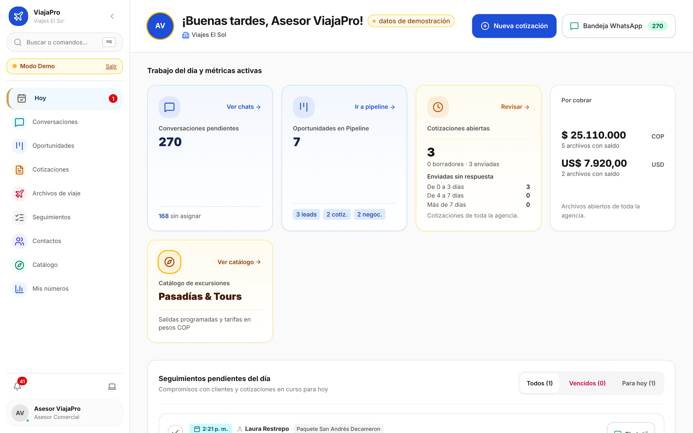

**Qué haces.** Pulsas **«Ver chats»** para ir a las conversaciones, **«Chat»** en un seguimiento para
abrir la conversación del viajero, o el círculo de la izquierda de un seguimiento para marcarlo como
cumplido. **«Nueva cotización»** abre el cotizador.

La campana (abajo a la izquierda en escritorio) junta los **avisos**: por ejemplo, un *time limit* que
vence pronto o un pago total próximo. Ver el [paso 9](#9-el-archivo-de-viaje-y-sus-reservas).

---

## 3. Atender una conversación

**Qué haces.** Entras a **Conversaciones**. A la izquierda está la lista; arriba, los filtros
**Todas · Mías · Sin asignar · Sin leer · SLA vencido** y las **etiquetas** de la agencia. Abres una
conversación pulsándola.

**Qué ves.** Cada fila trae el nombre del viajero, el último mensaje, la hora, las etiquetas de color y
un resumen del viaje que pide («Cancún · dic»). El aviso **«SLA vencido»** te dice que la conversación
lleva más tiempo sin respuesta del que la agencia se fijó.

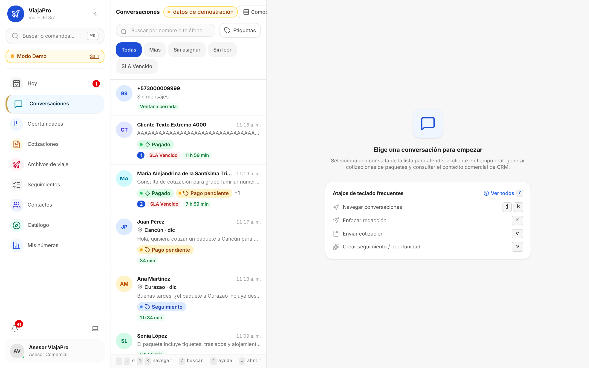

Al abrirla, el hilo del chat ocupa el centro y a la derecha queda la **ficha del viajero**: la
**solicitud de viaje** (destino, fecha de salida, pasajeros y valor estimado), la cotización vigente con
sus botones **«Cotizar»** y **«Ver cotización»**, el próximo paso pactado, los datos del contacto, sus
preferencias y sus consentimientos.

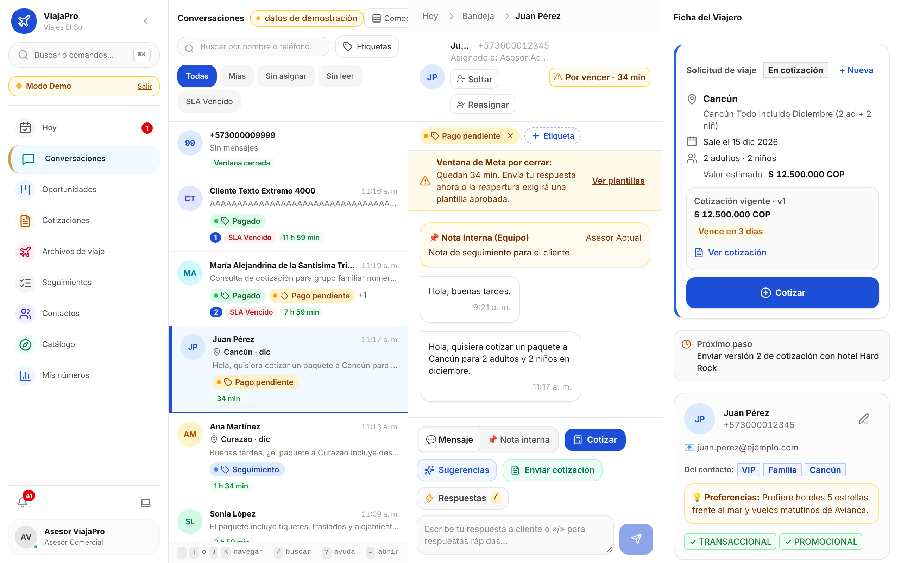

- **Qué conversaciones ves.** Según tu permiso, solo las tuyas y las sin asignar, o todas las de la
  agencia. Eso lo decide el dueño.
- **La ventana de 24 horas.** WhatsApp solo deja escribir libremente dentro de las 24 horas siguientes
  al último mensaje del viajero. Pasado ese plazo la conversación aparece como **«Ventana cerrada»** y
  hay que usar una plantilla aprobada por Meta.
- **Responder.** Escribes y envías; el mensaje pasa a la cola de envío y la conversación te muestra su
  estado. Junto al cuadro de texto hay **«Nota interna»** (solo la ve tu equipo, no el viajero),
  **«Sugerencias»**, **«Respuestas»** (escribe `/`) y **«Enviar cotización»**.
- **Asignación.** Arriba del chat ves quién lo atiende; con **«Soltar»** lo devuelves a la bandeja y con
  **«Reasignar»** se lo pasas a otro asesor.
- **Aviso de la ventana.** Cuando faltan pocos minutos para que se cierre la ventana de 24 horas, un
  recuadro amarillo te lo dice y te lleva a **«Ver plantillas»**.

---

## 4. Oportunidad y seguimiento

**Qué haces.** Desde el panel del viajero creas la **oportunidad** (una intención de compra). Aparece en
**Oportunidades**, el tablero por etapas del embudo (*Consulta nueva → En cotización → En negociación →
Ganada / Perdida* en la agencia de ejemplo; **cada agencia define sus etapas**).

**Qué ves.** Columnas con tarjetas: viajero, destino y fecha de salida, valor, el próximo paso y cuándo
vence. Puedes alternar entre **Kanban** y **Tabla**, filtrar por asesor y exportar a CSV.

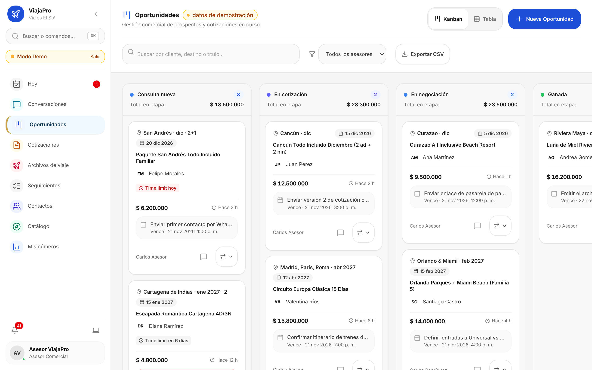

- Al cerrar una oportunidad como **perdida**, el sistema te pide el **motivo** de una lista que define
  la agencia.
- En **Seguimientos** agendas los compromisos con el viajero («Confirmar pago de anticipo…») y los
  marcas como cumplidos. Cada uno enlaza al chat y a la **Ficha 360** del contacto.

---

## 5. Cotizar

**Qué haces.** Desde la conversación pulsas **«Cotizar»** en la solicitud de viaje, o entras al
**Cotizador**. Eliges el **paquete**, la **fecha de salida**, la **composición del grupo** (adultos,
niños de 2 a 11 años, infantes menores de 2) y la **acomodación** (sencilla, doble, triple, cuádruple;
el sistema sugiere una).

**Qué ves.** A la derecha, la cotización calculándose al instante: el **total de venta sugerido**, la
tarifa por tipo de pasajero y el subtotal. Todo en pesos colombianos (COP).

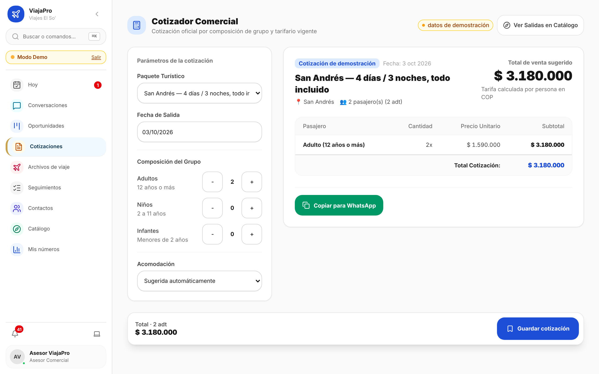

- Los precios salen del **tarifario vigente** del [catálogo](02-recorrido-del-dueno.md#4-el-catalogo).
  Si el tarifario del paquete venció, el sistema lo avisa.
- Tú ves **el precio de venta**. El neto del mayorista y el margen **solo los ve quien tiene ese
  permiso** (normalmente el dueño).
- **«Copiar para WhatsApp»** deja el texto listo para pegar; **«Guardar cotización»** crea la
  **versión 1** y abre su detalle.

---

## 6. Enviar la cotización

**Qué haces.** Desde la conversación pulsas **«Enviar cotización»**, o en el detalle de la cotización eliges **«Enviar en esta
conversación»**. Va por el canal oficial de WhatsApp de la agencia, queda en el chat y la cotización pasa
a **ENVIADA**.

**Qué ves.** En **Cotizaciones** tienes el historial: cliente, paquete y salida, versión, estado
(**Borrador · Enviada · Aceptada · Rechazada · Vencida**) y total, con las acciones **Ver · WhatsApp ·
Duplicar**.

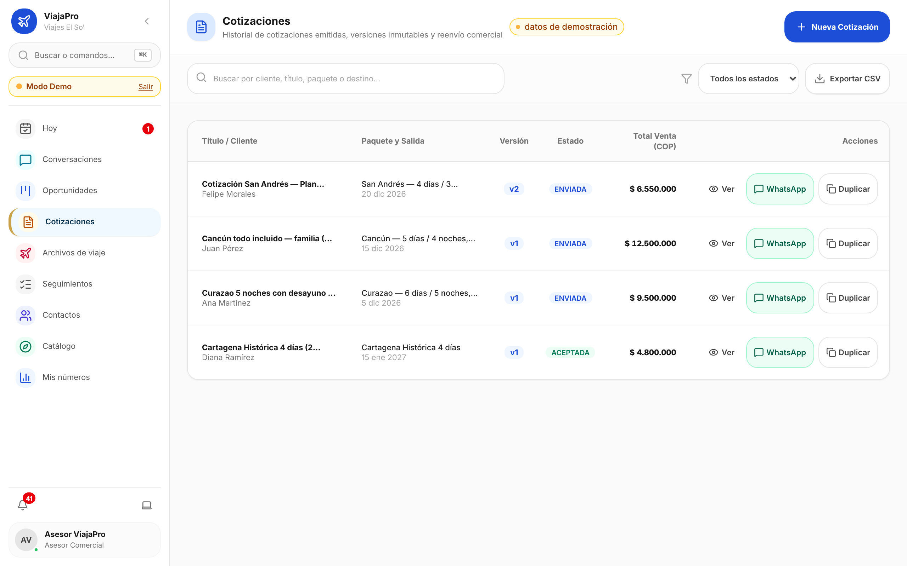

- **Cada cambio es una versión nueva** (v1, v2…); las anteriores no se alteran, para que siempre sepas
  qué le prometiste al viajero.
- ⚠ El botón **«WhatsApp»** de la lista abre WhatsApp *fuera* del canal de la agencia: el mensaje **no
  queda en el chat de ViajaPro ni cambia el estado**. Para que quede registrado, usa «Enviar en esta
  conversación».

---

## 7. Cuando el viajero acepta

> ⚠ **Esto todavía no tiene botón en la pantalla.** El sistema sabe pasar una cotización a **Aceptada** y
> ese cambio es lo que **abre el archivo de viaje** automáticamente, pero hoy la web solo permite llevar
> la cotización hasta **Enviada**. La aceptación se ha probado por la API, no desde una pantalla. Hasta
> que exista el botón, el equipo técnico debe hacerla. Está anotado como pendiente (T-563).

Lo que sí ocurre cuando una cotización pasa a **Aceptada**: el sistema abre el **archivo de viaje** con su
número («File 1043») y una **reserva por cada mayorista**, con la TRM del día congelada.

---

## 8. Archivos de viaje

**Qué haces.** Entras a **Archivos de viaje**. A la izquierda, la lista (**Abiertos · Cancelados ·
Todos**), ordenada por el plazo que vence primero.

**Qué ves.** Cada file con su destino, la salida, el mayorista, el estado de la reserva y cuánto falta
para su *time limit*. Una insignia roja («Menos de 24 h») te avisa lo urgente.

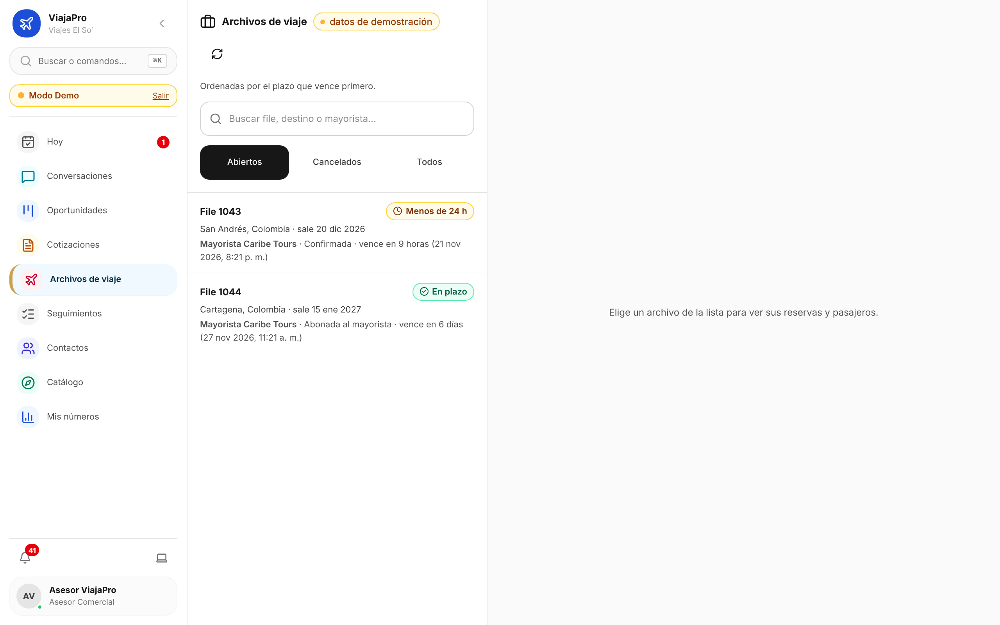

---

## 9. El archivo de viaje y sus reservas

**Qué haces.** Abres un archivo. Ves el resumen del viaje (cotización de origen, paquete, salida,
pasajeros, venta) y, debajo, las **reservas por mayorista**.

**Qué ves y qué puedes hacer en cada reserva.**

| Estado de la reserva | Acciones |
|---|---|
| Solicitada al mayorista | Confirmar · Pasar a lista de espera · Marcar como caída · Cancelar · Corregir datos |
| Confirmada (con localizador) | Registrar abono · Marcar como caída · Cancelar reserva · Corregir datos |

Cada reserva muestra su **time limit** y el plazo vigente («vence en 9 horas»). **Si el time limit se
vence, el mayorista libera el cupo y la reserva cae**: es el dato que más dinero cuesta olvidar. Por eso
el sistema te manda un **aviso a la campana** antes del plazo y antes de la fecha de pago total.

También editas los **pasajeros** (titular, adultos, niños con su edad) y, si hace falta, **cancelas el
archivo completo**.

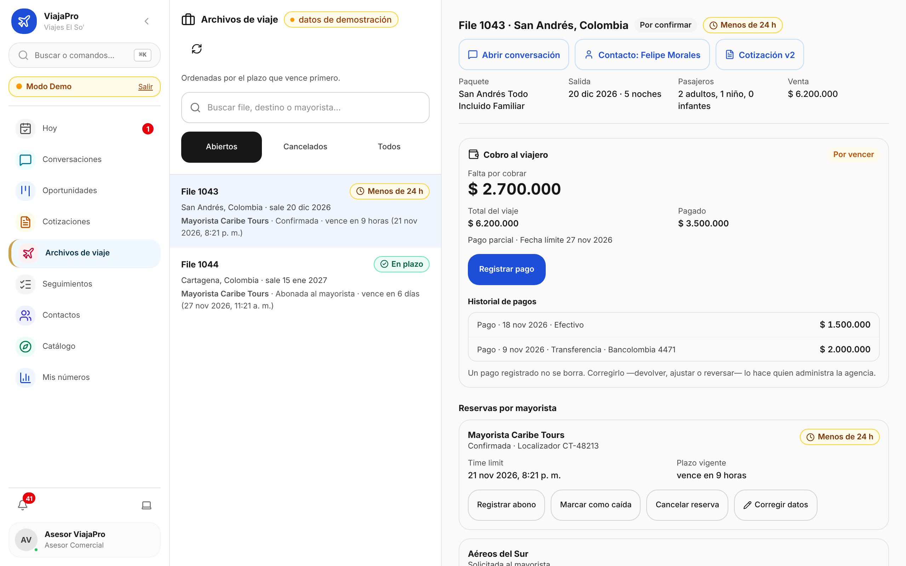

- El **neto del mayorista** solo se muestra a quien tenga el permiso de ver neto y margen.
- Para operar un archivo necesitas el permiso **«operar archivos de viaje»**; con solo «ver» lo
  consultas sin poder cambiarlo. El dueño, el asesor y operaciones los reciben por defecto.

---

## 10. Registrar un pago del viajero

**Qué haces.** Dentro del archivo, en **«Cobro al viajero»**, pulsas **«Registrar pago»**, llenas
**«Cuánto pagó»**, **«Fecha del pago»**, **«Cómo pagó»** (efectivo, transferencia…), una **referencia**
(opcional, por ejemplo el número de transferencia) y una nota, y guardas. El formulario te recuerda
cuánto falta por cobrar y que el pago queda **a tu nombre**.

**Qué ves.** El **saldo se recalcula solo**: *Total del viaje · Pagado · Falta por cobrar*, con la fecha
límite y el estado (*Por vencer*, al día…). Cada pago queda en el **historial de pagos**.

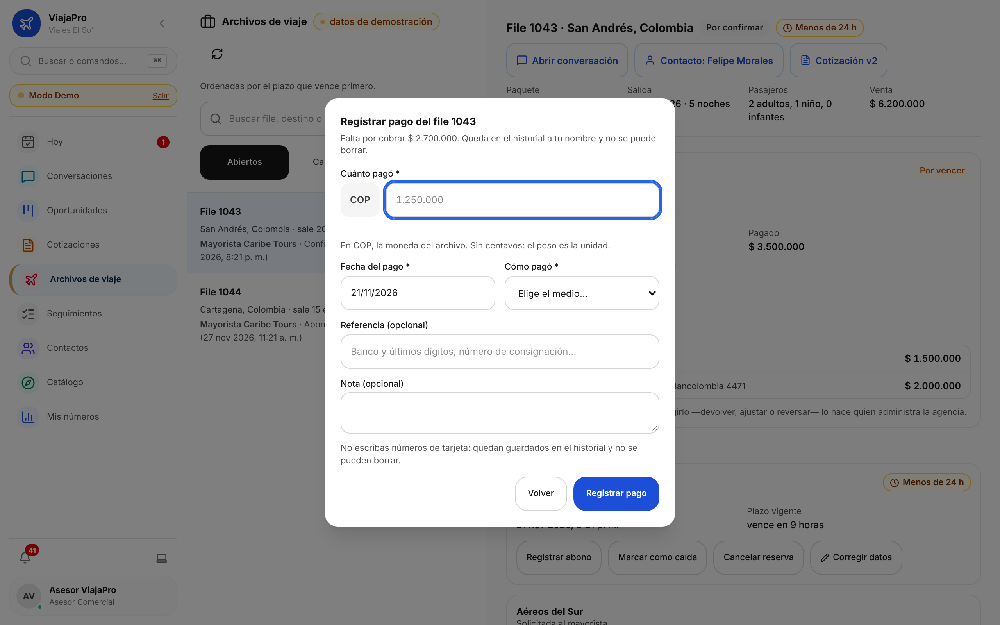

- **Formato de montos:** en pesos **no hay centavos: el peso es la unidad**. Escribe `2.500.000` (el
  punto separa miles). El sistema rechaza otros formatos para no confundir 2.500 con 2,5.
- **No escribas números de tarjeta** en la referencia ni en la nota: quedan guardados en el historial y
  no se pueden borrar.
- **Un pago registrado no se borra, y tú no puedes deshacerlo.** Revisa el monto antes de guardar.
  Corregirlo (devolver, ajustar o reversar) es del dueño y **hoy no tiene pantalla** (T-564): la pantalla
  solo te lo explica con un aviso. Si te equivocas, avisa al dueño.
- Registrar el pago **no cobra nada ni mueve dinero**: es el libro donde la agencia anota lo que ya
  recibió. No hay pasarela de pago.

---

## 11. Tus números

**Qué haces.** Entras a **Mis números**.

**Qué ves.** Tus cifras del periodo (este mes, últimos 30 o 90 días, este año): ventas cerradas, tasa de
aceptación, oportunidades ganadas y perdidas, **tiempo de primera respuesta** en WhatsApp, y lo que está
por cobrar de tus archivos.

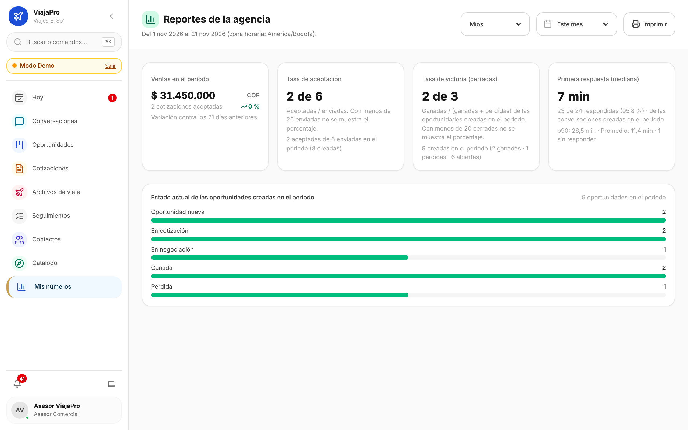

- Si tu perfil solo ve lo propio, el título es **«Mis números»**; el dueño ve **«Reportes de la
  agencia»** (ver [su recorrido](02-recorrido-del-dueno.md#6-reportes-de-toda-la-agencia)).
- ⚠ **La captura de arriba no es la vista de un asesor puro.** El usuario de la demostración tiene
  permisos de dueño, así que la pantalla se titula «Reportes de la agencia»; para acercarse a lo que ve
  un asesor se eligió el filtro **«Míos»**. Con un asesor real, el título y el menú dicen «Mis números» y
  desaparece la comparación entre asesores (T-566).
- Cuando hay pocos datos (por ejemplo, menos de 20 cotizaciones enviadas), el sistema **no muestra
  porcentaje** en vez de mostrar uno engañoso.
- Algunas cifras propias, como tus cotizaciones abiertas y tus cobros por cobrar, **aún no se calculan
  por asesor** y no aparecen o aparecen sin desglose.
