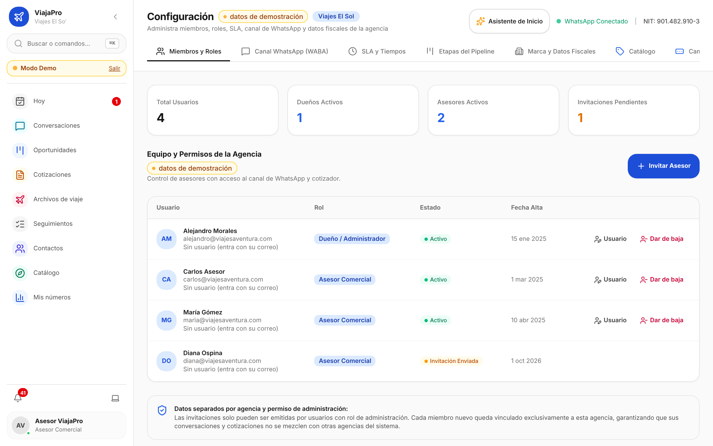
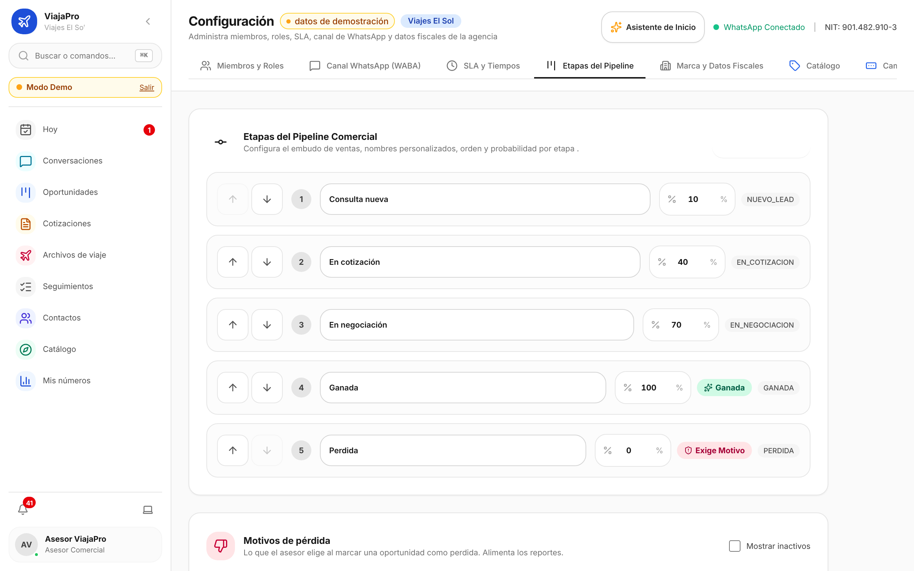
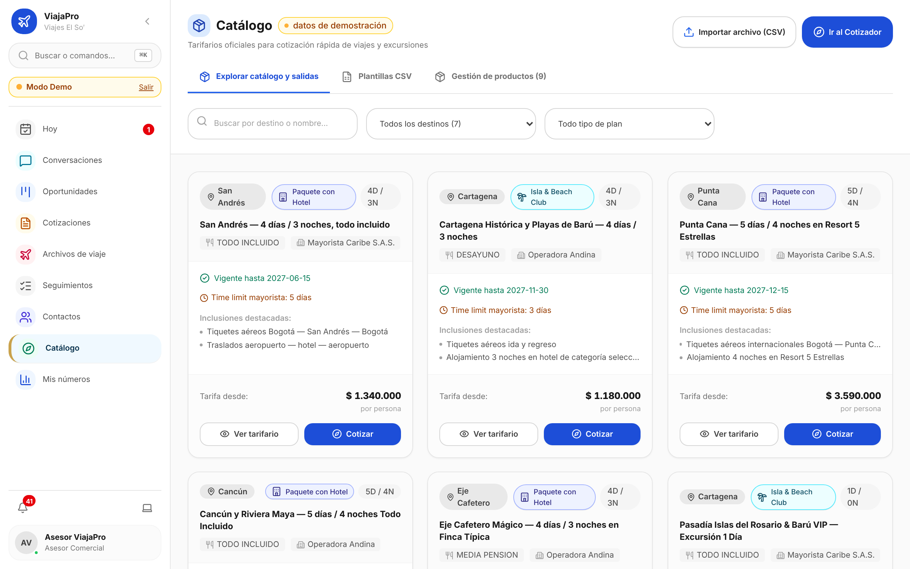
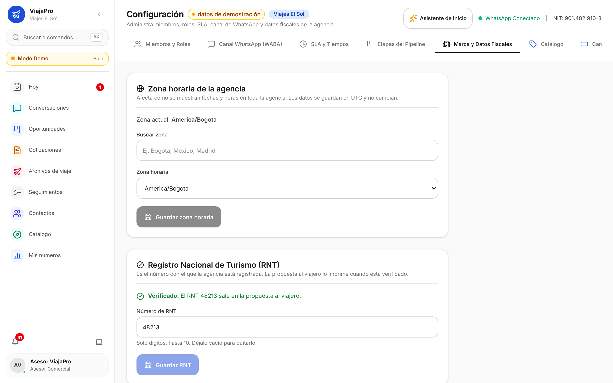
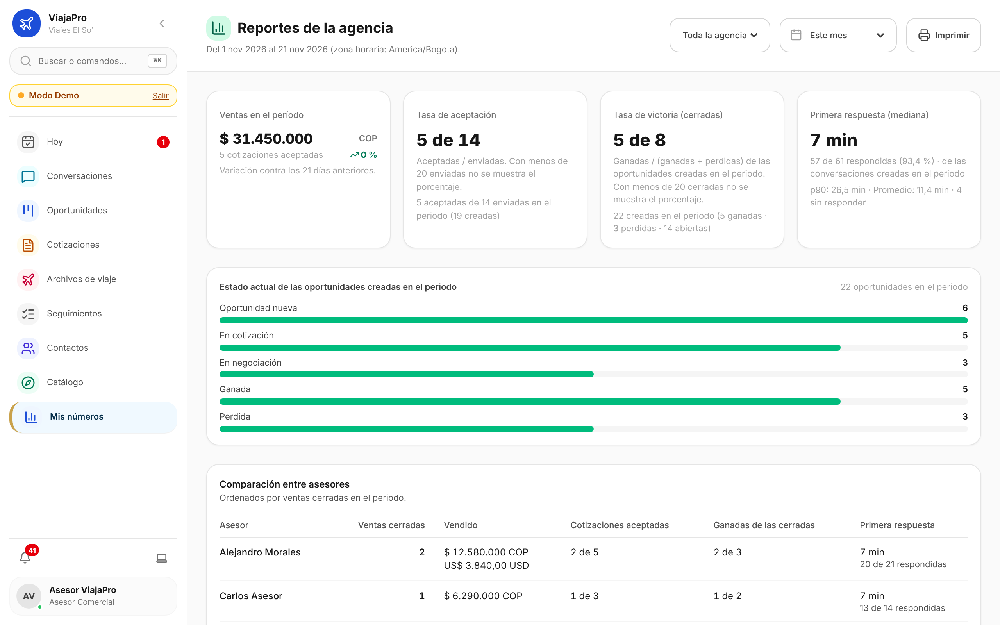

# El recorrido del dueño de la agencia

El dueño hace **todo lo que hace un asesor** —atender conversaciones, cotizar, abrir archivos de viaje,
registrar pagos— y además configura la agencia y ve los números de todo el equipo. Esas tareas están
en [el recorrido del asesor](01-recorrido-del-asesor.md); aquí solo está lo que es del dueño.

> **Antes de empezar:** las capturas son de la demostración («Viajes El Sol», datos de muestra), no
> de una agencia real. Léete las [tres advertencias](README.md#léelo-con-estas-tres-advertencias).

Lo que ves de más, y por qué: el menú del dueño suma **Reportes** y **Configuración**. Cada permiso
aparece o desaparece según el rol. **Ocultar un botón no es lo que protege los datos**: lo que protege es
que el servidor vuelve a comprobar el permiso en cada petición.

---

## 1. Configuración: el panel de la agencia

**Qué haces.** Entras a **Configuración**. Arriba ves el nombre de la agencia, el estado del canal de
WhatsApp y su NIT; debajo, las secciones.

| Sección | Para qué sirve | Estado |
|---|---|---|
| **Miembros y Roles** | Invitar al equipo y darle de baja | Real |
| **Canal WhatsApp (WABA)** | Ver si el número de la agencia está conectado | Real (estado del canal) |
| **Etapas del Pipeline** | Etapas del embudo y motivos de pérdida | Real |
| **Marca y Datos Fiscales** | Zona horaria y RNT de la agencia | Real |
| **Catálogo** | Entrada al catálogo de paquetes y tarifas | Real |
| **Etiquetas** | Etiquetas de color para las conversaciones | Real |
| **SLA y Tiempos**, **Campos Personalizados**, **Respuestas Rápidas**, **Asistente de Inicio** | — | **Maqueta**: se ve pero no se guarda en el servidor. Ver [lo que no cubre](03-lo-que-no-cubre.md) |

---

## 2. Invitar al equipo

**Qué haces.** En **Miembros y Roles** pulsas **«Invitar Asesor»**, escribes su correo y eliges su rol.
Cada persona recibe su invitación y define su contraseña.

**Qué ves.** La tabla del equipo con su **rol** (*Dueño / Administrador* o *Asesor Comercial*), su
**estado** (*Activo* o *Invitación enviada*) y la fecha de alta; y cuatro totales: usuarios, dueños,
asesores e invitaciones pendientes. Por fila puedes poner o cambiar el **usuario** (el nombre corto con
el que esa persona ingresa en lugar del correo) o **darla de baja**.

- **Cada miembro nuevo queda ligado solo a tu agencia.** Sus conversaciones y cotizaciones jamás se
  mezclan con las de otra agencia.
- Solo quien tiene el rol de administración puede invitar.
- **Lo que ve cada rol lo decide el rol**: por ejemplo, ver *todas* las conversaciones de la agencia, ver
  el neto y el margen, o ver los reportes de toda la agencia son permisos aparte. El **dueño** los
  recibe todos; el **asesor**, solo lo propio.

---

## 3. Las etapas del embudo y los motivos de pérdida

**Qué haces.** En **Etapas del Pipeline** defines las etapas por las que pasa una oportunidad en *tu*
agencia (lo que el tablero de **Oportunidades** muestra como columnas) y los **motivos de pérdida** con
los que tus asesores cierran una oportunidad perdida («Precio alto frente a presupuesto»…).

- Por cada etapa pones el **nombre**, el **orden** (con las flechas de subir y bajar) y la
  **probabilidad de cierre** en porcentaje. **Ganada** y **Perdida** son etapas de cierre; **Perdida «exige
  motivo»**.
- Las etapas y los motivos son **política de tu agencia**: cada agencia puede tener otros. Lo que no se
  puede cambiar son las reglas de fondo (una oportunidad termina ganada o perdida).
- Un **motivo desactivado** deja de ofrecerse, pero las oportunidades que ya lo usaron lo conservan.

---

## 4. El catálogo

**Qué haces.** En **Catálogo** administras los paquetes y excursiones que se pueden cotizar. Puedes
filtrar por destino y por plan (*Solo desayuno, Media pensión, Pensión completa, Todo incluido, Sin
alimentación*), y **importar un archivo CSV** (hay plantillas para descargar).

**Qué ves.** Cada producto con su destino, duración, plan, **mayorista**, vigencia del tarifario, el
*time limit* del mayorista, lo que incluye y la **tarifa «desde», por persona**. Desde cada tarjeta:
**«Ver tarifario»** y **«Cotizar»**.

- **El tarifario manda.** Un paquete cuyo tarifario venció aparece marcado; el cotizador no debe
  usarse con él sin renovarlo.
- Los precios se manejan en **pesos colombianos (COP)**. Las reservas con mayoristas pueden quedar en
  otra moneda con la TRM del día congelada al abrir el archivo.
- **Costos y márgenes** (el neto del mayorista): solo los ven los roles con ese permiso.

---

## 5. Zona horaria y datos de la agencia

**Qué haces.** En **Marca y Datos Fiscales** ves y cambias la **zona horaria** de la agencia
(por defecto `America/Bogota`) y escribes el **RNT** (Registro Nacional de Turismo).

- **La zona horaria** decide cómo se muestran las fechas y desde cuándo cuenta «hoy» en el cotizador,
  el catálogo y los reportes. Las fechas se guardan siempre en hora universal; la zona solo cambia lo
  que ves.
- **El RNT** se imprime en la propuesta al viajero **solo cuando está verificado**. Hoy esa
  verificación no la hace el dueño desde la pantalla, la marca el equipo de ViajaPro. Hasta entonces la
  propuesta sale sin RNT.
- En la demostración el RNT aparece como «Verificado» para que se vea cómo queda; en una agencia real
  aparece sin verificar hasta que el equipo de ViajaPro lo marque.
- Cambiar estos datos requiere el rol de dueño o administrador.

---

## 6. Reportes de toda la agencia

**Qué haces.** Entras a **Reportes**. Arriba eliges **«Qué cifras ver»**: *Toda la agencia* o *Míos*, y
el **periodo** (este mes, últimos 30 o 90 días, este año). **Imprimir** deja una versión para papel.

**Qué ves.**

| Bloque | Qué responde |
|---|---|
| **Ventas en el periodo** | Cuánto se vendió y cuántas cotizaciones se aceptaron, comparado con el periodo anterior |
| **Tasa de aceptación** y **tasa de victoria** | De lo enviado, qué se aceptó; de lo cerrado, qué se ganó |
| **Primera respuesta** | Cuánto tarda tu equipo en contestar el primer mensaje (mediana, p90 y promedio) |
| **Estado de las oportunidades** | Cuántas hay en cada etapa |
| **Comparación entre asesores** | Ventas cerradas, monto vendido y primera respuesta de cada asesor |
| **Por cobrar** | El saldo de los archivos abiertos, separado por moneda, con lo vencido y lo por vencer |
| **Salen pronto** | Archivos con salida en los próximos 30 días y cuánto debe cada uno |
| **Ventas por destino** | Qué destinos están vendiendo, cada moneda aparte |

- **El margen real** (venta menos neto) solo aparece si tu rol puede ver neto y margen.
- **Alcance:** el dueño ve *Toda la agencia*; un asesor solo ve lo propio y a él la pantalla se llama
  **«Mis números»**. Pedir a mano los datos de otro asesor sin permiso es rechazado por el servidor.
- Con pocos datos, el sistema **no muestra porcentajes** (menos de 20 cotizaciones enviadas o menos de
  20 oportunidades cerradas) para no inducir a error.
- ⚠ **Aún no se calculan por asesor** las cotizaciones abiertas y los cobros por cobrar propios, ni la
  fila «Sin responsable». Están anotados como pendientes.

---

## 7. Corregir un pago

El asesor registra pagos, pero **solo el dueño tiene el permiso de corregirlos** (devolver, ajustar o
reversar), y un pago nunca se borra. Ver el
[paso 10 del asesor](01-recorrido-del-asesor.md#10-registrar-un-pago-del-viajero).

> ⚠ **Hoy el dueño no tiene pantalla para corregir un pago.** El permiso y el libro que lo permite
> existen en el servidor, pero la web solo ofrece registrar pagos. Una corrección no se puede hacer
> desde la aplicación todavía (T-564).
