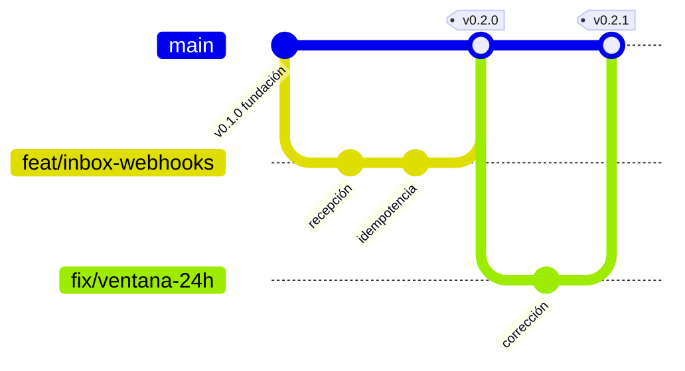

# Git — modelo de ramas y gobierno de la integración

> **La regla de la que cuelga todo lo demás:**
> **En `main` solo entra lo que supera un pull request con los 8 checks en verde y la rama al día**,
> por auto-merge o por el agente `integrador`. Nadie empuja directo —ni personas, ni agentes, ni
> administradores—, y el servidor lo impide. Las rutas protegidas esperan al propietario.
> Reformulación de la regla original por el [ADR-0016](../03-adr/0016-ciclo-autonomo-con-sesiones-de-opencode.md) §6.

Decisión de fondo: [ADR-0005](../03-adr/0005-modelo-de-ramas.md).

---

## 1. El modelo



Una sola rama permanente. El trabajo sale de `main`, vive poco, y vuelve por la compuerta.

| Rama | Quién escribe | Vida | Regla |
|---|---|---|---|
| **`main`** | **Solo `integrador`** | Permanente | Siempre desplegable. Cada commit que cambia el artefacto desplegable es un release etiquetado — ver §5 |
| `feat/<contexto>-<descripción>` | Cualquier agente o persona | 1-3 días | Una funcionalidad, un propósito |
| `fix/<contexto>-<descripción>` | Idem | Horas | Una corrección |
| `refactor/<contexto>-<descripción>` | Idem | 1-2 días | Sin cambio de comportamiento |
| `docs/<tema>` | Idem | Horas | Solo documentación |
| `chore/<descripción>` | Idem | Horas | Dependencias, configuración, tareas |
| `hotfix/<descripción>` | Idem | Horas | Urgencia en producción. **Mismas compuertas, más rápido** |

### Por qué no hay rama `develop`

Un `develop` permanente existe para software que se publica por versiones programadas: aplicaciones
de escritorio, librerías. **Este producto es un SaaS multi-tenant: hay una sola versión viva en
producción, siempre.** Un `develop` añadiría un segundo punto donde resolver conflictos y la
pregunta crónica de qué está en *staging* frente a producción.

**Cuándo se añade `release/*`** — el disparador está escrito para que sea una decisión, no un
olvido: cuando haya clientes en producción y una integración necesite estabilizarse más de un día
antes de desplegarse. Previsiblemente en la Fase 2. Hasta entonces, no.

---

## 2. El ciclo de una rama

```bash
# 1. Siempre desde main actualizado
git checkout main && git pull

# 2. Rama de trabajo con nombre que diga de qué va
git checkout -b feat/inbox-ventana-servicio

# 3. Trabajar. Commits pequeños, uno por cambio lógico.
git commit -m "feat(inbox): calcula la ventana de servicio de 24 horas"

# 4. Antes de pedir integración: ponerse al día con main
git fetch origin && git merge origin/main

# 5. Pedir integración
/integrar
```

**Mantén la rama corta.** Una rama de más de tres días acumula conflictos y se vuelve imposible de
revisar de verdad. Si el trabajo es más largo, pártelo: una funcionalidad grande son varias ramas
que integran por partes, no una rama de dos semanas.

---

## 3. Commits

[Conventional Commits](https://www.conventionalcommits.org/) con scope de contexto. Lo verifica
`commitlint` y el integrador lo rechaza si no cumple.

```
feat(quoting): calcula markup por tipo de pasajero
fix(inbox): evita duplicar mensajes cuando Meta reintenta el webhook
refactor(booking): extrae la validación de time limit al dominio
docs(adr): registra el modelo de ramas
chore(deps): actualiza prisma a 5.22
```

Tipos: `feat`, `fix`, `refactor`, `docs`, `chore`, `test`, `perf`, `build`, `ci`.
Scopes válidos: ver `commitlint.config.js`.

**Un commit, un cambio lógico.** Nada de «varios arreglos». Un commit que no se puede describir en
una línea es dos commits.

---

## 4. La compuerta

El agente [`integrador`](../../.claude/agents/integrador.md) ejecuta siete etapas antes de tocar
`main`. Ninguna se salta:

| # | Etapa | Qué verifica |
|---|---|---|
| 1 | Procedencia | Nombre de rama, commits, tamaño del cambio |
| 2 | Compuertas automáticas | `typecheck` · `lint` · `test` · `build` |
| 3 | Compuertas del proyecto | RLS, secretos, fronteras entre módulos, contratos, migraciones, `any`, dinero, idempotencia |
| 4 | Auditorías | `auditor-seguridad` obligatorio si toca datos, credenciales, pagos o PII |
| 5 | Hilo documental | `ESTADO.md`, bitácora, ADR, documentos que quedaron mintiendo |
| 6 | Integrar | `merge --no-ff` + etiqueta de versión, **salvo cierre documental** — ver §5 |
| 7 | Cerrar | Registro, borrado de rama, aviso a ramas abiertas |

**Siempre `--no-ff`.** El commit de merge es la evidencia de que se pasó por la compuerta; un
fast-forward la borra y hace imposible revertir el conjunto de un solo golpe.

### Qué hace que una integración sea devuelta

- Una sola prueba en rojo. Ni siquiera «esa que siempre falla» — esa se arregla o se borra.
- Tabla nueva sin `tenant_id`, sin RLS o sin su prueba de aislamiento.
- Cualquier rastro de secreto en el historial de la rama.
- Importación directa entre módulos.
- Migración ya aplicada que fue editada.
- `ESTADO.md` que no refleja lo que la rama completó.
- Un cambio tan grande que nadie puede revisarlo de verdad.

---

## 5. Versionado

[SemVer](https://semver.org/lang/es/) en cada integración a `main`:

| Cambio | Versión | Ejemplo |
|---|---|---|
| Ruptura de contrato de API o de evento | **MAYOR** | `1.0.0` → `2.0.0` |
| Funcionalidad nueva compatible | **MENOR** | `0.2.0` → `0.3.0` |
| Corrección compatible | **PARCHE** | `0.2.0` → `0.2.1` |

Antes de la Fase 1 estamos en `0.x`: la versión menor sube con cada fase del roadmap.

### Commits que NO producen versión

Un commit que **no cambia el artefacto desplegable** entra en `main` sin etiqueta. En la práctica,
solo una cosa cumple eso: el cierre documental de una versión ya publicada —actualizar `ESTADO.md`,
escribir la bitácora, registrar la integración.

Etiquetar eso como versión nueva vaciaría de significado los tags: dejarían de responder «qué hay
desplegado» para responder «cuántas veces se tocó el repositorio». Un tag debe seguir siendo la
respuesta a la primera pregunta.

**El criterio no es el tipo de archivo, es el efecto.** Un cambio en `docs/` que modifica una
política que el código aplica —un umbral, un plazo, una regla de negocio parametrizada— sí cambia
el comportamiento del sistema y sí lleva versión. Y a la inversa: un cambio en un `*.md` que solo
afecta a quien lee, no. En la duda, etiqueta: un tag de más es ruido, un tag de menos es una
versión desplegada que nadie puede nombrar.

Esta excepción se escribió después de aplicarla por primera vez, en el cierre documental de
v0.9.1. Lo señaló el propio `integrador` al detectar que la regla escrita decía «cada commit» y la
práctica acababa de hacer otra cosa.

---

## 6. Hasta dónde llega la protección local

**Honestidad sobre el alcance.** El hook `guard-rama.mjs` impide:

- Commitear estando en `main`.
- Fusionar o empujar hacia `main` sin autorización previa del integrador (marcador de un solo uso,
  válido 30 minutos, registrado en `docs/_integraciones/`).
- Reescribir el historial de `main`: `push --force`, `reset --hard`, borrado forzado.

**Lo que NO es:** una frontera de seguridad. Es una barandilla contra el accidente y el atajo
cómodo. Un agente o una persona decidida puede crear el marcador a mano.

**La protección real es de servidor, y desde el 2026-10-26 está activa** en
`system-technology/CRM` (copia de la configuración en `.github/proteccion-main.json`). Lo que
exige sobre `main`:

- Requerir pull request antes de fusionar.
- Requerir que las comprobaciones de CI pasen.
- Requerir al menos una aprobación.
- Prohibir *force push* y borrado de la rama.
- Incluir a los administradores en la restricción. **Una protección que el dueño puede saltarse
  no protege de la decisión apurada de un viernes.**

Guía paso a paso: [`.github/PROTECCION-DE-RAMA.md`](../../.github/PROTECCION-DE-RAMA.md).

---

## 7. Casos especiales

**Urgencia en producción.** Existe `hotfix/`, con las mismas compuertas pero ejecutadas de forma
expedita. Lo que **no** existe es saltarse la compuerta. «Hay que salir hoy» no es una verificación
superada; es exactamente la circunstancia en la que se cometen los errores caros.

**Deshacer algo ya integrado.** `git revert`, que deja constancia. Nunca reescribir el historial de
`main`: el repositorio de los demás ya tiene esos commits.

**Rama que se quedó atrás.** Si `main` avanzó, la rama se pone al día antes de pedir integración.
El integrador no resuelve conflictos ajenos: devuelve.

**Trabajo de más de tres días.** Pártelo. Si de verdad no se puede, habla con `arquitecto`: casi
siempre significa que el cambio está mal delimitado.

---

## 8. Sincronía: cómo no trabajar con cosas atrasadas

El proyecto avanza con varias sesiones y herramientas en paralelo. Lo que más se rompe no es el
código: es trabajar sobre una copia vieja de `main` o de la documentación.

1. **Antes de cada bloque de trabajo:** `git fetch origin`, y rama nueva desde `origin/main`
   (`git checkout -B feat/<contexto>-<descripcion> origin/main`). No desde la rama anterior.
2. **Nunca sigas en una rama de la que ya se integró un PR.** Un PR integrado cierra su rama: lo
   siguiente va en otra, desde `origin/main`. Seguir en la vieja produce conflictos con tu propio
   trabajo ya integrado.
3. **Mira qué árboles están atrasados:** `node scripts/estado-de-arboles.mjs`. Informa, por cada
   árbol de trabajo, cuánto se quedó atrás de `origin/main`. *El script llega con un PR en curso;
   hasta que entre en `main`, el comando no existe y la comprobación es `git fetch origin` y
   `git status -sb`.*
4. **Un PR a la vez cuando tocan los mismos ficheros.** `main` exige la rama al día: el segundo PR
   queda `BEHIND` en cuanto entra el primero. Pon el segundo al día y espera su CI antes de pedir
   el tercero.
5. **Los commits del PR cumplen commitlint**, o el CI cae en `convencion-de-commits`: tipo y scope
   válidos, asunto en minúscula, sin punto final. Un commit mal escrito en medio de la rama obliga
   a reescribirla; revisa el mensaje antes de empujar.
6. **Al cerrar la sesión:** `ESTADO.md` y bitácora. Ver la sección «Cómo actualizar este archivo»
   de [`ESTADO.md`](../../ESTADO.md).
