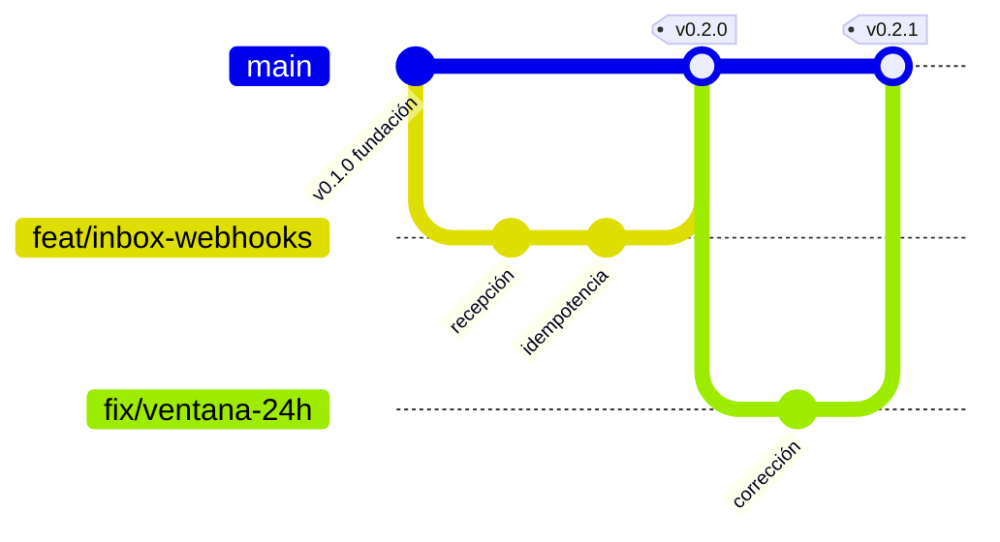

# Git — modelo de ramas y gobierno de la integración

> **La regla de la que cuelga todo lo demás:**
> **En `main` solo escribe el agente `integrador`, y solo después de superar todas las compuertas.**
> Nadie más. Ni personas, ni otros agentes, ni «solo esta vez porque urge».

Decisión de fondo: [ADR-0005](../03-adr/0005-modelo-de-ramas.md).

---

## 1. El modelo



Una sola rama permanente. El trabajo sale de `main`, vive poco, y vuelve por la compuerta.

| Rama | Quién escribe | Vida | Regla |
|---|---|---|---|
| **`main`** | **Solo `integrador`** | Permanente | Siempre desplegable. Cada commit es un release etiquetado |
| `feat/<contexto>-<descripción>` | Cualquier agente o persona | 1-3 días | Una funcionalidad, un propósito |
| `fix/<contexto>-<descripción>` | Idem | Horas | Una corrección |
| `refactor/<contexto>-<descripción>` | Idem | 1-2 días | Sin cambio de comportamiento |
| `docs/<tema>` | Idem | Horas | Solo documentación |
| `chore/<descripción>` | Idem | Horas | Dependencias, configuración, tareas |
| `hotfix/<descripción>` | Idem | Horas | Urgencia en producción. **Mismas compuertas, más rápido** |

### Por qué no hay rama `develop`

Un `develop` permanente existe para software que se publica por versiones programadas: aplicaciones
de escritorio, librerías. **Este producto es un SaaS multi-tenant: hay una sola versión viva en
producción, siempre.** Un `develop` añadiría un segundo punto donde resolver conflictos y la
pregunta crónica de qué está en *staging* frente a producción.

**Cuándo se añade `release/*`** — el disparador está escrito para que sea una decisión, no un
olvido: cuando haya clientes en producción y una integración necesite estabilizarse más de un día
antes de desplegarse. Previsiblemente en la Fase 2. Hasta entonces, no.

---

## 2. El ciclo de una rama

```bash
# 1. Siempre desde main actualizado
git checkout main && git pull

# 2. Rama de trabajo con nombre que diga de qué va
git checkout -b feat/inbox-ventana-servicio

# 3. Trabajar. Commits pequeños, uno por cambio lógico.
git commit -m "feat(inbox): calcula la ventana de servicio de 24 horas"

# 4. Antes de pedir integración: ponerse al día con main
git fetch origin && git merge origin/main

# 5. Pedir integración
/integrar
```

**Mantén la rama corta.** Una rama de más de tres días acumula conflictos y se vuelve imposible de
revisar de verdad. Si el trabajo es más largo, pártelo: una funcionalidad grande son varias ramas
que integran por partes, no una rama de dos semanas.

---

## 3. Commits

[Conventional Commits](https://www.conventionalcommits.org/) con scope de contexto. Lo verifica
`commitlint` y el integrador lo rechaza si no cumple.

```
feat(quoting): calcula markup por tipo de pasajero
fix(inbox): evita duplicar mensajes cuando Meta reintenta el webhook
refactor(booking): extrae la validación de time limit al dominio
docs(adr): registra el modelo de ramas
chore(deps): actualiza prisma a 5.22
```

Tipos: `feat`, `fix`, `refactor`, `docs`, `chore`, `test`, `perf`, `build`, `ci`.
Scopes válidos: ver `commitlint.config.js`.

**Un commit, un cambio lógico.** Nada de «varios arreglos». Un commit que no se puede describir en
una línea es dos commits.

---

## 4. La compuerta

El agente [`integrador`](../../.claude/agents/integrador.md) ejecuta siete etapas antes de tocar
`main`. Ninguna se salta:

| # | Etapa | Qué verifica |
|---|---|---|
| 1 | Procedencia | Nombre de rama, commits, tamaño del cambio |
| 2 | Compuertas automáticas | `typecheck` · `lint` · `test` · `build` |
| 3 | Compuertas del proyecto | RLS, secretos, fronteras entre módulos, contratos, migraciones, `any`, dinero, idempotencia |
| 4 | Auditorías | `auditor-seguridad` obligatorio si toca datos, credenciales, pagos o PII |
| 5 | Hilo documental | `ESTADO.md`, bitácora, ADR, documentos que quedaron mintiendo |
| 6 | Integrar | `merge --no-ff` + etiqueta de versión |
| 7 | Cerrar | Registro, borrado de rama, aviso a ramas abiertas |

**Siempre `--no-ff`.** El commit de merge es la evidencia de que se pasó por la compuerta; un
fast-forward la borra y hace imposible revertir el conjunto de un solo golpe.

### Qué hace que una integración sea devuelta

- Una sola prueba en rojo. Ni siquiera «esa que siempre falla» — esa se arregla o se borra.
- Tabla nueva sin `tenant_id`, sin RLS o sin su prueba de aislamiento.
- Cualquier rastro de secreto en el historial de la rama.
- Importación directa entre módulos.
- Migración ya aplicada que fue editada.
- `ESTADO.md` que no refleja lo que la rama completó.
- Un cambio tan grande que nadie puede revisarlo de verdad.

---

## 5. Versionado

[SemVer](https://semver.org/lang/es/) en cada integración a `main`:

| Cambio | Versión | Ejemplo |
|---|---|---|
| Ruptura de contrato de API o de evento | **MAYOR** | `1.0.0` → `2.0.0` |
| Funcionalidad nueva compatible | **MENOR** | `0.2.0` → `0.3.0` |
| Corrección compatible | **PARCHE** | `0.2.0` → `0.2.1` |

Antes de la Fase 1 estamos en `0.x`: la versión menor sube con cada fase del roadmap.

---

## 6. Hasta dónde llega la protección local

**Honestidad sobre el alcance.** El hook `guard-rama.mjs` impide:

- Commitear estando en `main`.
- Fusionar o empujar hacia `main` sin autorización previa del integrador (marcador de un solo uso,
  válido 30 minutos, registrado en `docs/_integraciones/`).
- Reescribir el historial de `main`: `push --force`, `reset --hard`, borrado forzado.

**Lo que NO es:** una frontera de seguridad. Es una barandilla contra el accidente y el atajo
cómodo. Un agente o una persona decidida puede crear el marcador a mano.

**La protección real es de servidor.** En cuanto exista el repositorio remoto, hay que configurar
en GitHub, sobre `main`:

- Requerir pull request antes de fusionar.
- Requerir que las comprobaciones de CI pasen.
- Requerir al menos una aprobación.
- Prohibir *force push* y borrado de la rama.
- Incluir a los administradores en la restricción. **Una protección que el dueño puede saltarse
  no protege de la decisión apurada de un viernes.**

Guía paso a paso: [`.github/PROTECCION-DE-RAMA.md`](../../.github/PROTECCION-DE-RAMA.md).

---

## 7. Casos especiales

**Urgencia en producción.** Existe `hotfix/`, con las mismas compuertas pero ejecutadas de forma
expedita. Lo que **no** existe es saltarse la compuerta. «Hay que salir hoy» no es una verificación
superada; es exactamente la circunstancia en la que se cometen los errores caros.

**Deshacer algo ya integrado.** `git revert`, que deja constancia. Nunca reescribir el historial de
`main`: el repositorio de los demás ya tiene esos commits.

**Rama que se quedó atrás.** Si `main` avanzó, la rama se pone al día antes de pedir integración.
El integrador no resuelve conflictos ajenos: devuelve.

**Trabajo de más de tres días.** Pártelo. Si de verdad no se puede, habla con `arquitecto`: casi
siempre significa que el cambio está mal delimitado.
