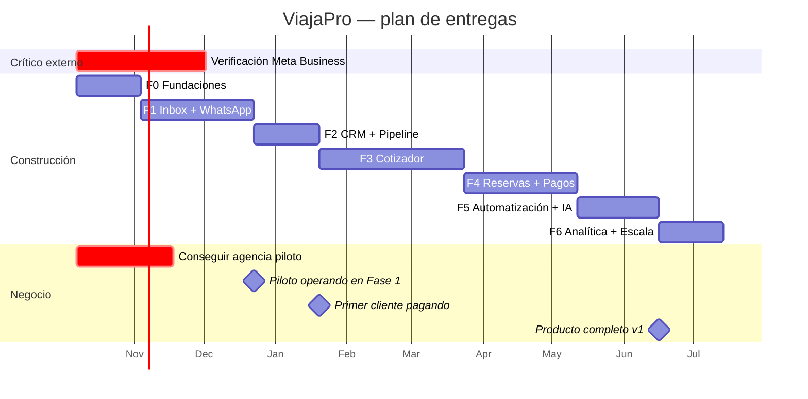

# Roadmap

> **Lee esto primero.** El alcance aprobado para v1 incluye los cuatro bloques: inbox + pipeline,
> cotizador, reservas/pagos y automatización/IA. Este documento no recorta ese alcance: lo
> **secuencia con fechas honestas**, para que la decisión de dónde cortar sea tuya y esté informada.

---

## 1. La aritmética, sin maquillaje

Con un equipo de **3 a 4 personas** (2 desarrolladores full-stack, 1 persona de producto/diseño,
apoyo de agentes de IA), y contando que buena parte del trabajo es integración con terceros cuyos
tiempos no controlamos:

| Bloque | Esfuerzo realista | Por qué cuesta lo que cuesta |
|---|---|---|
| Fundaciones + identidad | 3–4 semanas | Multi-tenancy con RLS, auth, CI/CD. Se hace una vez y sostiene todo |
| Inbox + WhatsApp | 6–8 semanas | Embedded Signup, webhooks, plantillas, tiempo real, ventana de 24h |
| CRM + pipeline | 3–4 semanas | Es lo más convencional del producto |
| Cotizador | 8–10 semanas | **El más complejo.** Multi-moneda, multi-pasajero, markup vs comisión, versionado, PDF |
| Reservas + pagos | 6–8 semanas | Archivo de viaje, *time limits*, pasarela, conciliación, idempotencia estricta |
| Automatización + IA | 4–6 semanas | Extracción de intención, scoring, secuencias, evaluaciones |
| Analítica | 3–4 semanas | Proyecciones y reportes |

**Total: 33 a 44 semanas.** Entre 8 y 11 meses. No 3 o 4.

Las tres salidas posibles, y lo que cuesta cada una:

| Camino | Consecuencia |
|---|---|
| **Fases, lanzar con menos** (recomendado) | Clientes pagando al mes 4. Aprendes del uso real antes de construir lo caro. |
| **Todo antes de lanzar** | Primer cliente al mes 9–11. Nueve meses construyendo a ciegas. |
| **Todo en 4 meses** | Cinco cosas a medias. El modo de fallo más común de productos como este. |

La recomendación es el primer camino, y el roadmap está construido sobre él. **Pero el alcance
completo sigue planificado**: nada se eliminó, solo se ordenó.

---

## 2. Las fases

### Fase 0 — Fundaciones · 3 a 4 semanas

**Objetivo:** que el equipo pueda construir sin discutir cómo.

- [x] Andamiaje documental, arquitectura, ADRs, capa de agentes de IA
- [ ] **Iniciar verificación de Meta Business y acceso a Tech Provider** ← *camino crítico, hoy*
- [ ] Monorepo compilando: `apps/api`, `apps/web`, `apps/worker`, `packages/*`
- [ ] PostgreSQL con RLS, migraciones, seed, prueba de aislamiento entre tenants
- [ ] CI: lint, tipos, pruebas, escaneo de secretos
- [ ] Entornos `dev` y `staging` desplegando
- [ ] Observabilidad mínima: trazas, logs estructurados, Sentry
- [ ] Validar los servidores MCP declarados en `.mcp.json`

**Criterio de salida:** un desarrollador clona, corre `pnpm install && pnpm infra:up && pnpm dev`,
y tiene el sistema andando en menos de diez minutos. La prueba de aislamiento pasa en CI.

---

### Fase 1 — Inbox con WhatsApp · 6 a 8 semanas

**Objetivo:** que una agencia real atienda sus conversaciones aquí. **Es el momento de la verdad.**

- Embedded Signup: la agencia conecta su número desde nuestra interfaz
- Webhook: firma, idempotencia, enrutamiento por `phone_number_id`
- Bandeja compartida: asignación, filtros, búsqueda, notas internas
- Envío y recepción: texto, media, plantillas, interactivos
- Ventana de 24 horas visible y aplicada
- Gestión del ciclo de vida de plantillas
- Tiempo real por WebSocket
- Contactos básicos y timeline unificado por viajero

**Criterio de salida:** una agencia piloto opera **todo** su WhatsApp aquí durante dos semanas sin
volver al celular. Esa es la prueba, no una demo.

**Si esta fase falla, el producto no existe.** Todo lo demás se construye encima.

---

### Fase 2 — CRM y pipeline · 3 a 4 semanas

- Oportunidades, etapas configurables, tablero y tabla
- Actividades, tareas y recordatorios
- Viajeros, empresas, segmentación
- Motivos de pérdida obligatorios
- Reportes básicos: conversión por etapa, actividad por asesor

**Criterio de salida:** la agencia piloto sabe, por primera vez, cuántas consultas entraron y
cuántas se convirtieron. Casi siempre, este número los sorprende.

**Aquí se puede empezar a cobrar.** Inbox + pipeline ya es un producto vendible.

---

### Fase 3 — Cotizador · 8 a 10 semanas

**La fase más larga y el mayor diferenciador.** También la de mayor riesgo de alcance: es donde
"una cosita más" multiplica el tiempo.

- Catálogo de productos y proveedores, tarifarios
- Cotización multi-opción, multi-pasajero (ADT/CHD/INF)
- Tarifa neta, markup, comisión, impuestos, margen visible
- Multi-moneda con TRM congelada
- Itinerario por días y segmentos
- Versionado: la cotización que vio el cliente no cambia
- PDF con la marca de la agencia
- Envío por WhatsApp y seguimiento de apertura

**Criterio de salida:** un asesor pasa de conversación a propuesta enviada en **menos de cinco
minutos**, cronometrado con un caso real.

---

### Fase 4 — Reservas y pagos · 6 a 8 semanas

- Archivo de viaje: pasajeros, documentos, proveedores
- Reservas con localizador y **control de *time limit* con alertas**
- Plan de pagos: anticipo y cuotas
- Pasarela de pagos con webhooks idempotentes
- Conciliación
- Documentos del viajero (dato sensible: cifrado y acceso auditado)
- Seguimiento del viaje y post-venta

**Criterio de salida:** un archivo completo, de la cotización aceptada al viaje terminado, con
pagos conciliados. Ninguna reserva se pierde por un *time limit* no avisado.

---

### Fase 5 — Automatización e IA · 4 a 6 semanas

- Extracción de intención de viaje desde el chat ← *la de mayor impacto, va primera*
- Calificación de leads con justificación visible
- Respuestas sugeridas (siempre revisadas por el asesor)
- Resumen de conversación
- Secuencias de seguimiento automáticas
- Evaluaciones en CI y control de presupuesto por tenant

**Criterio de salida:** el 80% de las conversaciones entrantes genera una oportunidad con destino,
fechas y pasajeros correctos **sin que nadie teclee nada**, medido contra un conjunto anotado.

---

### Fase 6 — Analítica y escala · 3 a 4 semanas

- Reportes de conversión, margen por archivo, productividad, origen de leads
- Recompra y cohortes de viajeros
- Réplica de lectura; particionado de `messages`
- Panel de administración de la plataforma

---

## 3. Cronograma

| Hito | Cuándo | Qué significa |
|---|---|---|
| Piloto operando | ~mes 3 | Una agencia real usa el inbox todos los días |
| **Primer ingreso** | ~mes 4 | Inbox + pipeline es vendible |
| Diferenciador en producción | ~mes 7 | El cotizador nos separa de la competencia |
| v1 completa | ~mes 10 | Los cuatro bloques del alcance aprobado |

---

## 4. Lo que está fuera de v1 (y por qué)

Nombrarlo evita que se cuele por la puerta de atrás:

| Fuera | Por qué | Cuándo |
|---|---|---|
| Integración con GDS (Amadeus, Sabre) | Contratos, certificación y complejidad desproporcionados | v2 |
| Contabilidad y facturación electrónica | No competimos con el ERP de la agencia: integramos | v2, vía API |
| App móvil nativa | La web responsive cubre el caso. Nativa es un producto aparte | v2 |
| Instagram, Messenger, correo en el inbox | WhatsApp es el 90% del volumen real | v1.5 |
| Marca blanca completa de la interfaz | Solo PDF y color de acento en v1 | Plan enterprise |
| Portal del viajero | Interesante, no urgente | v2 |
| Turismo corporativo (políticas, autorizaciones) | Otro producto, otro comprador | v3 |

---

## 5. Decisiones que necesita el usuario

Cada una bloquea o cambia una fase. Están en `ESTADO.md` como preguntas abiertas:

1. **Agencia piloto.** Sin un cliente real en Fase 1, construimos a ciegas. Es la decisión más
   urgente después de iniciar el trámite con Meta.
2. **País de operación inicial.** Define moneda, impuestos, pasarela y normativa por defecto.
3. **Pasarela de pagos.** Bloquea la Fase 4.
4. **Nombre comercial.** Barato ahora, caro después de tener clientes.
5. **Presupuesto mensual de IA.** Define si la Fase 5 usa el modelo rápido o el fuerte.
