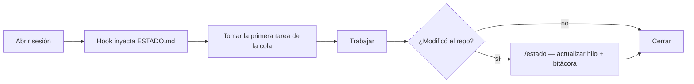
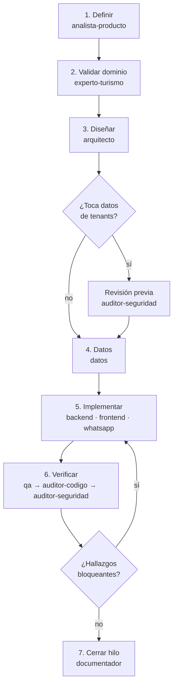
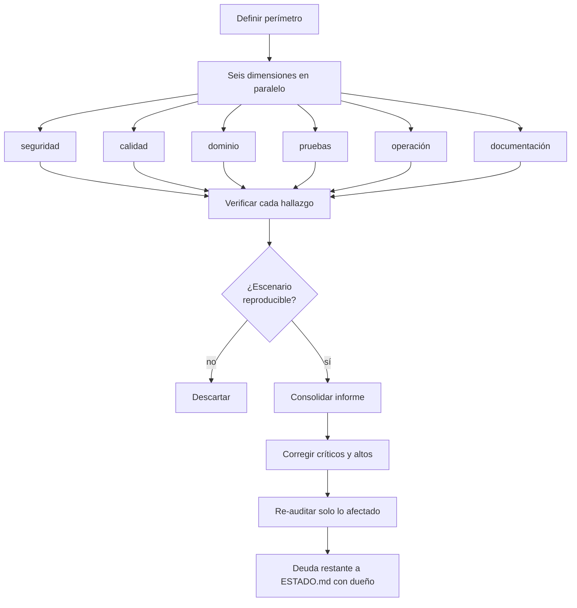

# Loops de trabajo

Un *loop* es un ciclo de trabajo con etapas fijas, compuertas explícitas y un cierre que deja
constancia. Existen porque **lo que no tiene ciclo definido se improvisa distinto cada vez**, y en
un proyecto asistido por agentes eso se traduce en deriva: cada sesión produce código con otro
criterio.

Hay cinco. Tres son de ritmo (se disparan solos), dos son bajo demanda.

---

## Loop 1 — Sesión (cada vez que se abre el proyecto)



El hook `SessionStart` elimina el arranque a ciegas; el hook `Stop` elimina el cierre sin
constancia. Entre medio, el trabajo real.

**Dura:** una sesión. **Dispara:** automático.

---

## Loop 2 — Funcionalidad (skill `ciclo-funcionalidad`)

Siete etapas, de la idea al código integrado:



**Compuertas que requieren una persona:** aprobación de alcance (etapa 1) y aprobación de diseño
(etapa 3). Un agente no se aprueba a sí mismo.

**Dura:** de una sesión a cuatro, según tamaño. **Dispara:** `/funcionalidad <descripción>`.

---

## Loop 3 — Auditoría (skill `auditoria-integral`)

Seis dimensiones en paralelo, verificación, consolidación, corrección, y **una segunda vuelta sobre
lo corregido**. Esa segunda vuelta es lo que separa una auditoría de una lista de buenas intenciones.



**Ritmo:** quincenal durante desarrollo activo, mensual después, **siempre** antes de cerrar una
fase o desplegar a producción.

**Dispara:** `/auditoria [completa|incremental]`, o de forma programada.

---

## Loop 4 — Investigación (agente `investigador`)

Para todo lo que cambia con el tiempo y no se puede responder de memoria: precios de Meta, límites
de la API, normativa, movimientos de la competencia.

```
Pregunta → Buscar fuente primaria → Fechar y citar
        → Marcar lo no verificable → Escribir en docs/ → Enlazar desde ESTADO.md
```

La última etapa es la que suele faltar: una investigación que vive solo en el chat se pierde, y
alguien la vuelve a hacer dentro de dos meses.

**Ritmo:** bajo demanda, más una revisión trimestral obligatoria de precios y políticas de Meta —
son la base de nuestro modelo de costos y cambian sin avisarnos.

---

## Loop 5 — Incidente (producción)

```
Detectar (alerta) → Mitigar → Comunicar al cliente afectado
                  → Causa raíz → Corregir → Prueba que lo habría atrapado
                  → Postmortem en docs/_incidentes/ → Alerta o runbook nuevo si faltaba
```

Dos reglas:

1. **La corrección incluye la prueba** que habría detectado el fallo. Sin eso, el incidente
   volverá con otro disfraz.
2. **El postmortem no busca culpables, busca la condición** que permitió el fallo. Si la conclusión
   es "hay que tener más cuidado", el postmortem no terminó.

**Dispara:** alerta de producción.

---

## Ritmos programados

| Cuándo | Qué corre |
|---|---|
| Cada sesión | Loop 1 |
| Cada funcionalidad | Loop 2 |
| Quincenal | Loop 3 incremental |
| Cierre de fase / release | Loop 3 completo |
| Trimestral | Loop 4 sobre precios y políticas de Meta; prueba de restauración de respaldos |
| Por incidente | Loop 5 |

Los loops programados pueden automatizarse con agentes en la nube. Mientras no estén automatizados,
viven como tareas con fecha en `ESTADO.md` — un ritmo que depende de la memoria de alguien no es
un ritmo.
