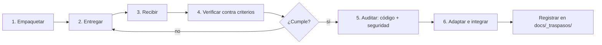

# Interoperabilidad entre IAs

Cómo hacer que otra IA —otro modelo, otra herramienta, otro proveedor— trabaje en temas puntuales
del proyecto **sin que se pierda el hilo ni se rompan las convenciones**.

---

## 1. El principio

Una IA externa no conoce el proyecto y no va a leerlo entero. Si recibe una instrucción suelta,
devolverá código que parece correcto y que viola tres convenciones que nadie le dijo.

La interoperabilidad funciona cuando se cumplen dos condiciones, y falla cuando falta cualquiera:

1. **El paquete de entrada es autosuficiente.** Contiene todo lo necesario, pegado íntegro.
2. **La verificación de salida es objetiva.** No se integra por confianza, se integra por criterio
   cumplido.

---

## 2. Tres formas de colaboración

### A. Traspaso asíncrono — *la forma por defecto*

Se empaqueta la tarea, se entrega, vuelve el resultado, se audita, se integra.
Skill: `handoff-ia-externa`. Comando: `/handoff <tarea>`.

Sirve para: algoritmos autocontenidos, generación de contenido, traducciones, datos de prueba,
investigación acotada.

### B. Segunda opinión — *la de mejor relación valor/riesgo*

Se le da a otra IA el mismo problema y se comparan las propuestas. **No produce código que se
integre**, produce desacuerdo útil.

Particularmente valioso para decisiones de arquitectura: si dos modelos con el mismo contexto
proponen estructuras distintas, el desacuerdo señala exactamente dónde está la tensión real del
diseño. Esa es la parte que hay que pensar con una persona.

### C. Herramienta conectada por MCP — *la de mayor acoplamiento*

Otra IA expuesta como servidor MCP, invocable dentro del flujo.
Solo cuando aporte una capacidad que no tenemos y con un límite de alcance explícito.

---

## 3. Qué se delega y qué no

| Delegable | No delegable | Por qué |
|---|---|---|
| Algoritmo puro: cálculo de tarifas, conversión de formatos, parsers | Cualquier cosa que toque `tenant_id` o RLS | El aislamiento entre tenants es la propiedad que mata el producto si falla |
| Generación de contenido: textos, plantillas, traducciones | Credenciales y cifrado | Superficie de riesgo desproporcionada |
| Datos de prueba realistas | Esquema de base de datos | Es el activo más caro de cambiar |
| Investigación con fuente verificable | Lógica de pagos | Un error cuesta dinero real de un cliente real |
| Revisión independiente de un diseño | Decisiones de arquitectura | Requieren el contexto completo que el externo no tiene |
| Pruebas de casos borde | Modelado del dominio sin validación posterior | El error de modelar turismo como e-commerce no es visible desde afuera |

---

## 4. El protocolo, en seis pasos



**Paso 1 — Empaquetar.** Ocho secciones obligatorias (ver la skill). Archivos pegados íntegros,
nunca referenciados por ruta. Criterios de aceptación objetivos. Restricciones explícitas:
TypeScript estricto, sin `any`, dinero en centavos, fechas UTC, sin dependencias nuevas.

**Paso 4 — Verificar.** Criterio por criterio. Lo que no cumple, vuelve. No se "arregla un poquito"
para que pase: eso convierte la delegación en retrabajo disfrazado.

**Paso 5 — Auditar.** `auditor-codigo` siempre; `auditor-seguridad` si toca cualquier dato, aunque
la tarea pareciera inocua. **Y las pruebas las escribimos nosotros.** Una prueba escrita por quien
escribió el código solo demuestra que hace lo que su autor creyó que hacía.

**Paso 6 — Registrar.** Entrada en `docs/_traspasos/`: qué se delegó, a quién, qué volvió, qué
hubo que corregir. Con tres o cuatro registros se sabe empíricamente qué conviene delegar y qué no.

---

## 5. Formato de intercambio

Para que cualquier IA pueda recibir una tarea sin ambigüedad:

```json
{
  "proyecto": "viajapro",
  "version_contexto": "<hash del commit>",
  "tarea": {
    "id": "TR-2026-001",
    "titulo": "Calculadora de markup multi-moneda",
    "descripcion": "..."
  },
  "entradas": [{ "ruta": "packages/domain/src/money.ts", "contenido": "..." }],
  "contratos": [{ "nombre": "QuoteItem", "esquema_zod": "..." }],
  "criterios_aceptacion": [
    "Dado un costo neto de 100 USD y markup 20%, el precio de venta es 120 USD",
    "Con markup negativo lanza MarkupInvalidError",
    "Toda aritmética en enteros; ningún resultado con error de redondeo"
  ],
  "restricciones": [
    "TypeScript estricto, sin any",
    "Función pura: sin red, sin base de datos, sin reloj",
    "Sin dependencias nuevas"
  ],
  "formato_entrega": "Un archivo TypeScript exportando calculateMarkup(...)",
  "comando_verificacion": "pnpm --filter @viajapro/domain test markup"
}
```

`version_contexto` importa: si el repositorio avanzó mientras la tarea estaba afuera, el resultado
puede haber nacido obsoleto. Se verifica al recibir, antes de integrar.

---

## 6. Riesgos y cómo se controlan

| Riesgo | Control |
|---|---|
| Fuga de información del proyecto a un tercero | Nunca se envían datos reales de clientes, credenciales ni esquema completo. Solo el fragmento necesario. |
| Código con licencia incompatible | Se exige declaración de origen; `auditor-codigo` revisa dependencias introducidas. |
| Deriva de convenciones | Restricciones explícitas en el paquete + adaptación obligatoria en el paso 6. |
| Dependencia operativa de un proveedor externo | La delegación es siempre puntual. Nada crítico del camino se externaliza de forma permanente. |
| Resultado plausible pero incorrecto | Pruebas escritas por nosotros, no aceptadas del proveedor. |
| Pérdida del hilo | Todo traspaso queda registrado en `docs/_traspasos/` y referenciado desde `ESTADO.md`. |
