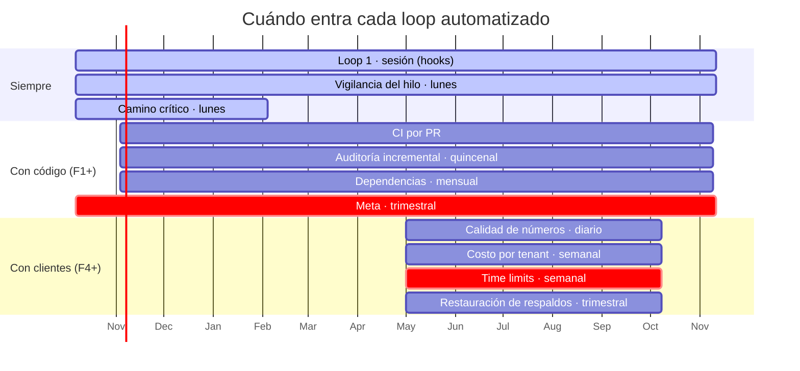

# Cronograma de loops automatizados

> Qué corre solo, cuándo, y por qué. Los loops están definidos en
> [`02-loops-de-trabajo.md`](02-loops-de-trabajo.md); aquí está el calendario.

**Principio rector: solo se automatiza lo que de verdad hay que vigilar.** Un loop que informa
«todo sigue igual» quince veces seguidas enseña al equipo a ignorar sus avisos, y entonces no
sirve el día que sí pasa algo. Por eso el cronograma **crece con el proyecto** en lugar de nacer
completo.

---

## Fase 0 — ahora · lo mínimo que paga

No hay código de aplicación. Automatizar auditorías de código, pruebas o costos sería teatro.
Solo dos cosas merecen vigilancia:

| Cuándo | Qué | Quién | Por qué |
|---|---|---|---|
| **Cada sesión** | Loop 1: inyección del hilo al abrir, recordatorio de cierre | Hooks `SessionStart` / `Stop` | **Ya activo.** Es la defensa contra perder el hilo |
| **Lunes 08:00** | **Vigilancia del hilo**: ¿`ESTADO.md` coincide con `git log`? ¿algún bloqueo lleva 2 semanas sin moverse? ¿ADR abandonado en el código? | `documentador` | El hilo se rompe en silencio. Un chequeo semanal lo detecta antes de que se propague |
| **Lunes 08:00** | **Recordatorio de camino crítico**: estado de la verificación de Meta y de la agencia piloto | Usuario | Son los dos bloqueos que no controlamos. Sin recordatorio, se postergan |

**Eso es todo.** Cualquier otro loop programado hoy generaría ruido.

---

## Fase 1 — cuando haya código e inbox

| Cuándo | Qué | Quién |
|---|---|---|
| Por cada PR | CI completa: `secretos`, `typecheck`, `lint`, `build`, `test`, `aislamiento-tenants`, `fronteras`, `politica-de-rama` | GitHub Actions |
| Por funcionalidad | Loop 2: ciclo de siete etapas | `/funcionalidad` |
| Por integración | Las siete compuertas | `integrador` |
| **Viernes, cada 15 días** | **Loop 3 incremental**: auditoría de lo cambiado desde la anterior | `auditoria-integral` |
| **Mensual, día 1** | Revisión de dependencias: vulnerabilidades, abandono, licencias | `devops` |
| **Trimestral** (1 ene · abr · jul · oct) | **Loop 4 sobre Meta**: precios, límites, versión de Graph API, cambios de política | `investigador` |
| Al cerrar cada fase | **Loop 3 completa** + actualización del roadmap | `auditoria-integral` |

La revisión trimestral de Meta **no es opcional**: sus precios son nuestro mayor costo variable y
cambian varias veces al año. Si no la vigilamos, nos enteramos por la factura.

---

## Fase 4 en adelante — cuando haya clientes en producción

| Cuándo | Qué | Quién | Por qué |
|---|---|---|---|
| **Diario 07:00** | Calidad y límite de envío de cada número de WhatsApp | `devops` | Un número degradado deja a una agencia sin vender **ese día** |
| **Diario 07:00** | Profundidad y antigüedad de las colas | `devops` | Una cola que crece es el primer síntoma de casi todo |
| **Lunes 08:00** | Costo por tenant: infraestructura + mensajería + IA, contra su ingreso | `analista-datos` | Un SaaS que no conoce su costo marginal no sabe si su precio sirve |
| **Lunes 08:00** | *Time limits* que vencen esta semana sin pago registrado | `devops` | Es la alerta que más dinero salva |
| Por alerta | **Loop 5: incidente** | `devops` | — |
| **Trimestral** | **Prueba de restauración de respaldos** | `devops` | Un respaldo sin restauración probada no es un respaldo |

---

## El calendario completo, de un vistazo

---

## Cómo se activa cada uno

**Loop 1** — ya activo. No requiere nada: los hooks `SessionStart` y `Stop` lo ejecutan.

**Loops programados** — dos mecanismos, según si necesitan contexto del repositorio:

| Mecanismo | Para qué sirve | Cuándo usarlo |
|---|---|---|
| **Agente programado en la nube** (`/schedule`) | Corre solo, sin sesión abierta. Lee el repositorio remoto | Vigilancia del hilo, Meta trimestral, dependencias, costo por tenant |
| **GitHub Actions con `schedule:`** | Corre en la infraestructura del repositorio | Auditorías de código, pruebas de restauración, métricas de producción |

**Regla de oro: cada loop programado debe poder terminar con «nada que reportar» sin generar
ruido.** Si un loop produce una notificación cada vez que corre, se desactiva solo en la cabeza
del equipo. El objetivo es que un aviso **signifique algo**.

---

## Qué NO se automatiza, y por qué

| No automatizado | Razón |
|---|---|
| La aprobación de una integración | La compuerta necesita juicio. Automatizarla es quitarla |
| La decisión de alcance | Es del propietario del producto |
| La validación con el cliente piloto | Ninguna métrica sustituye a ver a alguien usar el producto |
| El juicio sobre riesgo aceptable | Lo decide una persona que responde si sale mal |
| La auditoría de seguridad completa | Las verificaciones mecánicas van en CI; el análisis de amenazas no es mecánico |

---

## Revisión del propio cronograma

**Al cerrar cada fase**, revisar esta tabla y preguntar de cada loop:

1. ¿Ha encontrado algo real desde la última revisión?
2. Si no, ¿es porque no hay problemas, o porque no está mirando donde debe?
3. ¿Alguien ha ignorado sus avisos? Si sí, **se arregla o se borra**. No hay tercera opción.

Un loop que lleva dos fases sin encontrar nada y sin que nadie lo eche de menos sobra.
