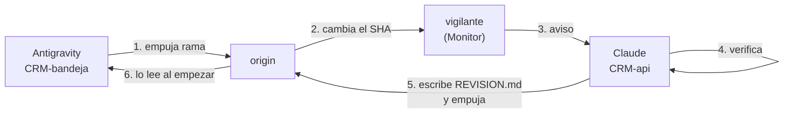

# Flujo de trabajo en paralelo con Antigravity

> **El problema que resuelve.** Dos agentes de familias distintas trabajando a la vez sobre el
> mismo repositorio, sin que el propietario tenga que llevar recados entre ellos. Antes de esto,
> cada entrega pasaba por él: Antigravity terminaba, se lo contaba, él me lo pegaba, yo revisaba,
> y le devolvía los hallazgos para que se los pasara. Cuatro saltos para cada vuelta.

---

## 1. El canal es git, no una persona

No hay mensajería entre harnesses, y montar una sería inventar infraestructura para un problema
que ya tiene solución. **El repositorio remoto es el canal**: Antigravity empuja su rama, y ese
empujón es la señal.



Nadie espera a nadie. Cada uno trabaja en su carpeta, en su rama, con su servidor de desarrollo.

## 2. Las tres carpetas

| Carpeta | Quién | Rama |
|---|---|---|
| `CRM` | **Nadie.** Solo el `integrador` | `main`, siempre limpia |
| `CRM-bandeja` | Antigravity | `feat/bandeja-web` |
| `CRM-api` | Claude | `feat/inbox-*` |

Son *worktrees* de git: un repositorio, un historial, tres árboles. Cada uno con su
`pnpm install` y su `.env`.

> **Si se añade una carpeta, hay que rotar credenciales o copiar el `.env`.** Lo primero lo hace
> `scripts/rotar-roles-y-actualizar-env.ps1`, que actualiza todos los árboles a la vez.

## 3. El protocolo de entrega

### Lo que hace Antigravity al terminar un bloque

1. **Commitea y empuja.** `git push origin feat/bandeja-web`. Sin empujar no hay señal: el
   trabajo local es invisible para todos los demás, y ya se perdió una sesión entera por eso.
2. **Escribe `ENTREGA.md`** en la raíz de su árbol, lo commitea y lo empuja con el resto. Es el
   resumen que antes pegaba el propietario a mano.

Formato, corto a propósito:

```markdown
# Entrega — <qué bloque> — <fecha>

## Qué construí
<tres a cinco líneas>

## Qué verifiqué EJECUTANDO
<comandos y resultados reales>

## Qué NO verifiqué
<decirlo es obligatorio; «no lo probé» es una respuesta aceptable>

## Decisiones que el encargo no especificaba
<lo que nadie ha revisado todavía, y lo que más nos interesa>
```

### Lo que hace Claude al recibir la señal

1. Fusiona `main` en una copia y corre las compuertas: `lint`, `typecheck`, `test`, `build`,
   `format:check`.
2. **Verifica en navegador** lo que el `ENTREGA.md` declare como no verificado. Es la razón de
   ser de esta división: Antigravity construye, aquí se comprueba con Playwright.
3. Escribe **`REVISION.md`** en la raíz de la rama, lo commitea y lo empuja.

```markdown
# Revisión — <commit revisado> — <fecha>

## Veredicto
PASA · PASA CON CORRECCIONES · VUELVE

## Bloqueante (está roto hoy)
<lista. Esto detiene la integración>

## A la cola (empieza por «el día que…»)
<lista. Esto NO bloquea — regla R13>

## Lo que verifiqué y cómo
<para que no haya que creerme>

## Siguiente bloque
<el encargo completo del trabajo que viene: qué construir, contra qué
contratos, qué criterios tiene que cumplir. Autosuficiente.>
```

> **El apartado «Siguiente bloque» es el que cierra el ciclo.** Sin él, alguien tiene que
> componer el encargo siguiente cada vez, y ese alguien acaba siendo el propietario. Con él, su
> intervención se reduce a decirle a Antigravity que continúe: el qué ya está escrito.
>
> Se redacta **autosuficiente**, como si quien lo lee no hubiera visto esta conversación —
> porque es literalmente el caso: Antigravity empieza cada sesión sin memoria de la anterior.

4. Si pasa, va a la compuerta del `integrador`. Si no, Antigravity lee `REVISION.md` al empezar
   su siguiente sesión.

## 4. El vigilante

Del lado de Claude, un proceso comprueba cada minuto si el SHA remoto de la rama cambió:

```bash
anterior=""
while true; do
  actual=$(git ls-remote origin feat/bandeja-web | cut -f1)
  if [ -n "$actual" ] && [ "$actual" != "$anterior" ] && [ -n "$anterior" ]; then
    echo "ENTREGA: feat/bandeja-web -> $actual"
  fi
  anterior=$actual
  sleep 60
done
```

Una línea por entrega. No hay sondeo manual ni «¿ya terminaste?».

## 5. Lo que esto NO resuelve, dicho claro

**Antigravity no arranca solo.** El flujo automatiza la *revisión*, no el *inicio*: alguien tiene
que decirle que empiece el bloque siguiente. Lo que desaparece es que el propietario sea el
cartero entre los dos.

**Y la compuerta sigue siendo humana en su decisión final.** El `integrador` no integra porque lo
hiciera otra IA: integra si pasa. Esa parte no se automatiza a propósito — es donde esta semana
aparecieron dos críticos y una regresión.

## 6. Las reglas que no cambian

- **Antigravity solo toca `apps/web/`.** Nada de `packages/database`, `apps/api`, `packages/contracts`.
- **`ESTADO.md` tiene un solo dueño**, y es Claude. Dos agentes escribiendo el hilo lo rompen —
  ya pasó dos veces.
- **Nadie escribe en `main`** salvo el `integrador` (R11).
- **Lo que dice `ENTREGA.md` sobre lo no verificado se toma en serio.** Es lo más valioso del
  documento: una entrega que afirma lo que no comprobó cuesta más que una que calla.
